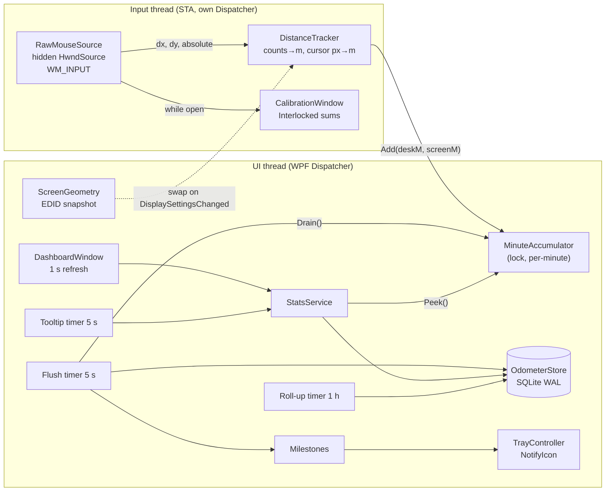

<!-- TINS Specification v1.0 -->
<!-- ZS:COMPLEXITY:MEDIUM -->
<!-- ZS:PRIORITY:HIGH -->
<!-- ZS:PLATFORM:WINDOWS-DESKTOP -->
<!-- ZS:LANGUAGE:CSHARP -->
<!-- ZS:FRAMEWORK:WPF/.NET 10 -->

# Mouse-Odometer

## Description

Mouse-Odometer is a small Windows tray app that works like a car odometer for your mouse. While it runs, it adds up how far the mouse physically travels across the desk and reports the total in meters and kilometres for four windows: **last hour**, **today**, **last 30 days** and **lifetime**. A compact dark dashboard, styled like a car instrument cluster, opens from the tray. It shows the lifetime total on rolling mechanical digit wheels, three smaller counters and a 30-day bar sparkline.

The primary measurement is **desk distance**. It is read from raw mouse input (the sensor's own counts), divided by the mouse's DPI. This is what makes it an odometer rather than a map: like a wheel counter, it measures the device itself. Pointer speed, "Enhance pointer precision", a cursor pinned at a screen edge or a game that locks the cursor do not affect it. As a secondary figure, the app also records **screen distance**, meaning how far the cursor travelled across the monitors, converted to meters using each monitor's physical size from its EDID.

It is meant for anyone curious about how much they move their mouse: desk workers, gamers, people tracking RSI habits. It is a portable single-file exe that needs no admin rights and no installer. Data stays local in `%LOCALAPPDATA%\Mouse-Odometer`. Autostart is optional and per user.

---

## Decisions Log (resolved before writing this spec)

| Topic | Decision |
|---|---|
| UI stack | WPF on **.NET 10 (LTS)**, `net10.0-windows`; tray icon via WinForms `NotifyIcon` in the same process |
| Primary metric | **Desk distance** from Raw Input (`WM_INPUT`, `RIDEV_INPUTSINK`), counts ÷ DPI |
| Secondary metric | **Screen distance**: cursor displacement × per-monitor mm/pixel (EDID), shown smaller, can be switched off |
| DPI source | User enters the DPI (default 800) **or** runs a ruler calibration wizard (10 cm / 20 cm / 4 in / 8 in) |
| Storage | **SQLite**: per-minute buckets for 35 days, rolled up to per-local-day rows after that; lifetime kept as running totals |
| Distribution | **Portable self-contained single-file exe** (`win-x64`, `win-arm64`); "Start with Windows" writes `HKCU\…\Run` |
| Dashboard | Car-odometer style, dark theme, 344 px wide flyout anchored next to the tray |
| Extras **in scope** | Live tray tooltip · milestone notifications · CSV export · reset with confirmation |
| Extras **out of scope** | Pause/resume, per-mouse DPI profiles, charts beyond the 30-day sparkline, cloud sync |

---

## Assessment of Affected Regions

This is a new project with no existing code. The regions below are the Windows platform surfaces the app touches, with the risk each carries and how this spec deals with it.

| Region | API / mechanism | Risk | Handling in this spec |
|---|---|---|---|
| Raw mouse input | `RegisterRawInputDevices` + `WM_INPUT` + `GetRawInputData` | High-rate events (125–8000 Hz); struct layout must match x64/ARM64 | Dedicated STA input thread with its own hidden `HwndSource`; RAWMOUSE read by verified offsets; handler does O(1) work |
| Cursor position | `GetCursorPos`, `MonitorFromPoint` | DPI virtualization would return scaled coordinates | `app.manifest` declares **PerMonitorV2**, so all coordinates are physical pixels |
| Monitor physical size | `QueryDisplayConfig` → `DisplayConfigGetDeviceInfo` → `HKLM\SYSTEM\CurrentControlSet\Enum\DISPLAY\…\EDID` | TVs and projectors report no size; some EDIDs put cm in the mm field | Plausibility checks, fallback to bytes 21/22, then to the Windows scale factor; per-monitor manual override |
| Display changes | `SystemEvents.DisplaySettingsChanged` | Monitors hot-plugged or rotated; HMONITOR handles change | Geometry is an immutable snapshot, rebuilt and swapped atomically |
| Tray | `System.Windows.Forms.NotifyIcon` | WPF and WinForms type-name clashes | `ImplicitUsings` disabled, explicit `using`s per file |
| Notifications | `NotifyIcon.ShowBalloonTip` | Needs no package identity (unlike WinRT toasts) | On Windows 10/11 balloons appear as toast notifications |
| Autostart | `HKCU\Software\Microsoft\Windows\CurrentVersion\Run` | Portable exe may be moved; the user may disable it in Task Manager | Path repaired on every start; reads `StartupApproved\Run` and shows a hint instead of overriding the user |
| Storage | `Microsoft.Data.Sqlite` 10.0.0 (bundles `e_sqlite3`) | Corruption; native library in single-file publish | `PRAGMA quick_check` at open, corrupt file set aside; `IncludeNativeLibrariesForSelfExtract` |
| Single instance | Named `Mutex` + named `EventWaitHandle` | Two trackers would double-count | A second launch signals the first to open its dashboard, then exits |

---

## Functionality

### 1. Core Features

1. **Desk distance tracking.** Every relative raw mouse report `(dx, dy)` adds `sqrt(dx² + dy²) × 0.0254 / DPI` meters. Absolute reports (pen tablets, RDP sessions, VMs) are not desk distance and are ignored for this metric.
2. **Screen distance tracking** (on by default, can be switched off). On each raw report the app reads the cursor position. The Euclidean pixel distance since the previous position is multiplied by the mm/pixel of the monitor under the cursor. Jumps larger than **1500 px** between two reports are treated as teleports (`SetCursorPos`, warp tools, RDP) and not counted.
3. **Four windows**, always live to the second (persisted data plus the unflushed buffer):
   - **Last hour**: the current minute plus the 59 minutes before it (rolling 60 minutes).
   - **Today**: since local midnight.
   - **Last 30 days**: today plus the 29 previous local calendar days. This matches the 30 sparkline bars exactly.
   - **Lifetime**: since first run, or since the last reset.
4. **Compact dashboard** (see layout). Opens on left-click of the tray icon and hides when it loses focus, unless pinned.
5. **Tray icon** with a context menu and a **live tooltip** (updated every 5 s):
   `Mouse-Odometer⏎Today: 312.4 m⏎Lifetime: 12.345 km` (at most 63 characters).
6. **Mouse DPI**: entered manually or measured with the **calibration wizard**.
7. **Milestone notifications** (on by default): 100 m, 1 km, 5 km, 10 km, half marathon (21.0975 km), marathon (42.195 km), 100 km, 500 km, 1,000 km, then every further 1,000 km. If several are crossed at once, only the highest is announced.
8. **CSV export**: one row per local day, `date,desk_m,screen_m`.
9. **Reset all stats**, with a confirmation prompt that defaults to *No*.
10. **Start with Windows** (off by default), toggled from the tray menu or Settings. The app then starts with `--minimized` and does not open the dashboard.

### 2. User Interface

#### 2.1 Dashboard flyout (344 × ~330 DIP, anchored 4 DIP from the bottom-right corner of the primary work area)

```
╭──────────────────────────────────────────╮
│ MOUSE-ODOMETER                 📌  ⚙  ✕ │   title row; icons: Pin (toggle), Settings, Close
│                                          │
│ LIFETIME                                 │
│ ┌──────────────────────────────┐         │
│ │[0][0][0][1][2].[3][4][5]     │ km      │   5 dark km wheels . 3 amber metre wheels
│ └──────────────────────────────┘         │
│ on screen 9.871 km                       │   secondary (hidden if screen tracking off)
│                                          │
│ LAST HOUR     TODAY        30 DAYS       │
│ 42.1 m        312.4 m      7.912 km      │   17 px semibold
│ screen 30.2 m screen 250.0 m screen 6.1… │   11 px muted (hidden if off)
│                                          │
│ ▂▃▅▂▇▆▃▁▂▅▆▇▃▂▅▆▄▃▂▅▇▆▃▂▄▅▆▇▅█         │   30 bars, last (today) amber, hover tooltip
│ 30 days ago                       today  │
│                                          │
│ Desk distance · 800 DPI (calibrated)     │   footer; amber warning text if DPI is default
╰──────────────────────────────────────────╯
```

Behaviour:

- **Open**: left-click the tray icon, choose "Open dashboard" in the tray menu, or launch the exe a second time.
- **Close**: ✕, Esc, Alt+F4, clicking elsewhere (focus lost), or left-clicking the tray icon again. Closing only hides the window; it is created once and reused.
- **Pin** (📌 toggle, amber when on): the flyout stays open when it loses focus and can be dragged by its background.
- **Tray-click debounce**: clicking the tray icon while the flyout is open first deactivates the flyout, which hides it, and then delivers the click. Any tray click within **400 ms** of an auto-hide is ignored, so the flyout doesn't reopen straight away.
- **Refresh**: the counters update every **1 s** and the sparkline every **30 s**, only while the flyout is visible.
- **Odometer animation**: a changed digit rolls upwards in 260 ms (cubic ease-out). Going from 9 to 0 rolls forward onto a trailing "0" cell and snaps to the top. Animation is skipped when Windows animations are off (`SystemParameters.ClientAreaAnimation == false`), and after a reset the digits jump straight back down. When the value passes 99,999.999 km a sixth km wheel is added.
- **Sparkline tooltip**: hovering a bar shows `Tue 17 Nov: 312.4 m`.

#### 2.2 Tray context menu

```
┌────────────────────────┐
│ **Open dashboard**     │  bold = default action
│ Settings…              │
├────────────────────────┤
│ ✓ Start with Windows   │  check mark read from the registry each time the menu opens
│ Export CSV…            │
├────────────────────────┤
│ Exit                   │
└────────────────────────┘
```

#### 2.3 Settings window (500 DIP wide, standard Windows chrome, centred on screen)

```
┌ Mouse-Odometer Settings ─────────────────────────────── ✕ ┐
│ Mouse                                                     │
│ Mouse DPI: [ 800    ]  [Calibrate…]                       │
│ Calibrated on 18.11.2026.                                 │
│ Use the DPI from your mouse's spec sheet or software …    │
│                                                           │
│ Screen distance                                           │
│ [x] Also record how far the cursor travels on screen      │
│ Physical size is read from each monitor's EDID …          │
│ DELL U2720Q  (DISPLAY1)                     [      ] mm   │
│ 3840 × 2160 px · EDID 597 × 336 mm · 0.1555 mm/px (Edid)  │
│ LG TV  (DISPLAY2)                           [ 1210 ] mm   │
│ 1920 × 1080 px · no EDID size … · 0.6302 mm/px (Override) │
│                                                           │
│ General                                                   │
│ [x] Start with Windows                                    │
│     (amber hint if disabled in Task Manager)              │
│ [x] Milestone notifications (1 km, marathon, …)           │
│                                                           │
│ Data                                                      │
│ [Export CSV…] [Open data folder] [Reset all stats…]       │
│ C:\Users\me\AppData\Local\Mouse-Odometer                  │
│                                                           │
│ (red validation message area)                             │
│                                         [ Save ] [Cancel] │
└───────────────────────────────────────────────────────────┘
```

Validation (nothing is saved while any error is shown):

| Field | Rule | Message |
|---|---|---|
| Mouse DPI | number, 50 ≤ DPI ≤ 64000 (current or invariant culture) | `Enter a mouse DPI between 50 and 64000.` |
| Monitor override | empty **or** 50 ≤ mm ≤ 3000 | `Monitor width must be between 50 and 3000 mm, or empty.` |

The DPI source line reads `Calibrated on {date}.`, `Entered manually.` or `Default value, distances are only accurate once you enter or calibrate your mouse DPI.` Typing a different DPI after calibrating changes the source to *Entered*. Overrides for monitors that are not currently connected are kept.

#### 2.4 Calibration window (440 DIP, modal over Settings)

```
┌ Calibrate mouse DPI ─────────────────────────── ✕ ┐
│ 1. Lay a ruler on your desk, mouse at the 0 mark. │
│ 2. Press Space to start.                          │
│ 3. Slide the mouse straight to the chosen mark.   │
│ 4. Press Enter to finish (keyboard only).         │
│ Distance: [10 cm ▾]   (10 cm · 20 cm · 4 in · 8 in)│
│ ┌───────────────────────────────────────────────┐ │
│ │ Measuring… slide the mouse to the mark …      │ │
│ │ 3,150 counts                                  │ │
│ │ 800 DPI                                       │ │
│ └───────────────────────────────────────────────┘ │
│        [Start] [Done] [Use value] [Cancel]         │
└───────────────────────────────────────────────────┘
```

- Counts are summed **only between Start and Done**, from relative reports only. The result uses the **net displacement** `sqrt(ΣdX² + ΣdY²)`, so sideways wobble cancels out instead of inflating the count.
- `DPI = netCounts ÷ (distanceMm ÷ 25.4)`, rounded to a whole number.
- Fewer than 100 counts gives `Not enough movement detected. Try again.` A result outside 50–64000 gives `Result is outside 50–64000 DPI. Try again.`
- After a good result: `Done. Repeat once or twice: results within ~3 % mean a good measurement.` *Use value* copies the number into the Settings DPI field with source *Calibrated*. The value is only stored when Settings is saved.

### 3. User Flows

**First run**
1. The user starts `Mouse-Odometer.exe`. The single-instance check passes.
2. The data folder is created; settings default to 800 DPI (source *Default*) and the database is created.
3. Raw input registers; the tray icon appears.
4. A notification reads *"Mouse-Odometer is running — It lives in the tray. Set your mouse DPI in Settings for accurate meters."*
5. The dashboard opens, with an amber footer warning about the default DPI.

**Calibrate**
1. Dashboard ⚙ (or tray → Settings…) opens Settings and hides the flyout.
2. *Calibrate…* opens the wizard. Space starts it, the user slides the mouse 10 cm, Enter finishes: `800 DPI`.
3. *Use value*, then *Save*. The tracker uses the new DPI from the next report onwards. Distance already recorded is **not** recalculated, because history stores meters.

**Enable autostart**
1. Tray → *Start with Windows* writes `"C:\path\Mouse-Odometer.exe" --minimized` to `HKCU\…\Run\Mouse-Odometer`.
2. If Task Manager has the entry disabled, a notification asks the user to enable it there.
3. At logon the app starts silently in the tray, without the dashboard.

**Second launch**
1. The user double-clicks the exe while it is already running.
2. The new process can't take the mutex, so it sets the named "show" event and exits.
3. The running instance opens its dashboard.

**Export / Reset**
- Export: the buffer is flushed, a *Save as* dialog opens with default name `mouse-odometer-2026-11-18.csv`, the file is written as UTF-8 with BOM, and a notification reports *"Export complete"* with the path.
- Reset: a confirmation (default **No**) appears. On *Yes*, the buffer is discarded, all tables are cleared, lifetime and milestone index go to 0, the database is vacuumed, the tooltip refreshes, and a notification confirms the reset.

**Exit**: tray → Exit. Raw input is unregistered, a final flush runs, the WAL is checkpointed, the database is closed and the tray icon is removed.

### 4. Edge Cases & Error States

| Situation | Behaviour |
|---|---|
| Mouse lifted / no movement | No reports arrive, so nothing is added |
| Game locks or hides the cursor | Desk distance keeps counting; screen distance stays at 0 (the cursor doesn't move) |
| Cursor pinned at a screen edge | Desk distance keeps counting; screen distance doesn't |
| Pen tablet, touch-to-mouse, RDP, VM | Reports carry `MOUSE_MOVE_ABSOLUTE`: ignored for desk distance, still counted on screen |
| Several mice | All are summed, using one DPI setting |
| Lock screen / UAC secure desktop | No input reaches the app; `GetCursorPos` fails, so the cursor chain resets and the next real movement isn't counted as a jump |
| Cursor teleports > 1500 px in one report | Not counted as screen distance |
| Monitor without EDID size (projector, many TVs) | Falls back to `25.4 / effectiveDpi` mm/px (Windows scale ≈ density), labelled *Fallback* in Settings; the user can override it |
| Portrait / rotated monitor | Uses the diagonal ratio `diag_mm / diag_px`, which doesn't change with rotation |
| Monitor hot-plug / resolution change | Geometry rebuilt on `DisplaySettingsChanged`; unknown monitor handles use 0.25 mm/px until the rebuild finishes |
| Duplicated (mirrored) displays | First target per GDI source wins |
| Sleep / hibernate | Nothing is recorded while asleep; empty minutes simply don't exist |
| System clock moves backwards | Minutes may repeat; the additive upsert merges them, so nothing is lost or double-counted |
| DST transitions | Windows are computed from local midnights converted to UTC with the zone's offset on that date; an invalid local midnight (zones that switch at 00:00) moves to the first valid minute |
| Database write fails (disk full, locked) | Buckets go back into the buffer and are retried on the next 5 s flush; the error is logged |
| Database corrupt at startup | Renamed to `odometer.db.corrupt-yyyyMMdd-HHmmss` (plus `-wal`/`-shm`), a fresh database is created, and a notification explains what happened |
| `settings.json` unreadable | Renamed to `settings.json.bad`; defaults are used |
| Hand-edited settings out of range | `Normalize()` resets DPI to 800 (*Default*) and drops invalid overrides |
| Exe moved after enabling autostart | Next start rewrites the Run value to the current path |
| Autostart disabled in Task Manager | Not overridden; an amber hint in Settings and a notification when enabling |
| Raw input registration fails | Startup error dialog: *"Mouse-Odometer could not start. RegisterRawInputDevices failed (Win32 error N)."*; the app exits |
| App killed / crash / power loss | At most the last 5 s of distance is lost; `SessionEnding` flushes on logoff and shutdown |
| Unhandled UI exception | Logged to `error.log` (1 MB cap, rotated to `.old`); the app keeps running |
| More than 99,999.999 km lifetime | The odometer adds a wheel; formatting switches to `123,456.7 km` above 100,000 km |

---

## Technical Implementation

### 1. Architecture



Threading rules:

- `RawMouseSource` and `DistanceTracker.OnRawMouse` run **only** on the input thread. That code path never allocates per event and never takes a lock other than the accumulator's.
- Everything else, the SQLite connection included, runs on the **UI thread**. There is exactly one open `SqliteConnection`.
- Settings changes reach the tracker through `Volatile`/`volatile` fields (`SetDpi`, `SetTrackScreen`, `SetGeometry` swaps an immutable snapshot).

### 2. Project Layout

```
MouseOdometer/
├─ MouseOdometer.csproj            WPF + WinForms, net10.0-windows, Microsoft.Data.Sqlite 10.0.0
├─ app.manifest                    PerMonitorV2 DPI awareness, asInvoker
├─ App.xaml / App.xaml.cs          lifecycle, single instance, timers, tray wiring
├─ Native/NativeMethods.cs         all P/Invoke
├─ Input/
│  ├─ RawMouseSource.cs            WM_INPUT on a dedicated thread
│  ├─ ScreenGeometry.cs            monitors → mm/px (DisplayConfig + EDID + fallback)
│  └─ EdidParser.cs                pure EDID size parsing
├─ Tracking/
│  ├─ MinuteAccumulator.cs         thread-safe per-minute buffer
│  ├─ DistanceTracker.cs           counts/pixels → meters
│  └─ DpiCalibration.cs            pure calibration maths
├─ Data/
│  ├─ OdometerStore.cs             SQLite schema, upserts, roll-up, reset
│  └─ AppSettings.cs               settings model + JSON store
├─ Services/
│  ├─ OdometerCore.cs              composition root for non-UI parts, flush/export/reset
│  ├─ StatsService.cs              windows + daily series (DB + unflushed buffer)
│  ├─ TimeWindows.cs               local-midnight / DST-safe window maths
│  ├─ Milestones.cs                milestone table and evaluation
│  ├─ Formatting.cs                distance strings, tooltip
│  ├─ StartupManager.cs            HKCU Run key
│  ├─ TrayIconFactory.cs           gauge icon drawn at runtime
│  ├─ TrayController.cs            NotifyIcon + context menu
│  └─ Log.cs                       error.log
└─ UI/
   ├─ DashboardWindow.xaml(.cs)    flyout
   ├─ OdometerDisplay.cs           rolling digit wheels
   ├─ Sparkline.cs                 30 bars, OnRender
   ├─ SettingsWindow.xaml(.cs)
   └─ CalibrationWindow.xaml(.cs)
LogicTests/                        console test harness (cross-platform) for the pure logic
```

### 3. Data Models

#### 3.1 SQLite (`%LOCALAPPDATA%\Mouse-Odometer\odometer.db`, WAL, `synchronous=NORMAL`)

```sql
minute_bucket (
  minute_utc INTEGER PRIMARY KEY,  -- Unix seconds / 60 (UTC). One row per minute with movement.
  desk_m     REAL NOT NULL,        -- meters on the desk during that minute
  screen_m   REAL NOT NULL         -- meters on screen during that minute
) WITHOUT ROWID;                    -- holds the last 35 days only (≤ 50,400 rows)

daily_bucket (
  day_local TEXT PRIMARY KEY,      -- 'yyyy-MM-dd' in the local time zone at roll-up time
  desk_m    REAL NOT NULL,
  screen_m  REAL NOT NULL
) WITHOUT ROWID;                    -- everything older than 35 days

meta (
  key   TEXT PRIMARY KEY,
  value NOT NULL                    -- no type affinity, so REAL stays REAL
) WITHOUT ROWID;
-- keys: schema_version = 1 · lifetime_desk_m REAL · lifetime_screen_m REAL · milestone_index INTEGER
```

Invariants:
- `lifetime_*` is the running sum of every flushed bucket since creation or reset. It is **never** recomputed from the tables, which lets old minute rows be rolled up freely.
- All writes are **additive upserts** (`ON CONFLICT … SET x = x + excluded.x`), so retrying a flush or merging a repeated minute can never lose data.
- History is stored in **meters**, using the DPI and mm/px in effect at recording time. Changing the DPI does not rewrite history.

#### 3.2 Settings (`settings.json`, System.Text.Json, enums as strings)

```jsonc
{
  "MouseDpi": 800,                         // double, 50..64000, default 800
  "DpiSource": "Default",                  // "Default" | "Entered" | "Calibrated"
  "DpiCalibratedUtc": null,                // ISO 8601 UTC, set only when Calibrated
  "TrackScreenDistance": true,
  "MilestoneToasts": true,
  "MonitorWidthOverridesMm": {             // StableKey -> visible width in mm (50..3000)
    "GSM5B7F#5&2a2b3c4d&0&UID4353": 597.0
  },
  "FirstRunCompleted": true
}
```

"Start with Windows" is **not** stored here. The registry Run value is the single source of truth.

#### 3.3 In-memory types

```csharp
readonly record struct MinuteAmount(long MinuteUtc, double DeskM, double ScreenM);
readonly record struct DistancePair(double DeskM, double ScreenM);          // supports +
record StatsSnapshot(DistancePair LastHour, DistancePair Today, DistancePair Last30Days, DistancePair Lifetime);
record DailyPoint(DateOnly Day, double DeskM, double ScreenM);
record MonitorInfo(IntPtr Handle, string GdiName, string FriendlyName, string StableKey,
                   RECT Bounds, double? EdidWidthMm, double? EdidHeightMm, double MmPerPixel, ScaleSource Source);
enum ScaleSource { Edid, Override, Fallback }
record Milestone(int Index, double Meters, string Title, string Body);
```

### 4. Key Algorithms

**4.1 Desk distance per report**

```
if (!absolute && (dx,dy) != (0,0)):
    deskM = sqrt(dx² + dy²) × (0.0254 / DPI)
```
Example: 1,600 counts at 1,600 DPI = 1 inch = 0.0254 m. Summing the length of each report (instead of only the net displacement) is correct for an odometer, because back-and-forth movement counts.

**4.2 Screen distance per report**

```
if trackScreen and GetCursorPos(p):
    if hasLast: px = |p - last|;  if 0 < px ≤ 1500: screenM = px × mmPerPixel(monitor at p) / 1000
    last = p
else: hasLast = false
```
The monitor lookup is cached: `MonitorFromPoint` is called only when the cursor leaves the cached monitor's bounds.

**4.3 mm per pixel for a monitor**

1. Map `\\.\DISPLAYn` (from `GetMonitorInfo`) to a target through `QueryDisplayConfig(QDC_ONLY_ACTIVE_PATHS)` plus `DISPLAYCONFIG_DEVICE_INFO_GET_SOURCE_NAME` and `_GET_TARGET_NAME`. The result is `monitorDevicePath = \\?\DISPLAY#<HwId>#<Instance>#{guid}`.
2. Read the EDID from `HKLM\SYSTEM\CurrentControlSet\Enum\DISPLAY\<HwId>\<Instance>\Device Parameters\EDID`.
3. Get the size from Detailed Timing Descriptor 1 (byte 66 + high nibble of byte 68 = width in mm; byte 67 + low nibble of byte 68 = height in mm). If that is implausible, use bytes 21/22 (cm). Plausible means 100–3000 mm wide and 50–2000 mm tall.
4. Choose in this order:
   - Override: `overrideMm / widthPx`.
   - EDID: `sqrt(wMm² + hMm²) / sqrt(wPx² + hPx²)`.
   - Fallback: `25.4 / effectiveDpi`.

Example: 27″ 4K at 597 × 336 mm and 3840 × 2160 px gives **0.1555 mm/px**.

**4.4 Minute accumulation and flush**

- `Add` reads the UTC minute. When the minute changes, the previous minute is closed into a list.
- Every 5 s the UI thread calls `Drain()`, which returns the closed minutes plus the current partial minute and zeroes the buffer. The result goes to `AddBuckets` in one transaction. The upsert is additive, so a partial minute flushed several times adds up correctly.
- If the write fails, `Restore(buckets)` puts the data back.
- Live stats call `Peek()`, which reads without clearing, and add it to the database sums.

**4.5 Windows (local zone)**

```
nowMin       = unix(now)/60
HourFrom     = nowMin − 59
TodayFrom    = unix(localMidnight(today))/60
Month30From  = unix(localMidnight(today − 29 days))/60
sum(window)  = Σ minute_bucket where minute_utc ≥ from  +  Σ buffer where minute ≥ from
Lifetime     = meta.lifetime_*  +  Σ buffer
```
Because minutes are kept for 35 days, the 30-day window is always fully covered by `minute_bucket` (35 days leaves room for DST and clock drift).

**4.6 Roll-up**: at startup and then hourly. Minutes older than `nowMin − 35×1440` are grouped by **local** day into `daily_bucket` (additive) and deleted, in one transaction.

**4.7 Milestones**: `reached = count(fixed ≤ lifetime) + max(0, ⌊lifetime / 1,000,000⌋ − 1)` once past 2,000 km. If `reached > storedIndex`, store `reached` and announce only `Get(reached)`. The index advances even when notifications are off, so turning them on later doesn't replay old milestones.

**4.8 Calibration**: `DPI = round(sqrt(ΣdX² + ΣdY²) / (distanceMm / 25.4))`. Example: 3,150 net counts over 100 mm gives **800 DPI**.

### 5. Style Guide

| Token | Value | Use |
|---|---|---|
| Panel | `#15171A` | flyout background |
| Edge | `#2C3036` | flyout border, odometer frame |
| Text | `#E8E6E3` | primary values |
| Muted | `#8B9099` | labels, secondary lines |
| Accent (amber) | `#F2A33A` | metre wheels, today's bar, pin on, DPI warning |
| Hover | `#262A30` | icon button hover/focus |
| km wheel | gradient `#2A2D33 → #0E0F11`, digits `#F2F0EC` | |
| metre wheel | gradient `#F7B85A → #D88622`, digits `#1A140A` | like the tenths wheel on a car odometer |
| Bar / empty bar | `#4A5160` / `#2A2E35` | sparkline |

Typography: *Segoe UI Variable Text* (fallback *Segoe UI*); digits in *Cascadia Mono* (fallback *Consolas*), 0.62 × wheel height; icons in *Segoe Fluent Icons* (fallback *Segoe MDL2 Assets*): Pin `E718`, Settings `E713`, Close `E8BB`. The flyout has a 10 px corner radius and a 16 px blur shadow at 45 % opacity. Settings and Calibration use the standard light Windows controls.

Tray icon: drawn at runtime at 32 × 32 (no binary asset). It is a dark disc `#202225`, a 270° amber arc and a white needle at −50°, so it reads on both light and dark taskbars.

### 6. Accessibility

- Every icon button has `AutomationProperties.Name` and a tooltip; the odometer exposes "Lifetime distance 12.345 km" to screen readers and updates it on each refresh.
- Everything works from the keyboard. The flyout closes with Esc. Settings uses access keys (`_Mouse DPI`, `_Calibrate…`, `_Start with Windows`, `_Export CSV…`, `_Reset all stats…`), Enter for Save and Esc for Cancel. The calibration wizard is meant to be driven by keyboard (Space starts, Enter finishes).
- Digit animations respect the Windows "Show animations" setting.
- Text contrast: Text on Panel is 14.4:1, Muted on Panel 5.6:1 and Amber on Panel 8.6:1 (all pass WCAG AA).
- Per-monitor v2 DPI awareness keeps all text sharp at any scale.

### 7. Performance Goals

| Metric | Target |
|---|---|
| Work per raw report | < 2 µs (one `GetCursorPos`, arithmetic, one uncontended lock); no allocations |
| Supported polling rates | up to 8,000 Hz without dropped `WM_INPUT` |
| Idle CPU (dashboard hidden) | < 0.1 % |
| Memory | < 60 MB working set |
| Flush | ≤ 1 transaction per 5 s; < 5 ms |
| Dashboard refresh | 3 indexed range `SUM`s + 1 meta read per second, < 5 ms total |
| Database size | ~2 MB for 35 days of minutes, plus ~40 bytes per older day |
| Data loss on crash | ≤ 5 s of movement |

---

## Implementation Steps

Follow the steps in order. Each file is given **in full**: create it at the path shown, with no placeholders to fill in. Paths are relative to the solution folder `Mouse-Odometer/`.

### Step 0 — Prerequisites

- Windows 10 (1809 or later) or Windows 11, x64 or ARM64.
- .NET 10 SDK (`dotnet --version` reports `10.0.x`). Visual Studio 2026 or VS Code with C# Dev Kit is optional.
- NuGet access to restore `Microsoft.Data.Sqlite` **10.0.0**.

### Step 1 — Scaffold the solution

```powershell
mkdir Mouse-Odometer; cd Mouse-Odometer
dotnet new sln -n MouseOdometer
mkdir MouseOdometer, MouseOdometer\Native, MouseOdometer\Input, MouseOdometer\Tracking, MouseOdometer\Data, MouseOdometer\Services, MouseOdometer\UI, LogicTests
# create every file from Steps 2–29, then:
dotnet sln add MouseOdometer\MouseOdometer.csproj LogicTests\LogicTests.csproj
```

### Step 2 — Project file

WPF and WinForms in one project. `ImplicitUsings` is **disabled** on purpose: both frameworks define `Application`, `MessageBox`, etc. The single-file publish settings apply only when a runtime identifier is given.

**`MouseOdometer/MouseOdometer.csproj`**

```xml
<Project Sdk="Microsoft.NET.Sdk">

  <PropertyGroup>
    <OutputType>WinExe</OutputType>
    <TargetFramework>net10.0-windows</TargetFramework>
    <UseWPF>true</UseWPF>
    <UseWindowsForms>true</UseWindowsForms>
    <!-- WPF + WinForms share type names (Application, MessageBox, ...). Explicit usings avoid ambiguity. -->
    <ImplicitUsings>disable</ImplicitUsings>
    <Nullable>enable</Nullable>
    <LangVersion>latest</LangVersion>
    <AssemblyName>Mouse-Odometer</AssemblyName>
    <RootNamespace>MouseOdometer</RootNamespace>
    <ApplicationManifest>app.manifest</ApplicationManifest>
    <Version>1.0.0</Version>
    <Product>Mouse-Odometer</Product>
    <SatelliteResourceLanguages>en</SatelliteResourceLanguages>
    <InvariantGlobalization>false</InvariantGlobalization>
  </PropertyGroup>

  <!-- Single-file portable publish (used by: dotnet publish -c Release -r win-x64) -->
  <PropertyGroup Condition="'$(RuntimeIdentifier)' != ''">
    <SelfContained>true</SelfContained>
    <PublishSingleFile>true</PublishSingleFile>
    <IncludeNativeLibrariesForSelfExtract>true</IncludeNativeLibrariesForSelfExtract>
    <EnableCompressionInSingleFile>true</EnableCompressionInSingleFile>
    <DebugType>embedded</DebugType>
  </PropertyGroup>

  <ItemGroup>
    <PackageReference Include="Microsoft.Data.Sqlite" Version="10.0.0" />
  </ItemGroup>

</Project>
```

### Step 3 — Application manifest

**PerMonitorV2 is required.** Without it, `GetCursorPos` and monitor rectangles are DPI-virtualised and screen distance would be wrong on scaled monitors.

**`MouseOdometer/app.manifest`**

```xml
<?xml version="1.0" encoding="utf-8"?>
<assembly manifestVersion="1.0" xmlns="urn:schemas-microsoft-com:asm.v1">
  <assemblyIdentity version="1.0.0.0" name="MouseOdometer.app" />
  <trustInfo xmlns="urn:schemas-microsoft-com:asm.v2">
    <security>
      <requestedPrivileges xmlns="urn:schemas-microsoft-com:asm.v3">
        <requestedExecutionLevel level="asInvoker" uiAccess="false" />
      </requestedPrivileges>
    </security>
  </trustInfo>
  <compatibility xmlns="urn:schemas-microsoft-com:compatibility.v1">
    <application>
      <!-- Windows 10 / 11 -->
      <supportedOS Id="{8e0f7a12-bfb3-4fe8-b9a5-48fd50a15a9a}" />
    </application>
  </compatibility>
  <application xmlns="urn:schemas-microsoft-com:asm.v3">
    <windowsSettings>
      <!-- Per-monitor v2: GetCursorPos and monitor rectangles are in PHYSICAL pixels. Required for screen distance. -->
      <dpiAware xmlns="http://schemas.microsoft.com/SMI/2005/WindowsSettings">true/pm</dpiAware>
      <dpiAwareness xmlns="http://schemas.microsoft.com/SMI/2016/WindowsSettings">PerMonitorV2</dpiAwareness>
    </windowsSettings>
  </application>
</assembly>
```

### Step 4 — Win32 interop

Struct sizes were checked with `Marshal.SizeOf` on x64: RAWINPUTHEADER 24, RAWINPUTDEVICE 16, DISPLAYCONFIG_PATH_INFO 72, MODE_INFO 64, SOURCE_DEVICE_NAME 84, TARGET_DEVICE_NAME 420, MONITORINFOEX 104.

**`MouseOdometer/Native/NativeMethods.cs`**

```csharp
using System;
using System.Runtime.InteropServices;

namespace MouseOdometer.Native;

/// <summary>All Win32 P/Invoke declarations used by Mouse-Odometer.</summary>
public static class NativeMethods
{
    // ---------- Raw input ----------
    public const int WM_INPUT = 0x00FF;
    public const uint RID_INPUT = 0x10000003;
    public const uint RIM_TYPEMOUSE = 0;
    public const uint RIDEV_REMOVE = 0x00000001;
    public const uint RIDEV_INPUTSINK = 0x00000100;
    public const ushort MOUSE_MOVE_ABSOLUTE = 0x0001;
    public const ushort HID_USAGE_PAGE_GENERIC = 0x01;
    public const ushort HID_USAGE_GENERIC_MOUSE = 0x02;

    // RAWMOUSE field offsets (relative to the end of RAWINPUTHEADER), identical on x64 and ARM64:
    // usFlags @0 (USHORT), union ulButtons @4, ulRawButtons @8, lLastX @12, lLastY @16, ulExtraInformation @20
    public const int RAWMOUSE_FLAGS_OFFSET = 0;
    public const int RAWMOUSE_LASTX_OFFSET = 12;
    public const int RAWMOUSE_LASTY_OFFSET = 16;

    [StructLayout(LayoutKind.Sequential)]
    public struct RAWINPUTDEVICE
    {
        public ushort usUsagePage;
        public ushort usUsage;
        public uint dwFlags;
        public IntPtr hwndTarget;
    }

    [StructLayout(LayoutKind.Sequential)]
    public struct RAWINPUTHEADER
    {
        public uint dwType;
        public uint dwSize;
        public IntPtr hDevice;
        public IntPtr wParam;
    }

    [DllImport("user32.dll", SetLastError = true)]
    public static extern bool RegisterRawInputDevices(
        [In] RAWINPUTDEVICE[] pRawInputDevices, uint uiNumDevices, uint cbSize);

    [DllImport("user32.dll", SetLastError = true)]
    public static extern uint GetRawInputData(
        IntPtr hRawInput, uint uiCommand, IntPtr pData, ref uint pcbSize, uint cbSizeHeader);

    // ---------- Cursor / monitors ----------
    public const uint MONITOR_DEFAULTTONEAREST = 0x00000002;
    public const int MDT_EFFECTIVE_DPI = 0;

    [StructLayout(LayoutKind.Sequential)]
    public struct POINT
    {
        public int X;
        public int Y;
    }

    [StructLayout(LayoutKind.Sequential)]
    public struct RECT
    {
        public int Left;
        public int Top;
        public int Right;
        public int Bottom;

        public readonly int Width => Right - Left;
        public readonly int Height => Bottom - Top;
        public readonly bool Contains(POINT p) => p.X >= Left && p.X < Right && p.Y >= Top && p.Y < Bottom;
    }

    [StructLayout(LayoutKind.Sequential, CharSet = CharSet.Unicode)]
    public struct MONITORINFOEX
    {
        public uint cbSize;
        public RECT rcMonitor;
        public RECT rcWork;
        public uint dwFlags;
        [MarshalAs(UnmanagedType.ByValTStr, SizeConst = 32)]
        public string szDevice;
    }

    public delegate bool MonitorEnumProc(IntPtr hMonitor, IntPtr hdcMonitor, ref RECT lprcMonitor, IntPtr dwData);

    [DllImport("user32.dll")]
    public static extern bool GetCursorPos(out POINT lpPoint);

    [DllImport("user32.dll")]
    public static extern IntPtr MonitorFromPoint(POINT pt, uint dwFlags);

    [DllImport("user32.dll", CharSet = CharSet.Unicode)]
    public static extern bool GetMonitorInfo(IntPtr hMonitor, ref MONITORINFOEX lpmi);

    [DllImport("user32.dll")]
    public static extern bool EnumDisplayMonitors(IntPtr hdc, IntPtr lprcClip, MonitorEnumProc lpfnEnum, IntPtr dwData);

    [DllImport("shcore.dll")]
    public static extern int GetDpiForMonitor(IntPtr hmonitor, int dpiType, out uint dpiX, out uint dpiY);

    [DllImport("user32.dll")]
    public static extern bool DestroyIcon(IntPtr hIcon);

    // ---------- Display configuration (monitor -> EDID mapping) ----------
    public const uint QDC_ONLY_ACTIVE_PATHS = 0x00000002;
    public const int DISPLAYCONFIG_DEVICE_INFO_GET_SOURCE_NAME = 1;
    public const int DISPLAYCONFIG_DEVICE_INFO_GET_TARGET_NAME = 2;

    [StructLayout(LayoutKind.Sequential)]
    public struct LUID
    {
        public uint LowPart;
        public int HighPart;
    }

    /// <summary>Flattened DISPLAYCONFIG_PATH_INFO (72 bytes).</summary>
    [StructLayout(LayoutKind.Sequential)]
    public struct DISPLAYCONFIG_PATH_INFO
    {
        public LUID sourceAdapterId;
        public uint sourceId;
        public uint sourceModeInfoIdx;
        public uint sourceStatusFlags;
        public LUID targetAdapterId;
        public uint targetId;
        public uint targetModeInfoIdx;
        public int outputTechnology;
        public int rotation;
        public int scaling;
        public uint refreshRateNumerator;
        public uint refreshRateDenominator;
        public int scanLineOrdering;
        public int targetAvailable;
        public uint targetStatusFlags;
        public uint flags;
    }

    /// <summary>DISPLAYCONFIG_MODE_INFO is only needed as an opaque buffer (64 bytes).</summary>
    [StructLayout(LayoutKind.Explicit, Size = 64)]
    public struct DISPLAYCONFIG_MODE_INFO
    {
        [FieldOffset(0)] public int infoType;
        [FieldOffset(4)] public uint id;
        [FieldOffset(8)] public LUID adapterId;
    }

    [StructLayout(LayoutKind.Sequential)]
    public struct DISPLAYCONFIG_DEVICE_INFO_HEADER
    {
        public int type;
        public uint size;
        public LUID adapterId;
        public uint id;
    }

    [StructLayout(LayoutKind.Sequential, CharSet = CharSet.Unicode)]
    public struct DISPLAYCONFIG_SOURCE_DEVICE_NAME
    {
        public DISPLAYCONFIG_DEVICE_INFO_HEADER header;
        [MarshalAs(UnmanagedType.ByValTStr, SizeConst = 32)]
        public string viewGdiDeviceName;
    }

    [StructLayout(LayoutKind.Sequential, CharSet = CharSet.Unicode)]
    public struct DISPLAYCONFIG_TARGET_DEVICE_NAME
    {
        public DISPLAYCONFIG_DEVICE_INFO_HEADER header;
        public uint flags;
        public int outputTechnology;
        public ushort edidManufactureId;
        public ushort edidProductCodeId;
        public uint connectorInstance;
        [MarshalAs(UnmanagedType.ByValTStr, SizeConst = 64)]
        public string monitorFriendlyDeviceName;
        [MarshalAs(UnmanagedType.ByValTStr, SizeConst = 128)]
        public string monitorDevicePath;
    }

    [DllImport("user32.dll")]
    public static extern int GetDisplayConfigBufferSizes(uint flags, out uint numPathArrayElements, out uint numModeInfoArrayElements);

    [DllImport("user32.dll")]
    public static extern int QueryDisplayConfig(
        uint flags,
        ref uint numPathArrayElements, [Out] DISPLAYCONFIG_PATH_INFO[] pathArray,
        ref uint numModeInfoArrayElements, [Out] DISPLAYCONFIG_MODE_INFO[] modeInfoArray,
        IntPtr currentTopologyId);

    [DllImport("user32.dll")]
    public static extern int DisplayConfigGetDeviceInfo(ref DISPLAYCONFIG_SOURCE_DEVICE_NAME requestPacket);

    [DllImport("user32.dll")]
    public static extern int DisplayConfigGetDeviceInfo(ref DISPLAYCONFIG_TARGET_DEVICE_NAME requestPacket);
}
```

### Step 5 — EDID parsing (pure)

**`MouseOdometer/Input/EdidParser.cs`**

```csharp
namespace MouseOdometer.Input;

/// <summary>Extracts the physical image size (mm) from a 128+ byte EDID block. Pure logic, unit-testable.</summary>
public static class EdidParser
{
    private static readonly byte[] Header = { 0x00, 0xFF, 0xFF, 0xFF, 0xFF, 0xFF, 0xFF, 0x00 };

    /// <summary>
    /// Returns (widthMm, heightMm) or (null, null) when the EDID has no plausible size
    /// (projectors and many TVs report 0 or only an aspect ratio).
    /// Preference order: 1) first Detailed Timing Descriptor (mm precision), 2) basic params bytes 21/22 (cm).
    /// </summary>
    public static (double? WidthMm, double? HeightMm) ParseImageSize(byte[]? edid)
    {
        if (edid is null || edid.Length < 128) return (null, null);
        for (int i = 0; i < Header.Length; i++)
            if (edid[i] != Header[i]) return (null, null);

        // Detailed Timing Descriptor #1 at offset 54. Pixel clock (bytes 54-55) != 0 means it is a timing descriptor.
        if (edid[54] != 0 || edid[55] != 0)
        {
            int w = edid[66] | ((edid[68] & 0xF0) << 4);
            int h = edid[67] | ((edid[68] & 0x0F) << 8);
            if (IsPlausible(w, h)) return (w, h);
        }

        // Basic display parameters: max horizontal / vertical image size in centimetres.
        int wcm = edid[21];
        int hcm = edid[22];
        if (wcm > 0 && hcm > 0 && IsPlausible(wcm * 10, hcm * 10)) return (wcm * 10.0, hcm * 10.0);

        return (null, null);
    }

    /// <summary>Between a 4.5" panel and a ~140" wall. Rejects cm-in-mm-field mistakes such as 60×34.</summary>
    public static bool IsPlausible(int widthMm, int heightMm) =>
        widthMm >= 100 && widthMm <= 3000 && heightMm >= 50 && heightMm <= 2000;
}
```

### Step 6 — Screen geometry

Immutable snapshot; rebuilt by `OdometerCore.RebuildGeometry()` at start, on display changes, and when Settings opens or saves.

**`MouseOdometer/Input/ScreenGeometry.cs`**

```csharp
using System;
using System.Collections.Generic;
using System.Runtime.InteropServices;
using Microsoft.Win32;
using MouseOdometer.Native;

namespace MouseOdometer.Input;

public enum ScaleSource { Edid, Override, Fallback }

/// <summary>One connected monitor and its physical scale. Bounds are in physical pixels (per-monitor v2).</summary>
public sealed record MonitorInfo(
    IntPtr Handle,
    string GdiName,            // \\.\DISPLAY1
    string FriendlyName,       // DELL U2720Q
    string StableKey,          // DELA0B8#5&2a2b3c4d&0&UID4353 — survives reboots; key for overrides
    NativeMethods.RECT Bounds,
    double? EdidWidthMm,
    double? EdidHeightMm,
    double MmPerPixel,
    ScaleSource Source);

/// <summary>Immutable snapshot of all monitors. Rebuilt on display changes and settings changes.</summary>
public sealed class ScreenGeometry
{
    public const double DefaultMmPerPixel = 0.25;

    private readonly Dictionary<IntPtr, MonitorInfo> _byHandle;
    public IReadOnlyList<MonitorInfo> Monitors { get; }

    private ScreenGeometry(List<MonitorInfo> monitors)
    {
        Monitors = monitors;
        _byHandle = new Dictionary<IntPtr, MonitorInfo>();
        foreach (var m in monitors) _byHandle[m.Handle] = m;
    }

    public static ScreenGeometry Empty { get; } = new(new List<MonitorInfo>());

    public MonitorInfo? Find(IntPtr hMonitor) => _byHandle.TryGetValue(hMonitor, out var m) ? m : null;

    private sealed record TargetName(string Friendly, string DevicePath, string StableKey);

    /// <param name="widthOverridesMm">StableKey -> visible image width in mm, as currently oriented.</param>
    public static ScreenGeometry Build(IReadOnlyDictionary<string, double> widthOverridesMm)
    {
        var targets = QueryTargets();
        var list = new List<MonitorInfo>();

        NativeMethods.MonitorEnumProc callback = (IntPtr hMon, IntPtr hdc, ref NativeMethods.RECT r, IntPtr data) =>
        {
            var info = new NativeMethods.MONITORINFOEX { cbSize = (uint)Marshal.SizeOf<NativeMethods.MONITORINFOEX>() };
            if (!NativeMethods.GetMonitorInfo(hMon, ref info)) return true;

            var bounds = info.rcMonitor;
            int wPx = Math.Max(1, bounds.Width);
            int hPx = Math.Max(1, bounds.Height);

            targets.TryGetValue(info.szDevice, out var target);
            string friendly = string.IsNullOrWhiteSpace(target?.Friendly) ? info.szDevice : target!.Friendly;
            string key = target?.StableKey ?? info.szDevice;
            var (wMm, hMm) = target is null ? (null, null) : ReadEdidSize(target.DevicePath);

            double mmPerPx;
            ScaleSource source;
            if (widthOverridesMm.TryGetValue(key, out double overrideMm) && overrideMm > 0)
            {
                mmPerPx = overrideMm / wPx;
                source = ScaleSource.Override;
            }
            else if (wMm is double a && hMm is double b)
            {
                // Diagonal ratio is rotation-independent (portrait monitors) and assumes square pixels.
                mmPerPx = Math.Sqrt(a * a + b * b) / Math.Sqrt((double)wPx * wPx + (double)hPx * hPx);
                source = ScaleSource.Edid;
            }
            else
            {
                mmPerPx = FallbackFromDpi(hMon);
                source = ScaleSource.Fallback;
            }

            list.Add(new MonitorInfo(hMon, info.szDevice, friendly, key, bounds, wMm, hMm, mmPerPx, source));
            return true;
        };

        NativeMethods.EnumDisplayMonitors(IntPtr.Zero, IntPtr.Zero, callback, IntPtr.Zero);
        GC.KeepAlive(callback);
        return new ScreenGeometry(list);
    }

    /// <summary>Windows' scale factor approximates pixel density: 100 % ≈ 96 px/in, 150 % ≈ 144 px/in.</summary>
    private static double FallbackFromDpi(IntPtr hMon)
    {
        try
        {
            if (NativeMethods.GetDpiForMonitor(hMon, NativeMethods.MDT_EFFECTIVE_DPI, out uint dx, out _) == 0 && dx > 0)
                return 25.4 / dx;
        }
        catch (DllNotFoundException) { }
        catch (EntryPointNotFoundException) { }
        return DefaultMmPerPixel;
    }

    /// <summary>Maps GDI device names (\\.\DISPLAYn) to monitor device paths using the DisplayConfig API.</summary>
    private static Dictionary<string, TargetName> QueryTargets()
    {
        var result = new Dictionary<string, TargetName>(StringComparer.OrdinalIgnoreCase);
        try
        {
            for (int attempt = 0; attempt < 2; attempt++)
            {
                if (NativeMethods.GetDisplayConfigBufferSizes(NativeMethods.QDC_ONLY_ACTIVE_PATHS, out uint np, out uint nm) != 0)
                    return result;
                var paths = new NativeMethods.DISPLAYCONFIG_PATH_INFO[np];
                var modes = new NativeMethods.DISPLAYCONFIG_MODE_INFO[nm];
                int rc = NativeMethods.QueryDisplayConfig(NativeMethods.QDC_ONLY_ACTIVE_PATHS, ref np, paths, ref nm, modes, IntPtr.Zero);
                if (rc == 122 /* ERROR_INSUFFICIENT_BUFFER: topology changed between calls */) continue;
                if (rc != 0) return result;

                for (int i = 0; i < np; i++)
                {
                    var p = paths[i];
                    var src = new NativeMethods.DISPLAYCONFIG_SOURCE_DEVICE_NAME
                    {
                        header = new NativeMethods.DISPLAYCONFIG_DEVICE_INFO_HEADER
                        {
                            type = NativeMethods.DISPLAYCONFIG_DEVICE_INFO_GET_SOURCE_NAME,
                            size = (uint)Marshal.SizeOf<NativeMethods.DISPLAYCONFIG_SOURCE_DEVICE_NAME>(),
                            adapterId = p.sourceAdapterId,
                            id = p.sourceId,
                        },
                    };
                    if (NativeMethods.DisplayConfigGetDeviceInfo(ref src) != 0) continue;
                    if (result.ContainsKey(src.viewGdiDeviceName)) continue; // duplicated/mirrored output: first target wins

                    var tgt = new NativeMethods.DISPLAYCONFIG_TARGET_DEVICE_NAME
                    {
                        header = new NativeMethods.DISPLAYCONFIG_DEVICE_INFO_HEADER
                        {
                            type = NativeMethods.DISPLAYCONFIG_DEVICE_INFO_GET_TARGET_NAME,
                            size = (uint)Marshal.SizeOf<NativeMethods.DISPLAYCONFIG_TARGET_DEVICE_NAME>(),
                            adapterId = p.targetAdapterId,
                            id = p.targetId,
                        },
                    };
                    if (NativeMethods.DisplayConfigGetDeviceInfo(ref tgt) != 0) continue;

                    result[src.viewGdiDeviceName] = new TargetName(
                        tgt.monitorFriendlyDeviceName ?? string.Empty,
                        tgt.monitorDevicePath ?? string.Empty,
                        StableKeyFromDevicePath(tgt.monitorDevicePath ?? string.Empty));
                }
                return result;
            }
        }
        catch (Exception ex) when (ex is DllNotFoundException or EntryPointNotFoundException)
        {
        }
        return result;
    }

    /// <summary>\\?\DISPLAY#DELA0B8#5&amp;2a2b&amp;0&amp;UID4353#{guid} -> "DELA0B8#5&amp;2a2b&amp;0&amp;UID4353"</summary>
    public static string StableKeyFromDevicePath(string devicePath)
    {
        var parts = devicePath.Split('#');
        return parts.Length >= 3 ? parts[1] + "#" + parts[2] : devicePath;
    }

    private static (double? WidthMm, double? HeightMm) ReadEdidSize(string devicePath)
    {
        var parts = devicePath.Split('#');
        if (parts.Length < 3) return (null, null);
        try
        {
            using var key = Registry.LocalMachine.OpenSubKey(
                $@"SYSTEM\CurrentControlSet\Enum\DISPLAY\{parts[1]}\{parts[2]}\Device Parameters");
            return EdidParser.ParseImageSize(key?.GetValue("EDID") as byte[]);
        }
        catch (Exception ex) when (ex is System.Security.SecurityException or UnauthorizedAccessException or System.IO.IOException)
        {
            return (null, null);
        }
    }
}
```

### Step 7 — Raw mouse input

Runs on its own STA thread with a hidden top-level `HwndSource`. `RIDEV_INPUTSINK` delivers input even while other apps have focus. `handled` stays `false` so that `DefWindowProc` performs the required `WM_INPUT` cleanup.

**`MouseOdometer/Input/RawMouseSource.cs`**

```csharp
using System;
using System.Runtime.InteropServices;
using System.Threading;
using System.Windows.Interop;
using System.Windows.Threading;
using MouseOdometer.Native;

namespace MouseOdometer.Input;

/// <summary>
/// Receives WM_INPUT for every mouse in the system (RIDEV_INPUTSINK = also while other apps have focus)
/// on a dedicated STA thread, so a busy dashboard never delays input processing.
/// </summary>
public sealed class RawMouseSource : IDisposable
{
    /// <summary>Raised on the input thread for every mouse report: (dx, dy, isAbsolute).</summary>
    public event Action<int, int, bool>? Moved;

    private readonly ManualResetEventSlim _ready = new(false);
    private Thread? _thread;
    private Dispatcher? _dispatcher;
    private HwndSource? _sink;
    private IntPtr _buffer = IntPtr.Zero;
    private uint _bufferSize = 128;
    private readonly uint _headerSize = (uint)Marshal.SizeOf<NativeMethods.RAWINPUTHEADER>();
    private string? _startError;

    public void Start()
    {
        _thread = new Thread(ThreadMain) { IsBackground = true, Name = "Mouse-Odometer raw input" };
        _thread.SetApartmentState(ApartmentState.STA);
        _thread.Start();
        if (!_ready.Wait(TimeSpan.FromSeconds(5)))
            throw new InvalidOperationException("The raw input thread did not start within 5 seconds.");
        if (_startError is not null)
            throw new InvalidOperationException(_startError);
    }

    private void ThreadMain()
    {
        try
        {
            _dispatcher = Dispatcher.CurrentDispatcher;
            _buffer = Marshal.AllocHGlobal((int)_bufferSize);

            // A hidden top-level window (not message-only, so it also receives WM_DISPLAYCHANGE broadcasts).
            var parameters = new HwndSourceParameters("Mouse-Odometer input sink")
            {
                Width = 0,
                Height = 0,
                WindowStyle = 0,                 // no WS_VISIBLE
                ExtendedWindowStyle = 0x00000080, // WS_EX_TOOLWINDOW: never in taskbar / Alt+Tab
            };
            _sink = new HwndSource(parameters);
            _sink.AddHook(WndProc);

            var devices = new[]
            {
                new NativeMethods.RAWINPUTDEVICE
                {
                    usUsagePage = NativeMethods.HID_USAGE_PAGE_GENERIC,
                    usUsage = NativeMethods.HID_USAGE_GENERIC_MOUSE,
                    dwFlags = NativeMethods.RIDEV_INPUTSINK,
                    hwndTarget = _sink.Handle,
                },
            };
            if (!NativeMethods.RegisterRawInputDevices(devices, 1, (uint)Marshal.SizeOf<NativeMethods.RAWINPUTDEVICE>()))
                _startError = $"RegisterRawInputDevices failed (Win32 error {Marshal.GetLastWin32Error()}).";
        }
        catch (Exception ex)
        {
            _startError = ex.Message;
        }

        _ready.Set();
        if (_startError is null) Dispatcher.Run();
    }

    private IntPtr WndProc(IntPtr hwnd, int msg, IntPtr wParam, IntPtr lParam, ref bool handled)
    {
        if (msg == NativeMethods.WM_INPUT)
        {
            try { ReadInput(lParam); }
            catch (Exception ex) { Services.Log.Write("Raw input read failed: " + ex.Message); }
            // Leave handled = false so DefWindowProc performs the required WM_INPUT cleanup.
        }
        return IntPtr.Zero;
    }

    private void ReadInput(IntPtr hRawInput)
    {
        uint size = _bufferSize;
        uint read = NativeMethods.GetRawInputData(hRawInput, NativeMethods.RID_INPUT, _buffer, ref size, _headerSize);
        if (read == uint.MaxValue)
        {
            uint needed = 0;
            NativeMethods.GetRawInputData(hRawInput, NativeMethods.RID_INPUT, IntPtr.Zero, ref needed, _headerSize);
            if (needed <= _bufferSize) return;
            Marshal.FreeHGlobal(_buffer);
            _bufferSize = needed;
            _buffer = Marshal.AllocHGlobal((int)_bufferSize);
            size = _bufferSize;
            read = NativeMethods.GetRawInputData(hRawInput, NativeMethods.RID_INPUT, _buffer, ref size, _headerSize);
            if (read == uint.MaxValue) return;
        }

        uint type = (uint)Marshal.ReadInt32(_buffer, 0);
        if (type != NativeMethods.RIM_TYPEMOUSE) return;

        int b = (int)_headerSize;
        ushort flags = (ushort)Marshal.ReadInt16(_buffer, b + NativeMethods.RAWMOUSE_FLAGS_OFFSET);
        int dx = Marshal.ReadInt32(_buffer, b + NativeMethods.RAWMOUSE_LASTX_OFFSET);
        int dy = Marshal.ReadInt32(_buffer, b + NativeMethods.RAWMOUSE_LASTY_OFFSET);
        bool absolute = (flags & NativeMethods.MOUSE_MOVE_ABSOLUTE) != 0;

        Moved?.Invoke(dx, dy, absolute);
    }

    public void Dispose()
    {
        var dispatcher = _dispatcher;
        if (dispatcher is not null && !dispatcher.HasShutdownStarted)
        {
            try
            {
                dispatcher.Invoke(() =>
                {
                    var remove = new[]
                    {
                        new NativeMethods.RAWINPUTDEVICE
                        {
                            usUsagePage = NativeMethods.HID_USAGE_PAGE_GENERIC,
                            usUsage = NativeMethods.HID_USAGE_GENERIC_MOUSE,
                            dwFlags = NativeMethods.RIDEV_REMOVE,
                            hwndTarget = IntPtr.Zero,
                        },
                    };
                    NativeMethods.RegisterRawInputDevices(remove, 1, (uint)Marshal.SizeOf<NativeMethods.RAWINPUTDEVICE>());
                    _sink?.Dispose();
                });
                dispatcher.InvokeShutdown();
            }
            catch (Exception ex) { Services.Log.Write("Raw input shutdown: " + ex.Message); }
        }
        _thread?.Join(TimeSpan.FromSeconds(2));
        if (_buffer != IntPtr.Zero)
        {
            Marshal.FreeHGlobal(_buffer);
            _buffer = IntPtr.Zero;
        }
        _ready.Dispose();
    }
}
```

### Step 8 — Minute accumulator

**`MouseOdometer/Tracking/MinuteAccumulator.cs`**

```csharp
using System;
using System.Collections.Generic;

namespace MouseOdometer.Tracking;

/// <summary>Distance travelled during one UTC minute. MinuteUtc = Unix seconds / 60.</summary>
public readonly record struct MinuteAmount(long MinuteUtc, double DeskM, double ScreenM);

/// <summary>
/// Thread-safe in-memory buffer between the input thread (Add, thousands of calls/second)
/// and the UI thread (Drain every 5 s, Peek for live stats). Minute boundaries are cut on Add.
/// </summary>
public sealed class MinuteAccumulator
{
    private readonly object _gate = new();
    private readonly List<MinuteAmount> _closed = new();
    private readonly Func<long> _clock;
    private long _minute = -1;
    private double _desk;
    private double _screen;

    public MinuteAccumulator(Func<long>? minuteClock = null)
    {
        _clock = minuteClock ?? CurrentMinuteUtc;
    }

    public static long CurrentMinuteUtc() => DateTimeOffset.UtcNow.ToUnixTimeSeconds() / 60;

    public void Add(double deskM, double screenM)
    {
        long m = _clock();
        lock (_gate)
        {
            if (m != _minute)
            {
                if (_minute >= 0 && (_desk > 0 || _screen > 0))
                    _closed.Add(new MinuteAmount(_minute, _desk, _screen));
                _minute = m;
                _desk = 0;
                _screen = 0;
            }
            _desk += deskM;
            _screen += screenM;
        }
    }

    /// <summary>Removes and returns everything not yet persisted (closed minutes + the current partial minute).</summary>
    public List<MinuteAmount> Drain()
    {
        lock (_gate)
        {
            var result = new List<MinuteAmount>(_closed);
            _closed.Clear();
            if (_desk > 0 || _screen > 0) result.Add(new MinuteAmount(_minute, _desk, _screen));
            _desk = 0;
            _screen = 0;
            return result;
        }
    }

    /// <summary>Same as Drain but leaves the buffer untouched. Used for live (sub-flush) stats.</summary>
    public List<MinuteAmount> Peek()
    {
        lock (_gate)
        {
            var result = new List<MinuteAmount>(_closed);
            if (_desk > 0 || _screen > 0) result.Add(new MinuteAmount(_minute, _desk, _screen));
            return result;
        }
    }

    /// <summary>Puts buckets back after a failed database write. Duplicated minutes are fine: the store adds.</summary>
    public void Restore(IEnumerable<MinuteAmount> buckets)
    {
        lock (_gate) _closed.InsertRange(0, buckets);
    }

    public void Discard()
    {
        lock (_gate)
        {
            _closed.Clear();
            _desk = 0;
            _screen = 0;
        }
    }
}
```

### Step 9 — Distance tracker

**`MouseOdometer/Tracking/DistanceTracker.cs`**

```csharp
using System;
using System.Threading;
using MouseOdometer.Input;
using MouseOdometer.Native;

namespace MouseOdometer.Tracking;

/// <summary>
/// Converts raw mouse reports into meters.
/// Desk distance: Euclidean length of each relative report (counts) ÷ counts-per-meter (DPI / 0.0254).
/// Screen distance: Euclidean cursor displacement (physical px) × mm-per-pixel of the monitor under the cursor.
/// OnRawMouse runs on the input thread only; setters may be called from any thread.
/// </summary>
public sealed class DistanceTracker
{
    /// <summary>Cursor jumps larger than this between two reports are teleports (SetCursorPos, RDP, warp tools), not movement.</summary>
    public const int TeleportThresholdPx = 1500;

    private readonly MinuteAccumulator _accumulator;
    private double _metersPerCount;
    private volatile bool _trackScreen;
    private volatile ScreenGeometry _geometry = ScreenGeometry.Empty;

    // Input-thread-only state
    private bool _hasLast;
    private NativeMethods.POINT _last;
    private MonitorInfo? _lastMonitor;
    private ScreenGeometry? _lastGeometry;

    public DistanceTracker(MinuteAccumulator accumulator, double dpi, bool trackScreen)
    {
        _accumulator = accumulator;
        SetDpi(dpi);
        _trackScreen = trackScreen;
    }

    public void SetDpi(double dpi) => Volatile.Write(ref _metersPerCount, 0.0254 / dpi);
    public void SetTrackScreen(bool enabled) => _trackScreen = enabled;
    public void SetGeometry(ScreenGeometry geometry) => _geometry = geometry;

    /// <summary>Pure conversion, exposed for tests: counts → meters.</summary>
    public static double CountsToMeters(int dx, int dy, double dpi) =>
        Math.Sqrt((double)dx * dx + (double)dy * dy) * 0.0254 / dpi;

    public void OnRawMouse(int dx, int dy, bool absolute)
    {
        double deskM = 0;
        if (!absolute && (dx != 0 || dy != 0))
        {
            // Absolute reports (pen tablets, RDP, VMs) carry positions, not sensor counts: not desk distance.
            deskM = Math.Sqrt((double)dx * dx + (double)dy * dy) * Volatile.Read(ref _metersPerCount);
        }

        double screenM = 0;
        if (_trackScreen && NativeMethods.GetCursorPos(out var p))
        {
            if (_hasLast)
            {
                long ddx = p.X - _last.X;
                long ddy = p.Y - _last.Y;
                double px = Math.Sqrt(ddx * ddx + ddy * ddy);
                if (px > 0 && px <= TeleportThresholdPx)
                    screenM = px * MmPerPixelAt(p) / 1000.0;
            }
            _last = p;
            _hasLast = true;
        }
        else
        {
            // GetCursorPos fails on the secure desktop (UAC, lock screen); restart the chain afterwards.
            _hasLast = false;
        }

        if (deskM > 0 || screenM > 0) _accumulator.Add(deskM, screenM);
    }

    private double MmPerPixelAt(NativeMethods.POINT p)
    {
        var geometry = _geometry;
        if (!ReferenceEquals(geometry, _lastGeometry))
        {
            _lastGeometry = geometry;
            _lastMonitor = null;
        }
        if (_lastMonitor is not null && _lastMonitor.Bounds.Contains(p)) return _lastMonitor.MmPerPixel;

        IntPtr hMon = NativeMethods.MonitorFromPoint(p, NativeMethods.MONITOR_DEFAULTTONEAREST);
        _lastMonitor = geometry.Find(hMon);
        return _lastMonitor?.MmPerPixel ?? ScreenGeometry.DefaultMmPerPixel;
    }
}
```

### Step 10 — Calibration maths (pure)

**`MouseOdometer/Tracking/DpiCalibration.cs`**

```csharp
using System;
using MouseOdometer.Data;

namespace MouseOdometer.Tracking;

/// <summary>Pure ruler-calibration maths: DPI = net counts / (distance mm / 25.4).</summary>
public static class DpiCalibration
{
    public const long MinimumCounts = 100;

    /// <summary>Net displacement in counts; perpendicular wobble cancels out instead of adding up.</summary>
    public static long NetCounts(long sumX, long sumY) =>
        (long)Math.Round(Math.Sqrt((double)sumX * sumX + (double)sumY * sumY));

    /// <summary>Returns null when movement is too small or the result is outside the accepted DPI range.</summary>
    public static double? ComputeDpi(long netCounts, double distanceMm)
    {
        if (netCounts < MinimumCounts || distanceMm <= 0) return null;
        double dpi = netCounts / (distanceMm / 25.4);
        return AppSettings.IsValidDpi(dpi) ? dpi : null;
    }
}
```

### Step 11 — SQLite store

**`MouseOdometer/Data/OdometerStore.cs`**

```csharp
using System;
using System.Collections.Generic;
using System.Globalization;
using System.Linq;
using Microsoft.Data.Sqlite;
using MouseOdometer.Services;
using MouseOdometer.Tracking;

namespace MouseOdometer.Data;

/// <summary>
/// SQLite persistence. All calls happen on the UI thread (flush timer, dashboard refresh), so one open
/// connection is enough; the lock only guards against accidental cross-thread use.
///
/// minute_bucket : last 35 days at 1-minute resolution (keyed by UTC minute)
/// daily_bucket  : everything older, rolled up per LOCAL calendar day
/// meta          : lifetime totals (kept as running sums, never recomputed) and milestone progress
/// </summary>
public sealed class OdometerStore : IDisposable
{
    public const int MinuteRetentionDays = 35;

    private const string Schema = """
        CREATE TABLE IF NOT EXISTS minute_bucket (
            minute_utc INTEGER PRIMARY KEY,
            desk_m     REAL NOT NULL DEFAULT 0,
            screen_m   REAL NOT NULL DEFAULT 0
        ) WITHOUT ROWID;
        CREATE TABLE IF NOT EXISTS daily_bucket (
            day_local TEXT PRIMARY KEY,           -- yyyy-MM-dd
            desk_m    REAL NOT NULL DEFAULT 0,
            screen_m  REAL NOT NULL DEFAULT 0
        ) WITHOUT ROWID;
        CREATE TABLE IF NOT EXISTS meta (
            key   TEXT PRIMARY KEY,
            value NOT NULL                        -- no affinity: REAL stays REAL, INTEGER stays INTEGER
        ) WITHOUT ROWID;
        INSERT OR IGNORE INTO meta(key, value) VALUES
            ('schema_version', 1),
            ('lifetime_desk_m', 0.0),
            ('lifetime_screen_m', 0.0),
            ('milestone_index', 0);
        """;

    private readonly object _gate = new();
    private readonly SqliteConnection _conn;
    public string FilePath { get; }

    public OdometerStore(string filePath)
    {
        FilePath = filePath;
        _conn = new SqliteConnection(new SqliteConnectionStringBuilder
        {
            DataSource = filePath,
            Mode = SqliteOpenMode.ReadWriteCreate,
            Pooling = false,
        }.ToString());
        _conn.Open();
        Exec("PRAGMA journal_mode=WAL;");
        Exec("PRAGMA synchronous=NORMAL;");
        string check = Convert.ToString(Scalar("PRAGMA quick_check;"), CultureInfo.InvariantCulture) ?? "";
        if (!string.Equals(check, "ok", StringComparison.OrdinalIgnoreCase))
            throw new SqliteException("Database integrity check failed: " + check, 11 /* SQLITE_CORRUPT */);
        Exec(Schema);
    }

    // ---------- writes ----------

    /// <summary>Adds buckets (additive upsert) and bumps lifetime totals in one transaction.</summary>
    public void AddBuckets(IReadOnlyList<MinuteAmount> buckets)
    {
        if (buckets.Count == 0) return;
        lock (_gate)
        {
            using var tx = _conn.BeginTransaction();
            using (var cmd = _conn.CreateCommand())
            {
                cmd.Transaction = tx;
                cmd.CommandText = """
                    INSERT INTO minute_bucket(minute_utc, desk_m, screen_m) VALUES ($m, $d, $s)
                    ON CONFLICT(minute_utc) DO UPDATE SET
                        desk_m = desk_m + excluded.desk_m,
                        screen_m = screen_m + excluded.screen_m;
                    """;
                var pm = cmd.Parameters.Add("$m", SqliteType.Integer);
                var pd = cmd.Parameters.Add("$d", SqliteType.Real);
                var ps = cmd.Parameters.Add("$s", SqliteType.Real);
                foreach (var b in buckets)
                {
                    pm.Value = b.MinuteUtc;
                    pd.Value = b.DeskM;
                    ps.Value = b.ScreenM;
                    cmd.ExecuteNonQuery();
                }
            }
            using (var cmd = _conn.CreateCommand())
            {
                cmd.Transaction = tx;
                cmd.CommandText = """
                    UPDATE meta SET value = value + $d WHERE key = 'lifetime_desk_m';
                    UPDATE meta SET value = value + $s WHERE key = 'lifetime_screen_m';
                    """;
                cmd.Parameters.AddWithValue("$d", buckets.Sum(b => b.DeskM));
                cmd.Parameters.AddWithValue("$s", buckets.Sum(b => b.ScreenM));
                cmd.ExecuteNonQuery();
            }
            tx.Commit();
        }
    }

    /// <summary>Moves minute rows older than the cutoff into daily_bucket (local calendar days). Returns rows moved.</summary>
    public int RollUp(long cutoffMinuteUtc)
    {
        lock (_gate)
        {
            var old = MinutesBetween(long.MinValue, cutoffMinuteUtc);
            if (old.Count == 0) return 0;
            var perDay = old
                .GroupBy(m => TimeWindows.LocalDayOf(m.MinuteUtc))
                .Select(g => (Day: g.Key, Desk: g.Sum(x => x.DeskM), Screen: g.Sum(x => x.ScreenM)))
                .ToList();

            using var tx = _conn.BeginTransaction();
            using (var cmd = _conn.CreateCommand())
            {
                cmd.Transaction = tx;
                cmd.CommandText = """
                    INSERT INTO daily_bucket(day_local, desk_m, screen_m) VALUES ($day, $d, $s)
                    ON CONFLICT(day_local) DO UPDATE SET
                        desk_m = desk_m + excluded.desk_m,
                        screen_m = screen_m + excluded.screen_m;
                    """;
                var pDay = cmd.Parameters.Add("$day", SqliteType.Text);
                var pd = cmd.Parameters.Add("$d", SqliteType.Real);
                var ps = cmd.Parameters.Add("$s", SqliteType.Real);
                foreach (var row in perDay)
                {
                    pDay.Value = row.Day.ToString("yyyy-MM-dd", CultureInfo.InvariantCulture);
                    pd.Value = row.Desk;
                    ps.Value = row.Screen;
                    cmd.ExecuteNonQuery();
                }
            }
            using (var cmd = _conn.CreateCommand())
            {
                cmd.Transaction = tx;
                cmd.CommandText = "DELETE FROM minute_bucket WHERE minute_utc < $cut;";
                cmd.Parameters.AddWithValue("$cut", cutoffMinuteUtc);
                cmd.ExecuteNonQuery();
            }
            tx.Commit();
            return old.Count;
        }
    }

    public void ResetAll()
    {
        lock (_gate)
        {
            Exec("""
                DELETE FROM minute_bucket;
                DELETE FROM daily_bucket;
                UPDATE meta SET value = 0.0 WHERE key IN ('lifetime_desk_m', 'lifetime_screen_m');
                UPDATE meta SET value = 0 WHERE key = 'milestone_index';
                """);
            Exec("PRAGMA wal_checkpoint(TRUNCATE);");
            Exec("VACUUM;");
        }
    }

    // ---------- reads ----------

    public (double DeskM, double ScreenM) SumMinutesSince(long fromMinuteUtc)
    {
        lock (_gate)
        {
            using var cmd = _conn.CreateCommand();
            cmd.CommandText = "SELECT COALESCE(SUM(desk_m),0), COALESCE(SUM(screen_m),0) FROM minute_bucket WHERE minute_utc >= $f;";
            cmd.Parameters.AddWithValue("$f", fromMinuteUtc);
            using var r = cmd.ExecuteReader();
            r.Read();
            return (r.GetDouble(0), r.GetDouble(1));
        }
    }

    /// <summary>Minute rows with from ≤ minute &lt; toExclusive.</summary>
    public List<MinuteAmount> MinutesBetween(long fromMinuteUtc, long toExclusiveMinuteUtc)
    {
        lock (_gate)
        {
            using var cmd = _conn.CreateCommand();
            cmd.CommandText = "SELECT minute_utc, desk_m, screen_m FROM minute_bucket WHERE minute_utc >= $f AND minute_utc < $t ORDER BY minute_utc;";
            cmd.Parameters.AddWithValue("$f", fromMinuteUtc);
            cmd.Parameters.AddWithValue("$t", toExclusiveMinuteUtc);
            using var r = cmd.ExecuteReader();
            var list = new List<MinuteAmount>();
            while (r.Read()) list.Add(new MinuteAmount(r.GetInt64(0), r.GetDouble(1), r.GetDouble(2)));
            return list;
        }
    }

    public List<(DateOnly Day, double DeskM, double ScreenM)> DailyRows()
    {
        lock (_gate)
        {
            using var cmd = _conn.CreateCommand();
            cmd.CommandText = "SELECT day_local, desk_m, screen_m FROM daily_bucket ORDER BY day_local;";
            using var r = cmd.ExecuteReader();
            var list = new List<(DateOnly, double, double)>();
            while (r.Read())
                list.Add((DateOnly.ParseExact(r.GetString(0), "yyyy-MM-dd", CultureInfo.InvariantCulture), r.GetDouble(1), r.GetDouble(2)));
            return list;
        }
    }

    public (double DeskM, double ScreenM) Lifetime() =>
        (GetMetaDouble("lifetime_desk_m"), GetMetaDouble("lifetime_screen_m"));

    public int GetMilestoneIndex() => (int)GetMetaDouble("milestone_index");

    public void SetMilestoneIndex(int index)
    {
        lock (_gate)
        {
            using var cmd = _conn.CreateCommand();
            cmd.CommandText = "UPDATE meta SET value = $v WHERE key = 'milestone_index';";
            cmd.Parameters.AddWithValue("$v", index);
            cmd.ExecuteNonQuery();
        }
    }

    // ---------- helpers ----------

    private double GetMetaDouble(string key)
    {
        lock (_gate)
        {
            using var cmd = _conn.CreateCommand();
            cmd.CommandText = "SELECT value FROM meta WHERE key = $k;";
            cmd.Parameters.AddWithValue("$k", key);
            object? v = cmd.ExecuteScalar();
            return v is null or DBNull ? 0 : Convert.ToDouble(v, CultureInfo.InvariantCulture);
        }
    }

    private void Exec(string sql)
    {
        using var cmd = _conn.CreateCommand();
        cmd.CommandText = sql;
        cmd.ExecuteNonQuery();
    }

    private object? Scalar(string sql)
    {
        using var cmd = _conn.CreateCommand();
        cmd.CommandText = sql;
        return cmd.ExecuteScalar();
    }

    public void Dispose()
    {
        lock (_gate)
        {
            try { Exec("PRAGMA wal_checkpoint(TRUNCATE);"); } catch (SqliteException) { }
            _conn.Dispose();
        }
    }
}
```

### Step 12 — Settings model and JSON store

**`MouseOdometer/Data/AppSettings.cs`**

```csharp
using System;
using System.Collections.Generic;
using System.IO;
using System.Text.Json;
using System.Text.Json.Serialization;

namespace MouseOdometer.Data;

public enum DpiSource { Default, Entered, Calibrated }

/// <summary>User settings, stored as JSON next to the database. "Start with Windows" lives in the registry, not here.</summary>
public sealed class AppSettings
{
    public const double MinDpi = 50;
    public const double MaxDpi = 64000;
    public const double DefaultDpi = 800;
    public const double MinOverrideMm = 50;
    public const double MaxOverrideMm = 3000;

    public double MouseDpi { get; set; } = DefaultDpi;
    public DpiSource DpiSource { get; set; } = DpiSource.Default;
    public DateTime? DpiCalibratedUtc { get; set; }
    public bool TrackScreenDistance { get; set; } = true;
    public bool MilestoneToasts { get; set; } = true;
    /// <summary>Monitor StableKey -> visible image width in millimetres (as currently oriented).</summary>
    public Dictionary<string, double> MonitorWidthOverridesMm { get; set; } = new();
    public bool FirstRunCompleted { get; set; }

    public static bool IsValidDpi(double dpi) => dpi >= MinDpi && dpi <= MaxDpi && !double.IsNaN(dpi);

    /// <summary>Repairs out-of-range values after loading a hand-edited file.</summary>
    public void Normalize()
    {
        if (!IsValidDpi(MouseDpi))
        {
            MouseDpi = DefaultDpi;
            DpiSource = DpiSource.Default;
        }
        MonitorWidthOverridesMm ??= new();
        var bad = new List<string>();
        foreach (var (k, v) in MonitorWidthOverridesMm)
            if (v < MinOverrideMm || v > MaxOverrideMm) bad.Add(k);
        foreach (var k in bad) MonitorWidthOverridesMm.Remove(k);
    }
}

public sealed class SettingsStore
{
    private static readonly JsonSerializerOptions Options = new()
    {
        WriteIndented = true,
        Converters = { new JsonStringEnumConverter() },
    };

    public string FilePath { get; }

    public SettingsStore(string filePath) => FilePath = filePath;

    /// <summary>Missing file → defaults. Corrupt file → renamed to settings.json.bad and defaults returned.</summary>
    public AppSettings Load()
    {
        if (!File.Exists(FilePath)) return new AppSettings();
        try
        {
            var s = JsonSerializer.Deserialize<AppSettings>(File.ReadAllText(FilePath), Options) ?? new AppSettings();
            s.Normalize();
            return s;
        }
        catch (Exception ex) when (ex is JsonException or IOException or NotSupportedException)
        {
            Services.Log.Write("settings.json unreadable, using defaults: " + ex.Message);
            try { File.Move(FilePath, FilePath + ".bad", overwrite: true); } catch (IOException) { }
            return new AppSettings();
        }
    }

    /// <summary>Atomic write: temp file then replace.</summary>
    public void Save(AppSettings settings)
    {
        string tmp = FilePath + ".tmp";
        File.WriteAllText(tmp, JsonSerializer.Serialize(settings, Options));
        File.Move(tmp, FilePath, overwrite: true);
    }
}
```

### Step 13 — Logging

**`MouseOdometer/Services/Log.cs`**

```csharp
using System;
using System.IO;

namespace MouseOdometer.Services;

/// <summary>Tiny append-only error log at %LOCALAPPDATA%\Mouse-Odometer\error.log, capped at 1 MB.</summary>
public static class Log
{
    private const long MaxBytes = 1_000_000;
    private static readonly object Gate = new();
    public static string? FilePath { get; set; }

    public static void Write(string message)
    {
        var path = FilePath;
        if (path is null) return;
        lock (Gate)
        {
            try
            {
                var info = new FileInfo(path);
                if (info.Exists && info.Length > MaxBytes) File.Move(path, path + ".old", overwrite: true);
                File.AppendAllText(path, $"{DateTime.Now:yyyy-MM-dd HH:mm:ss.fff}  {message}{Environment.NewLine}");
            }
            catch (IOException) { }
            catch (UnauthorizedAccessException) { }
        }
    }
}
```

### Step 14 — Time windows

**`MouseOdometer/Services/TimeWindows.cs`**

```csharp
using System;

namespace MouseOdometer.Services;

/// <summary>
/// Window definitions (all relative to "now", local time zone for calendar days):
///   Last hour    = the current minute + the 59 minutes before it (rolling 60 minutes)
///   Today        = since local midnight
///   Last 30 days = today + the 29 previous local calendar days (matches the 30 sparkline bars)
/// </summary>
public static class TimeWindows
{
    public static long MinuteOf(DateTimeOffset instant) => instant.ToUnixTimeSeconds() / 60;

    public static long LocalMidnightMinute(DateTime localDate, TimeZoneInfo? zone = null)
    {
        zone ??= TimeZoneInfo.Local;
        var midnight = DateTime.SpecifyKind(localDate.Date, DateTimeKind.Unspecified);
        // In zones that switch DST at 00:00, local midnight may not exist; use the first valid minute.
        while (zone.IsInvalidTime(midnight)) midnight = midnight.AddMinutes(1);
        var offset = zone.GetUtcOffset(midnight);
        return new DateTimeOffset(midnight, offset).ToUnixTimeSeconds() / 60;
    }

    public static DateOnly LocalDayOf(long minuteUtc, TimeZoneInfo? zone = null)
    {
        zone ??= TimeZoneInfo.Local;
        var utc = DateTimeOffset.FromUnixTimeSeconds(minuteUtc * 60).UtcDateTime;
        return DateOnly.FromDateTime(TimeZoneInfo.ConvertTimeFromUtc(utc, zone));
    }

    public readonly record struct Windows(long HourFrom, long TodayFrom, long Month30From, long NowMinute);

    public static Windows For(DateTimeOffset now, TimeZoneInfo? zone = null)
    {
        zone ??= TimeZoneInfo.Local;
        long nowMinute = MinuteOf(now);
        DateTime localToday = TimeZoneInfo.ConvertTime(now, zone).Date;
        return new Windows(
            HourFrom: nowMinute - 59,
            TodayFrom: LocalMidnightMinute(localToday, zone),
            Month30From: LocalMidnightMinute(localToday.AddDays(-29), zone),
            NowMinute: nowMinute);
    }
}
```

### Step 15 — Formatting

**`MouseOdometer/Services/Formatting.cs`**

```csharp
using System;
using System.Globalization;

namespace MouseOdometer.Services;

public static class Formatting
{
    /// <summary>
    /// 0–999.9 m → "312.4 m"; 1–99 999 km → "7.912 km"; ≥100 000 km → "123,456.7 km".
    /// Uses the current UI culture for separators (German: "312,4 m").
    /// </summary>
    public static string Distance(double meters, CultureInfo? culture = null)
    {
        culture ??= CultureInfo.CurrentCulture;
        if (double.IsNaN(meters) || meters < 0) meters = 0;
        if (meters < 999.95) return meters.ToString("0.0", culture) + " m";
        double km = meters / 1000.0;
        if (km < 100_000) return km.ToString("0.000", culture) + " km";
        return km.ToString("#,0.0", culture) + " km";
    }

    /// <summary>Tray tooltip, ≤ 63 characters (classic NotifyIcon limit).</summary>
    public static string Tooltip(double todayDeskM, double lifetimeDeskM)
    {
        string text = $"Mouse-Odometer\nToday: {Distance(todayDeskM)}\nLifetime: {Distance(lifetimeDeskM)}";
        return text.Length <= 63 ? text : text[..63];
    }
}
```

### Step 16 — Milestones

**`MouseOdometer/Services/Milestones.cs`**

```csharp
using System;
using System.Globalization;

namespace MouseOdometer.Services;

public sealed record Milestone(int Index, double Meters, string Title, string Body);

/// <summary>
/// Lifetime desk-distance milestones. Index n means "n milestones reached".
/// After the fixed list, every further 1 000 km is a milestone (2 000 km, 3 000 km, ...).
/// </summary>
public static class Milestones
{
    private static readonly (double Meters, string Title, string Body)[] Fixed =
    {
        (100,       "100 m",           "Your mouse just crossed a football pitch."),
        (1_000,     "1 km",            "A full kilometre of desk travel."),
        (5_000,     "5 km",            "That's a whole parkrun, one flick at a time."),
        (10_000,    "10 km",           "Ten kilometres: a proper road race."),
        (21_097.5,  "Half marathon",   "21.0975 km. Hydrate your wrist."),
        (42_195,    "Marathon",        "42.195 km. Your mouse is officially a marathoner."),
        (100_000,   "100 km",          "Ultramarathon territory."),
        (500_000,   "500 km",          "Roughly Berlin to Munich, by mouse."),
        (1_000_000, "1,000 km",        "A thousand kilometres on the odometer."),
    };

    public static double MetersFor(int index)
    {
        if (index < 1) return 0;
        if (index <= Fixed.Length) return Fixed[index - 1].Meters;
        return (index - Fixed.Length + 1) * 1_000_000.0;
    }

    public static Milestone Get(int index)
    {
        if (index <= Fixed.Length)
        {
            var f = Fixed[index - 1];
            return new Milestone(index, f.Meters, f.Title, f.Body);
        }
        double m = MetersFor(index);
        string km = (m / 1000).ToString("#,0", CultureInfo.InvariantCulture);
        return new Milestone(index, m, km + " km", $"{km} km of lifetime mouse travel. Legendary.");
    }

    /// <summary>Number of milestones whose distance is ≤ lifetime.</summary>
    public static int ReachedCount(double lifetimeMeters)
    {
        int n = 0;
        foreach (var f in Fixed)
        {
            if (lifetimeMeters >= f.Meters) n++;
            else return n;
        }
        if (lifetimeMeters >= 2_000_000) n += (int)Math.Floor(lifetimeMeters / 1_000_000.0) - 1;
        return n;
    }

    /// <summary>
    /// If new milestones were passed since <paramref name="storedIndex"/>, returns the HIGHEST one only
    /// (crossing several at once must not spam several notifications) and the new index to store.
    /// </summary>
    public static (Milestone? Reached, int NewIndex) Evaluate(double lifetimeMeters, int storedIndex)
    {
        int reached = ReachedCount(lifetimeMeters);
        return reached > storedIndex ? (Get(reached), reached) : (null, storedIndex);
    }
}
```

### Step 17 — Stats service

**`MouseOdometer/Services/StatsService.cs`**

```csharp
using System;
using System.Collections.Generic;
using System.Linq;
using MouseOdometer.Data;
using MouseOdometer.Tracking;

namespace MouseOdometer.Services;

public readonly record struct DistancePair(double DeskM, double ScreenM)
{
    public static DistancePair operator +(DistancePair a, DistancePair b) => new(a.DeskM + b.DeskM, a.ScreenM + b.ScreenM);
}

public sealed record StatsSnapshot(DistancePair LastHour, DistancePair Today, DistancePair Last30Days, DistancePair Lifetime);

public sealed record DailyPoint(DateOnly Day, double DeskM, double ScreenM);

/// <summary>Combines persisted data with the not-yet-flushed buffer so the dashboard is live to the second.</summary>
public sealed class StatsService
{
    private readonly OdometerStore _store;
    private readonly MinuteAccumulator _accumulator;

    public StatsService(OdometerStore store, MinuteAccumulator accumulator)
    {
        _store = store;
        _accumulator = accumulator;
    }

    public StatsSnapshot GetSnapshot(DateTimeOffset? now = null)
    {
        var w = TimeWindows.For(now ?? DateTimeOffset.Now);
        var pending = _accumulator.Peek();

        DistancePair Window(long from)
        {
            var (d, s) = _store.SumMinutesSince(from);
            var result = new DistancePair(d, s);
            foreach (var p in pending)
                if (p.MinuteUtc >= from) result += new DistancePair(p.DeskM, p.ScreenM);
            return result;
        }

        var (ld, ls) = _store.Lifetime();
        var lifetime = new DistancePair(ld, ls);
        foreach (var p in pending) lifetime += new DistancePair(p.DeskM, p.ScreenM);

        return new StatsSnapshot(Window(w.HourFrom), Window(w.TodayFrom), Window(w.Month30From), lifetime);
    }

    /// <summary>Exactly <paramref name="days"/> points, oldest first, the last one is today. Missing days are zero.</summary>
    public List<DailyPoint> GetDailySeries(int days = 30, DateTimeOffset? now = null)
    {
        var n = now ?? DateTimeOffset.Now;
        DateOnly today = DateOnly.FromDateTime(n.LocalDateTime);
        DateOnly first = today.AddDays(-(days - 1));
        long from = TimeWindows.LocalMidnightMinute(first.ToDateTime(TimeOnly.MinValue));

        var totals = new Dictionary<DateOnly, DistancePair>();
        void Add(long minute, double d, double s)
        {
            var day = TimeWindows.LocalDayOf(minute);
            totals[day] = totals.TryGetValue(day, out var t) ? t + new DistancePair(d, s) : new DistancePair(d, s);
        }

        foreach (var m in _store.MinutesBetween(from, long.MaxValue)) Add(m.MinuteUtc, m.DeskM, m.ScreenM);
        foreach (var p in _accumulator.Peek()) if (p.MinuteUtc >= from) Add(p.MinuteUtc, p.DeskM, p.ScreenM);

        return Enumerable.Range(0, days)
            .Select(i => first.AddDays(i))
            .Select(d => totals.TryGetValue(d, out var t) ? new DailyPoint(d, t.DeskM, t.ScreenM) : new DailyPoint(d, 0, 0))
            .ToList();
    }

    /// <summary>Every day ever recorded (daily rollups + minute rows + unflushed), oldest first. For CSV export.</summary>
    public List<DailyPoint> GetAllDays()
    {
        var totals = new SortedDictionary<DateOnly, DistancePair>();
        void Add(DateOnly day, double d, double s) =>
            totals[day] = totals.TryGetValue(day, out var t) ? t + new DistancePair(d, s) : new DistancePair(d, s);

        foreach (var (day, d, s) in _store.DailyRows()) Add(day, d, s);
        foreach (var m in _store.MinutesBetween(long.MinValue, long.MaxValue)) Add(TimeWindows.LocalDayOf(m.MinuteUtc), m.DeskM, m.ScreenM);
        foreach (var p in _accumulator.Peek()) Add(TimeWindows.LocalDayOf(p.MinuteUtc), p.DeskM, p.ScreenM);

        return totals.Select(kv => new DailyPoint(kv.Key, kv.Value.DeskM, kv.Value.ScreenM)).ToList();
    }
}
```

### Step 18 — Start with Windows

**`MouseOdometer/Services/StartupManager.cs`**

```csharp
using System;
using Microsoft.Win32;

namespace MouseOdometer.Services;

/// <summary>"Start with Windows" via HKCU\...\Run — per user, no admin rights.</summary>
public static class StartupManager
{
    private const string RunKey = @"Software\Microsoft\Windows\CurrentVersion\Run";
    private const string ApprovedKey = @"Software\Microsoft\Windows\CurrentVersion\Explorer\StartupApproved\Run";
    public const string ValueName = "Mouse-Odometer";
    public const string MinimizedArg = "--minimized";

    public static string ExpectedCommand =>
        $"\"{Environment.ProcessPath}\" {MinimizedArg}";

    public static bool IsEnabled()
    {
        using var key = Registry.CurrentUser.OpenSubKey(RunKey);
        return key?.GetValue(ValueName) is string;
    }

    public static void Enable()
    {
        using var key = Registry.CurrentUser.CreateSubKey(RunKey, writable: true);
        key.SetValue(ValueName, ExpectedCommand, RegistryValueKind.String);
    }

    public static void Disable()
    {
        using var key = Registry.CurrentUser.OpenSubKey(RunKey, writable: true);
        key?.DeleteValue(ValueName, throwOnMissingValue: false);
    }

    public static void SetEnabled(bool enabled)
    {
        if (enabled) Enable(); else Disable();
    }

    /// <summary>The portable exe may have been moved: keep the Run entry pointing at the running exe.</summary>
    public static void RepairPathIfEnabled()
    {
        using var key = Registry.CurrentUser.OpenSubKey(RunKey, writable: true);
        if (key?.GetValue(ValueName) is string current &&
            !string.Equals(current, ExpectedCommand, StringComparison.OrdinalIgnoreCase))
        {
            key.SetValue(ValueName, ExpectedCommand, RegistryValueKind.String);
        }
    }

    /// <summary>
    /// True when the user disabled the entry in Task Manager → Startup apps.
    /// StartupApproved stores 12 bytes; an odd first byte (0x03) means disabled. We respect it and only show a hint.
    /// </summary>
    public static bool IsBlockedByTaskManager()
    {
        using var key = Registry.CurrentUser.OpenSubKey(ApprovedKey);
        return key?.GetValue(ValueName) is byte[] { Length: > 0 } data && (data[0] & 0x01) == 0x01;
    }
}
```

### Step 19 — Tray icon artwork

**`MouseOdometer/Services/TrayIconFactory.cs`**

```csharp
using System;
using System.Drawing;
using System.Drawing.Drawing2D;
using System.Drawing.Imaging;
using MouseOdometer.Native;

namespace MouseOdometer.Services;

/// <summary>Draws the gauge icon at runtime, so the repo needs no binary .ico asset.</summary>
public static class TrayIconFactory
{
    private static readonly Color Amber = Color.FromArgb(242, 163, 58);
    private static readonly Color Disc = Color.FromArgb(32, 34, 37);

    public static Icon CreateGaugeIcon(int size = 32)
    {
        using var bmp = new Bitmap(size, size, PixelFormat.Format32bppArgb);
        using (var g = Graphics.FromImage(bmp))
        {
            g.SmoothingMode = SmoothingMode.AntiAlias;
            g.Clear(Color.Transparent);

            // Dark disc keeps the icon readable on light AND dark taskbars.
            using (var disc = new SolidBrush(Disc)) g.FillEllipse(disc, 0, 0, size - 1, size - 1);

            float pad = size * 0.17f;
            var arcRect = new RectangleF(pad, pad, size - 2 * pad, size - 2 * pad);
            using (var ring = new Pen(Amber, size * 0.10f)) g.DrawArc(ring, arcRect, 135, 270);

            var c = new PointF(size / 2f, size / 2f);
            double a = -50 * Math.PI / 180.0; // needle at "speed": up and to the right
            var tip = new PointF(c.X + (float)(Math.Cos(a) * size * 0.30), c.Y + (float)(Math.Sin(a) * size * 0.30));
            using (var needle = new Pen(Color.White, size * 0.09f) { StartCap = LineCap.Round, EndCap = LineCap.Round })
                g.DrawLine(needle, c, tip);

            float hub = size * 0.16f;
            using (var hubBrush = new SolidBrush(Color.White)) g.FillEllipse(hubBrush, c.X - hub / 2, c.Y - hub / 2, hub, hub);
        }

        IntPtr hIcon = bmp.GetHicon();
        try
        {
            return (Icon)Icon.FromHandle(hIcon).Clone(); // Clone owns its own handle
        }
        finally
        {
            NativeMethods.DestroyIcon(hIcon);
        }
    }
}
```

### Step 20 — Tray controller

**`MouseOdometer/Services/TrayController.cs`**

```csharp
using System;
using System.Drawing;
using System.Windows.Forms;

namespace MouseOdometer.Services;

/// <summary>WinForms NotifyIcon + context menu. All events fire on the UI thread.</summary>
public sealed class TrayController : IDisposable
{
    private readonly NotifyIcon _notifyIcon;
    private readonly ToolStripMenuItem _startupItem;

    public event Action? DashboardToggleRequested;
    public event Action? DashboardOpenRequested;
    public event Action? SettingsRequested;
    public event Action? ExportRequested;
    public event Action? ExitRequested;
    public event Action<bool>? StartWithWindowsChanged;

    public TrayController(Icon icon)
    {
        var menu = new ContextMenuStrip();

        var open = new ToolStripMenuItem("Open dashboard") { Font = new Font(SystemFonts.MenuFont ?? Control.DefaultFont, FontStyle.Bold) };
        open.Click += (_, _) => DashboardOpenRequested?.Invoke();

        var settings = new ToolStripMenuItem("Settings…");
        settings.Click += (_, _) => SettingsRequested?.Invoke();

        _startupItem = new ToolStripMenuItem("Start with Windows");
        _startupItem.Click += (_, _) => StartWithWindowsChanged?.Invoke(!_startupItem.Checked);

        var export = new ToolStripMenuItem("Export CSV…");
        export.Click += (_, _) => ExportRequested?.Invoke();

        var exit = new ToolStripMenuItem("Exit");
        exit.Click += (_, _) => ExitRequested?.Invoke();

        menu.Items.AddRange(new ToolStripItem[]
        {
            open, settings, new ToolStripSeparator(), _startupItem, export, new ToolStripSeparator(), exit,
        });
        menu.Opening += (_, _) => _startupItem.Checked = SafeIsStartupEnabled();

        _notifyIcon = new NotifyIcon
        {
            Icon = icon,
            Text = "Mouse-Odometer",
            ContextMenuStrip = menu,
            Visible = true,
        };
        _notifyIcon.MouseClick += (_, e) =>
        {
            if (e.Button == MouseButtons.Left) DashboardToggleRequested?.Invoke();
        };
    }

    private static bool SafeIsStartupEnabled()
    {
        try { return StartupManager.IsEnabled(); }
        catch (Exception ex) { Log.Write("Read Run key: " + ex.Message); return false; }
    }

    public void SetTooltip(string text) => _notifyIcon.Text = text.Length <= 63 ? text : text[..63];

    /// <summary>On Windows 10/11 balloon tips are shown as toast notifications.</summary>
    public void ShowNotification(string title, string text) =>
        _notifyIcon.ShowBalloonTip(6000, title, text, ToolTipIcon.Info);

    public void Dispose()
    {
        _notifyIcon.Visible = false; // otherwise a ghost icon remains until hovered
        _notifyIcon.ContextMenuStrip?.Dispose();
        _notifyIcon.Dispose();
    }
}
```

### Step 21 — Core composition root

**`MouseOdometer/Services/OdometerCore.cs`**

```csharp
using System;
using System.Globalization;
using System.IO;
using System.Linq;
using System.Text;
using Microsoft.Data.Sqlite;
using MouseOdometer.Data;
using MouseOdometer.Input;
using MouseOdometer.Tracking;

namespace MouseOdometer.Services;

/// <summary>Owns every non-UI component and their wiring. Created once in App.OnStartup.</summary>
public sealed class OdometerCore : IDisposable
{
    public string DataFolder { get; }
    public SettingsStore SettingsStore { get; }
    public AppSettings Settings { get; private set; }
    public OdometerStore Store { get; }
    public MinuteAccumulator Accumulator { get; }
    public DistanceTracker Tracker { get; }
    public RawMouseSource RawMouse { get; }
    public StatsService Stats { get; }
    public ScreenGeometry Geometry { get; private set; } = ScreenGeometry.Empty;
    /// <summary>Non-null when a corrupt database was set aside at startup.</summary>
    public string? RecoveredDatabasePath { get; }

    private OdometerCore(string folder, SettingsStore settingsStore, AppSettings settings, OdometerStore store, string? recovered)
    {
        DataFolder = folder;
        SettingsStore = settingsStore;
        Settings = settings;
        Store = store;
        RecoveredDatabasePath = recovered;
        Accumulator = new MinuteAccumulator();
        Tracker = new DistanceTracker(Accumulator, settings.MouseDpi, settings.TrackScreenDistance);
        Stats = new StatsService(Store, Accumulator);
        RawMouse = new RawMouseSource();
        RawMouse.Moved += Tracker.OnRawMouse;
    }

    public static OdometerCore Create()
    {
        string folder = Path.Combine(Environment.GetFolderPath(Environment.SpecialFolder.LocalApplicationData), "Mouse-Odometer");
        Directory.CreateDirectory(folder);
        Log.FilePath = Path.Combine(folder, "error.log");

        var settingsStore = new SettingsStore(Path.Combine(folder, "settings.json"));
        var settings = settingsStore.Load();

        string dbPath = Path.Combine(folder, "odometer.db");
        string? recovered = null;
        OdometerStore store;
        try
        {
            store = new OdometerStore(dbPath);
        }
        catch (SqliteException ex)
        {
            // Keep the damaged file for the user; start a fresh database.
            Log.Write("Database unusable, setting aside: " + ex.Message);
            SqliteConnection.ClearAllPools();
            recovered = dbPath + ".corrupt-" + DateTime.Now.ToString("yyyyMMdd-HHmmss", CultureInfo.InvariantCulture);
            File.Move(dbPath, recovered);
            foreach (var suffix in new[] { "-wal", "-shm" })
                if (File.Exists(dbPath + suffix)) File.Move(dbPath + suffix, recovered + suffix);
            store = new OdometerStore(dbPath);
        }

        return new OdometerCore(folder, settingsStore, settings, store, recovered);
    }

    public void Start()
    {
        RebuildGeometry();
        RawMouse.Start();
        RollUp();
    }

    public void RebuildGeometry()
    {
        try
        {
            Geometry = ScreenGeometry.Build(Settings.MonitorWidthOverridesMm);
            Tracker.SetGeometry(Geometry);
        }
        catch (Exception ex)
        {
            Log.Write("Screen geometry: " + ex.Message);
        }
    }

    public void SaveAndApplySettings(AppSettings updated)
    {
        updated.Normalize();
        Settings = updated;
        SettingsStore.Save(updated);
        Tracker.SetDpi(updated.MouseDpi);
        Tracker.SetTrackScreen(updated.TrackScreenDistance);
        RebuildGeometry();
    }

    /// <summary>Persists buffered minutes. Returns a milestone to announce, or null.</summary>
    public Milestone? Flush()
    {
        var buckets = Accumulator.Drain();
        if (buckets.Count == 0) return null;
        try
        {
            Store.AddBuckets(buckets);
        }
        catch (SqliteException ex)
        {
            Log.Write("Flush failed, will retry: " + ex.Message);
            Accumulator.Restore(buckets);
            return null;
        }

        var (lifetimeDesk, _) = Store.Lifetime();
        var (reached, newIndex) = Milestones.Evaluate(lifetimeDesk, Store.GetMilestoneIndex());
        if (newIndex != Store.GetMilestoneIndex()) Store.SetMilestoneIndex(newIndex);
        // Index always advances; the notification is only shown when enabled (so enabling later doesn't replay old ones).
        return Settings.MilestoneToasts ? reached : null;
    }

    public void RollUp()
    {
        try
        {
            long cutoff = MinuteAccumulator.CurrentMinuteUtc() - OdometerStore.MinuteRetentionDays * 1440L;
            Store.RollUp(cutoff);
        }
        catch (SqliteException ex)
        {
            Log.Write("Roll-up failed: " + ex.Message);
        }
    }

    public void ResetAll()
    {
        Accumulator.Discard();
        Store.ResetAll();
    }

    /// <summary>CSV: one row per local day. Invariant culture, '.' decimal separator, UTF-8 with BOM (Excel-friendly).</summary>
    public void ExportCsv(string path)
    {
        Flush();
        var sb = new StringBuilder();
        sb.AppendLine("date,desk_m,screen_m");
        foreach (var d in Stats.GetAllDays())
        {
            sb.Append(d.Day.ToString("yyyy-MM-dd", CultureInfo.InvariantCulture)).Append(',')
              .Append(d.DeskM.ToString("0.###", CultureInfo.InvariantCulture)).Append(',')
              .Append(d.ScreenM.ToString("0.###", CultureInfo.InvariantCulture)).AppendLine();
        }
        File.WriteAllText(path, sb.ToString(), new UTF8Encoding(encoderShouldEmitUTF8Identifier: true));
    }

    public void Dispose()
    {
        RawMouse.Moved -= Tracker.OnRawMouse;
        RawMouse.Dispose();
        Flush();
        Store.Dispose();
    }
}
```

### Step 22 — Application resources and styles

There is no `StartupUri`; `ShutdownMode=OnExplicitShutdown` keeps the app alive with no windows open.

**`MouseOdometer/App.xaml`**

```xml
<Application x:Class="MouseOdometer.App"
             xmlns="http://schemas.microsoft.com/winfx/2006/xaml/presentation"
             xmlns:x="http://schemas.microsoft.com/winfx/2006/xaml"
             ShutdownMode="OnExplicitShutdown">
    <Application.Resources>
        <!-- Palette (see Style Guide) -->
        <Color x:Key="PanelColor">#FF15171A</Color>
        <SolidColorBrush x:Key="PanelBrush" Color="{StaticResource PanelColor}" />
        <SolidColorBrush x:Key="EdgeBrush" Color="#FF2C3036" />
        <SolidColorBrush x:Key="TextBrush" Color="#FFE8E6E3" />
        <SolidColorBrush x:Key="MutedBrush" Color="#FF8B9099" />
        <SolidColorBrush x:Key="AccentBrush" Color="#FFF2A33A" />
        <SolidColorBrush x:Key="HoverBrush" Color="#FF262A30" />
        <FontFamily x:Key="UiFont">Segoe UI Variable Text, Segoe UI</FontFamily>
        <FontFamily x:Key="IconFont">Segoe Fluent Icons, Segoe MDL2 Assets</FontFamily>

        <Style x:Key="Caption" TargetType="TextBlock">
            <Setter Property="Foreground" Value="{StaticResource MutedBrush}" />
            <Setter Property="FontSize" Value="11" />
            <Setter Property="FontWeight" Value="SemiBold" />
        </Style>
        <Style x:Key="Label" TargetType="TextBlock">
            <Setter Property="Foreground" Value="{StaticResource MutedBrush}" />
            <Setter Property="FontSize" Value="10.5" />
            <Setter Property="FontWeight" Value="SemiBold" />
        </Style>
        <Style x:Key="Value" TargetType="TextBlock">
            <Setter Property="Foreground" Value="{StaticResource TextBrush}" />
            <Setter Property="FontSize" Value="17" />
            <Setter Property="FontWeight" Value="SemiBold" />
            <Setter Property="Margin" Value="0,2,0,0" />
        </Style>
        <Style x:Key="Secondary" TargetType="TextBlock">
            <Setter Property="Foreground" Value="{StaticResource MutedBrush}" />
            <Setter Property="FontSize" Value="11" />
            <Setter Property="Margin" Value="0,1,0,0" />
        </Style>

        <Style x:Key="IconButton" TargetType="ButtonBase">
            <Setter Property="Foreground" Value="{StaticResource MutedBrush}" />
            <Setter Property="FontFamily" Value="{StaticResource IconFont}" />
            <Setter Property="FontSize" Value="12" />
            <Setter Property="Width" Value="28" />
            <Setter Property="Height" Value="24" />
            <Setter Property="Focusable" Value="True" />
            <Setter Property="Cursor" Value="Hand" />
            <Setter Property="Template">
                <Setter.Value>
                    <ControlTemplate TargetType="ButtonBase">
                        <Border x:Name="Bg" Background="Transparent" CornerRadius="4">
                            <ContentPresenter HorizontalAlignment="Center" VerticalAlignment="Center" />
                        </Border>
                        <ControlTemplate.Triggers>
                            <Trigger Property="IsMouseOver" Value="True">
                                <Setter TargetName="Bg" Property="Background" Value="{StaticResource HoverBrush}" />
                                <Setter Property="Foreground" Value="{StaticResource TextBrush}" />
                            </Trigger>
                            <Trigger Property="IsKeyboardFocused" Value="True">
                                <Setter TargetName="Bg" Property="Background" Value="{StaticResource HoverBrush}" />
                            </Trigger>
                        </ControlTemplate.Triggers>
                    </ControlTemplate>
                </Setter.Value>
            </Setter>
        </Style>
    </Application.Resources>
</Application>
```

### Step 23 — Application lifecycle

**`MouseOdometer/App.xaml.cs`**

```csharp
using System;
using System.Linq;
using System.Threading;
using System.Windows;
using System.Windows.Interop;
using System.Windows.Media.Imaging;
using System.Windows.Threading;
using Microsoft.Win32;
using MouseOdometer.Services;
using MouseOdometer.UI;

namespace MouseOdometer;

public partial class App : Application
{
    private const string InstanceId = "7F3A2C1E-5B44-4C8E-9D21-0A6E4B1F9C33";
    private const string MutexName = @"Local\Mouse-Odometer-" + InstanceId;
    private const string ShowEventName = @"Local\Mouse-Odometer-Show-" + InstanceId;
    private static readonly TimeSpan TrayClickDebounce = TimeSpan.FromMilliseconds(400);

    private Mutex? _mutex;
    private bool _ownsMutex;
    private EventWaitHandle? _showSignal;
    private RegisteredWaitHandle? _showWait;

    private OdometerCore? _core;
    private TrayController? _tray;
    private System.Drawing.Icon? _icon;
    private DashboardWindow? _dashboard;
    private SettingsWindow? _settings;
    private DispatcherTimer? _flushTimer;
    private DispatcherTimer? _tooltipTimer;
    private DispatcherTimer? _rollupTimer;

    protected override void OnStartup(StartupEventArgs e)
    {
        base.OnStartup(e);

        // ---- 1. Single instance: a second launch asks the first one to open its dashboard, then exits.
        _mutex = new Mutex(initiallyOwned: true, MutexName, out _ownsMutex);
        _showSignal = new EventWaitHandle(false, EventResetMode.AutoReset, ShowEventName);
        if (!_ownsMutex)
        {
            _showSignal.Set();
            Shutdown();
            return;
        }

        DispatcherUnhandledException += (_, args) =>
        {
            Log.Write("Unhandled UI exception: " + args.Exception);
            args.Handled = true; // a tracker should keep running; errors are logged
        };
        AppDomain.CurrentDomain.UnhandledException += (_, args) => Log.Write("Fatal: " + args.ExceptionObject);

        bool minimized = e.Args.Any(a => string.Equals(a, StartupManager.MinimizedArg, StringComparison.OrdinalIgnoreCase));

        // ---- 2. Core: data folder, settings, database, raw input.
        try
        {
            _core = OdometerCore.Create();
            _core.Start();
        }
        catch (Exception ex)
        {
            Log.Write("Startup failed: " + ex);
            MessageBox.Show("Mouse-Odometer could not start.\n\n" + ex.Message, "Mouse-Odometer",
                MessageBoxButton.OK, MessageBoxImage.Error);
            Shutdown(1);
            return;
        }

        try { StartupManager.RepairPathIfEnabled(); }
        catch (Exception ex) { Log.Write("Run key repair: " + ex.Message); }

        // ---- 3. Tray.
        _icon = TrayIconFactory.CreateGaugeIcon();
        _tray = new TrayController(_icon);
        _tray.DashboardToggleRequested += ToggleDashboard;
        _tray.DashboardOpenRequested += ShowDashboard;
        _tray.SettingsRequested += ShowSettings;
        _tray.ExportRequested += () => ExportCsv(null);
        _tray.StartWithWindowsChanged += SetStartWithWindows;
        _tray.ExitRequested += Exit;

        _dashboard = new DashboardWindow(_core);
        _dashboard.SettingsRequested += ShowSettings;

        // ---- 4. Timers (UI thread).
        _flushTimer = new DispatcherTimer { Interval = TimeSpan.FromSeconds(5) };
        _flushTimer.Tick += (_, _) => FlushAndAnnounce();
        _flushTimer.Start();

        _tooltipTimer = new DispatcherTimer(DispatcherPriority.Background) { Interval = TimeSpan.FromSeconds(5) };
        _tooltipTimer.Tick += (_, _) => UpdateTooltip();
        _tooltipTimer.Start();
        UpdateTooltip();

        _rollupTimer = new DispatcherTimer(DispatcherPriority.Background) { Interval = TimeSpan.FromHours(1) };
        _rollupTimer.Tick += (_, _) => _core.RollUp();
        _rollupTimer.Start();

        // ---- 5. System events.
        SystemEvents.DisplaySettingsChanged += OnDisplaySettingsChanged;
        SessionEnding += (_, _) => _core?.Flush();
        _showWait = ThreadPool.RegisterWaitForSingleObject(_showSignal,
            (_, _) => Dispatcher.BeginInvoke(ShowDashboard), null, Timeout.Infinite, executeOnlyOnce: false);

        // ---- 6. First run / recovery notices.
        if (_core.RecoveredDatabasePath is not null)
            _tray.ShowNotification("Mouse-Odometer", "The stats database was damaged and has been set aside. Tracking continues with a fresh history.");

        if (!_core.Settings.FirstRunCompleted)
        {
            var s = _core.Settings;
            s.FirstRunCompleted = true;
            _core.SaveAndApplySettings(s);
            _tray.ShowNotification("Mouse-Odometer is running",
                "It lives in the tray. Set your mouse DPI in Settings for accurate meters.");
            ShowDashboard();
        }
        else if (!minimized)
        {
            ShowDashboard();
        }
    }

    private void Exit()
    {
        if (_dashboard is not null) _dashboard.AllowClose = true;
        Shutdown();
    }

    private void OnDisplaySettingsChanged(object? sender, EventArgs e) =>
        Dispatcher.BeginInvoke(() => _core?.RebuildGeometry());

    private void FlushAndAnnounce()
    {
        var milestone = _core?.Flush();
        if (milestone is not null)
            _tray?.ShowNotification("Milestone: " + milestone.Title, milestone.Body);
    }

    private void UpdateTooltip()
    {
        if (_core is null || _tray is null) return;
        try
        {
            var s = _core.Stats.GetSnapshot();
            _tray.SetTooltip(Formatting.Tooltip(s.Today.DeskM, s.Lifetime.DeskM));
        }
        catch (Exception ex) { Log.Write("Tooltip: " + ex.Message); }
    }

    private void ToggleDashboard()
    {
        if (_dashboard is null) return;
        if (_dashboard.IsVisible) { _dashboard.Hide(); return; }
        // Clicking the tray icon deactivates (and auto-hides) the flyout first; don't immediately reopen it.
        if (DateTime.UtcNow - _dashboard.LastAutoHideUtc < TrayClickDebounce) return;
        _dashboard.ShowFlyout();
    }

    private void ShowDashboard() => _dashboard?.ShowFlyout();

    private void ShowSettings()
    {
        if (_core is null) return;
        if (_settings is { IsLoaded: true })
        {
            _settings.Activate();
            return;
        }
        _dashboard?.Hide();
        _settings = new SettingsWindow(_core);
        if (_icon is not null)
            _settings.Icon = Imaging.CreateBitmapSourceFromHIcon(_icon.Handle, Int32Rect.Empty, BitmapSizeOptions.FromEmptyOptions());
        _settings.ExportRequested += () => ExportCsv(_settings);
        _settings.ResetConfirmed += () =>
        {
            try
            {
                _core.ResetAll();
                UpdateTooltip();
                _tray?.ShowNotification("Mouse-Odometer", "All stats have been reset.");
            }
            catch (Exception ex)
            {
                MessageBox.Show(_settings!, "Reset failed: " + ex.Message, "Mouse-Odometer", MessageBoxButton.OK, MessageBoxImage.Error);
            }
        };
        _settings.Closed += (_, _) => _settings = null;
        _settings.Show();
        _settings.Activate();
    }

    private void ExportCsv(Window? owner)
    {
        if (_core is null) return;
        var dialog = new SaveFileDialog
        {
            Title = "Export Mouse-Odometer history",
            FileName = $"mouse-odometer-{DateTime.Today:yyyy-MM-dd}.csv",
            Filter = "CSV file (*.csv)|*.csv",
            DefaultExt = ".csv",
            AddExtension = true,
        };
        bool? ok = owner is null ? dialog.ShowDialog() : dialog.ShowDialog(owner);
        if (ok != true) return;
        try
        {
            _core.ExportCsv(dialog.FileName);
            _tray?.ShowNotification("Export complete", dialog.FileName);
        }
        catch (Exception ex)
        {
            MessageBox.Show("Export failed: " + ex.Message, "Mouse-Odometer", MessageBoxButton.OK, MessageBoxImage.Error);
        }
    }

    private void SetStartWithWindows(bool enabled)
    {
        try
        {
            StartupManager.SetEnabled(enabled);
            if (enabled && StartupManager.IsBlockedByTaskManager())
                _tray?.ShowNotification("Start with Windows",
                    "Mouse-Odometer is disabled in Task Manager → Startup apps. Enable it there too.");
        }
        catch (Exception ex)
        {
            MessageBox.Show("Could not change the startup setting: " + ex.Message, "Mouse-Odometer",
                MessageBoxButton.OK, MessageBoxImage.Error);
        }
    }

    protected override void OnExit(ExitEventArgs e)
    {
        SystemEvents.DisplaySettingsChanged -= OnDisplaySettingsChanged;
        _flushTimer?.Stop();
        _tooltipTimer?.Stop();
        _rollupTimer?.Stop();
        _showWait?.Unregister(null);

        try { _core?.Dispose(); } // stops raw input, final flush, closes the database
        catch (Exception ex) { Log.Write("Shutdown: " + ex.Message); }

        _tray?.Dispose();
        _icon?.Dispose();
        _showSignal?.Dispose();
        if (_ownsMutex) _mutex?.ReleaseMutex();
        _mutex?.Dispose();
        base.OnExit(e);
    }
}
```

### Step 24 — Odometer digit wheels

**`MouseOdometer/UI/OdometerDisplay.cs`**

```csharp
using System;
using System.Collections.Generic;
using System.Globalization;
using System.Windows;
using System.Windows.Automation;
using System.Windows.Controls;
using System.Windows.Media;
using System.Windows.Media.Animation;

namespace MouseOdometer.UI;

/// <summary>
/// Car-style rolling odometer: integer kilometres on dark wheels, a dot, then three metre digits on amber wheels.
/// 12.345 km is shown as [0][0][0][1][2].[3][4][5]. Grows a wheel when the value passes 99 999.999 km.
/// </summary>
public sealed class OdometerDisplay : Border
{
    private const double WheelWidth = 22;
    private const double WheelHeight = 34;
    private const int FractionDigits = 3;

    private readonly StackPanel _row = new() { Orientation = Orientation.Horizontal };
    private readonly List<DigitWheel> _wheels = new();
    private int _integerDigits = 5;
    private long _shownMeters = -1;

    public OdometerDisplay()
    {
        Child = _row;
        CornerRadius = new CornerRadius(5);
        Background = new SolidColorBrush(Color.FromRgb(0x0B, 0x0C, 0x0E));
        BorderBrush = new SolidColorBrush(Color.FromRgb(0x2C, 0x30, 0x36));
        BorderThickness = new Thickness(1);
        Padding = new Thickness(3);
        SnapsToDevicePixels = true;
        BuildWheels();
        AutomationProperties.SetName(this, "Lifetime distance");
    }

    private void BuildWheels()
    {
        _row.Children.Clear();
        _wheels.Clear();
        for (int i = 0; i < _integerDigits; i++) AddWheel(fractional: false);
        _row.Children.Add(new TextBlock
        {
            Text = ".",
            Foreground = new SolidColorBrush(Color.FromRgb(0xE8, 0xE6, 0xE3)),
            FontSize = 22,
            FontWeight = FontWeights.Bold,
            VerticalAlignment = VerticalAlignment.Bottom,
            Margin = new Thickness(1, 0, 1, 2),
        });
        for (int i = 0; i < FractionDigits; i++) AddWheel(fractional: true);
        _shownMeters = -1;
    }

    private void AddWheel(bool fractional)
    {
        var wheel = new DigitWheel(fractional, WheelWidth, WheelHeight);
        _wheels.Add(wheel);
        _row.Children.Add(wheel);
    }

    public void SetMeters(double meters, bool animate)
    {
        long m = (long)Math.Floor(Math.Max(0, meters));
        string digits = m.ToString("D" + (_integerDigits + FractionDigits), CultureInfo.InvariantCulture);
        int neededInteger = digits.Length - FractionDigits;
        if (neededInteger != _integerDigits)
        {
            _integerDigits = neededInteger;
            BuildWheels();
            animate = false;
        }
        bool backwards = m < _shownMeters; // only after a reset
        for (int i = 0; i < _wheels.Count; i++)
            _wheels[i].SetDigit(digits[i] - '0', animate && !backwards && _shownMeters >= 0);
        _shownMeters = m;

        AutomationProperties.SetName(this, "Lifetime distance " + Services.Formatting.Distance(m));
    }

    private sealed class DigitWheel : Border
    {
        private readonly TranslateTransform _shift = new();
        private readonly double _height;
        private int _digit;
        private int _generation;

        public DigitWheel(bool fractional, double width, double height)
        {
            _height = height;
            Width = width;
            Height = height;
            ClipToBounds = true;
            Margin = new Thickness(1, 0, 1, 0);
            CornerRadius = new CornerRadius(2);
            Background = fractional
                ? new LinearGradientBrush(Color.FromRgb(0xF7, 0xB8, 0x5A), Color.FromRgb(0xD8, 0x86, 0x22), 90)
                : new LinearGradientBrush(Color.FromRgb(0x2A, 0x2D, 0x33), Color.FromRgb(0x0E, 0x0F, 0x11), 90);

            var strip = new StackPanel { RenderTransform = _shift };
            var fg = fractional ? new SolidColorBrush(Color.FromRgb(0x1A, 0x14, 0x0A)) : new SolidColorBrush(Color.FromRgb(0xF2, 0xF0, 0xEC));
            // 0..9 then 0 again: rolling 9 -> 0 moves forward onto cell 10 and snaps to cell 0.
            for (int i = 0; i <= 10; i++)
            {
                strip.Children.Add(new TextBlock
                {
                    Text = (i % 10).ToString(CultureInfo.InvariantCulture),
                    Width = width,
                    Height = height,
                    TextAlignment = TextAlignment.Center,
                    FontFamily = new FontFamily("Cascadia Mono, Consolas"),
                    FontSize = height * 0.62,
                    FontWeight = FontWeights.SemiBold,
                    Foreground = fg,
                    LineStackingStrategy = LineStackingStrategy.BlockLineHeight,
                    LineHeight = height,
                });
            }
            Child = strip;
        }

        public void SetDigit(int digit, bool animate)
        {
            if (digit == _digit) return;
            int gen = ++_generation;
            if (!animate || !SystemParameters.ClientAreaAnimation)
            {
                _shift.BeginAnimation(TranslateTransform.YProperty, null);
                _shift.Y = -digit * _height;
                _digit = digit;
                return;
            }

            int from = _digit;
            _digit = digit;
            if (digit > from)
            {
                Roll(from, digit, 260, null);
            }
            else
            {
                // Wrap: roll forward to the trailing "0", snap to the leading "0", continue to the target.
                Roll(from, 10, 160, () =>
                {
                    if (gen != _generation) return;
                    _shift.BeginAnimation(TranslateTransform.YProperty, null);
                    _shift.Y = 0;
                    if (digit > 0) Roll(0, digit, 140, null);
                });
            }
        }

        private void Roll(int fromCell, int toCell, int ms, Action? completed)
        {
            var anim = new DoubleAnimation(-fromCell * _height, -toCell * _height, TimeSpan.FromMilliseconds(ms))
            {
                EasingFunction = new CubicEase { EasingMode = EasingMode.EaseOut },
                FillBehavior = FillBehavior.HoldEnd,
            };
            if (completed is not null) anim.Completed += (_, _) => completed();
            _shift.BeginAnimation(TranslateTransform.YProperty, anim);
        }
    }
}
```

### Step 25 — Sparkline

**`MouseOdometer/UI/Sparkline.cs`**

```csharp
using System;
using System.Collections.Generic;
using System.Globalization;
using System.Linq;
using System.Windows;
using System.Windows.Controls;
using System.Windows.Input;
using System.Windows.Media;
using MouseOdometer.Services;

namespace MouseOdometer.UI;

/// <summary>30 daily bars of desk distance; today's bar is amber. Hover shows "Tue 17 Nov: 312.4 m".</summary>
public sealed class Sparkline : FrameworkElement
{
    private static readonly Brush BarBrush = Freeze(new SolidColorBrush(Color.FromRgb(0x4A, 0x51, 0x60)));
    private static readonly Brush TodayBrush = Freeze(new SolidColorBrush(Color.FromRgb(0xF2, 0xA3, 0x3A)));
    private static readonly Brush EmptyBrush = Freeze(new SolidColorBrush(Color.FromRgb(0x2A, 0x2E, 0x35)));

    private IReadOnlyList<DailyPoint> _points = Array.Empty<DailyPoint>();
    private int _hoverIndex = -1;

    private static Brush Freeze(Brush b) { b.Freeze(); return b; }

    public Sparkline()
    {
        ToolTipService.SetInitialShowDelay(this, 0);
        ToolTipService.SetBetweenShowDelay(this, 0);
    }

    public void SetData(IReadOnlyList<DailyPoint> points)
    {
        _points = points;
        InvalidateVisual();
    }

    protected override void OnRender(DrawingContext dc)
    {
        int n = _points.Count;
        if (n == 0 || ActualWidth <= 0 || ActualHeight <= 0) return;

        dc.DrawRectangle(Brushes.Transparent, null, new Rect(0, 0, ActualWidth, ActualHeight)); // hit-testable
        double slot = ActualWidth / n;
        double gap = Math.Min(2, slot * 0.25);
        double max = Math.Max(1.0, _points.Max(p => p.DeskM));

        for (int i = 0; i < n; i++)
        {
            double v = _points[i].DeskM;
            double h = v <= 0 ? 1 : Math.Max(2, v / max * ActualHeight);
            var rect = new Rect(i * slot + gap / 2, ActualHeight - h, Math.Max(1, slot - gap), h);
            Brush brush = v <= 0 ? EmptyBrush : i == n - 1 ? TodayBrush : BarBrush;
            dc.DrawRectangle(brush, null, rect);
        }
    }

    protected override void OnMouseMove(MouseEventArgs e)
    {
        base.OnMouseMove(e);
        if (_points.Count == 0) return;
        int i = (int)(e.GetPosition(this).X / (ActualWidth / _points.Count));
        i = Math.Clamp(i, 0, _points.Count - 1);
        if (i == _hoverIndex) return;
        _hoverIndex = i;
        var p = _points[i];
        ToolTip = p.Day.ToString("ddd d MMM", CultureInfo.CurrentCulture) + ": " + Formatting.Distance(p.DeskM);
    }

    protected override void OnMouseLeave(MouseEventArgs e)
    {
        base.OnMouseLeave(e);
        _hoverIndex = -1;
    }
}
```

### Step 26 — Dashboard flyout

**`MouseOdometer/UI/DashboardWindow.xaml`**

```xml
<Window x:Class="MouseOdometer.UI.DashboardWindow"
        xmlns="http://schemas.microsoft.com/winfx/2006/xaml/presentation"
        xmlns:x="http://schemas.microsoft.com/winfx/2006/xaml"
        xmlns:ui="clr-namespace:MouseOdometer.UI"
        Title="Mouse-Odometer"
        Width="344" SizeToContent="Height"
        WindowStyle="None" AllowsTransparency="True" Background="Transparent"
        ResizeMode="NoResize" ShowInTaskbar="False" Topmost="True"
        FontFamily="{StaticResource UiFont}"
        UseLayoutRounding="True" TextOptions.TextFormattingMode="Display">
    <Border Background="{StaticResource PanelBrush}" BorderBrush="{StaticResource EdgeBrush}"
            BorderThickness="1" CornerRadius="10" Padding="16,10,16,14" Margin="8">
        <Border.Effect>
            <DropShadowEffect BlurRadius="16" ShadowDepth="2" Opacity="0.45" />
        </Border.Effect>
        <StackPanel>
            <!-- Title row -->
            <DockPanel Margin="0,0,0,10">
                <StackPanel DockPanel.Dock="Right" Orientation="Horizontal">
                    <ToggleButton x:Name="PinButton" Style="{StaticResource IconButton}" Content="&#xE718;"
                                  ToolTip="Keep the dashboard open" AutomationProperties.Name="Keep open" />
                    <Button x:Name="SettingsButton" Style="{StaticResource IconButton}" Content="&#xE713;"
                            ToolTip="Settings" AutomationProperties.Name="Settings" />
                    <Button x:Name="CloseButton" Style="{StaticResource IconButton}" Content="&#xE8BB;"
                            ToolTip="Close (Esc)" AutomationProperties.Name="Close" />
                </StackPanel>
                <TextBlock Text="MOUSE-ODOMETER" Style="{StaticResource Caption}" VerticalAlignment="Center" />
            </DockPanel>

            <!-- Lifetime odometer -->
            <TextBlock Text="LIFETIME" Style="{StaticResource Label}" />
            <StackPanel Orientation="Horizontal" Margin="0,5,0,0">
                <ui:OdometerDisplay x:Name="LifetimeOdometer" />
                <TextBlock Text="km" Foreground="{StaticResource MutedBrush}" FontSize="13"
                           VerticalAlignment="Bottom" Margin="8,0,0,4" />
            </StackPanel>
            <TextBlock x:Name="LifetimeScreenText" Style="{StaticResource Secondary}" Margin="0,4,0,0" />

            <!-- Window counters -->
            <UniformGrid Columns="3" Margin="0,14,0,0">
                <StackPanel>
                    <TextBlock Text="LAST HOUR" Style="{StaticResource Label}" />
                    <TextBlock x:Name="HourText" Style="{StaticResource Value}" />
                    <TextBlock x:Name="HourScreenText" Style="{StaticResource Secondary}" />
                </StackPanel>
                <StackPanel>
                    <TextBlock Text="TODAY" Style="{StaticResource Label}" />
                    <TextBlock x:Name="TodayText" Style="{StaticResource Value}" />
                    <TextBlock x:Name="TodayScreenText" Style="{StaticResource Secondary}" />
                </StackPanel>
                <StackPanel>
                    <TextBlock Text="30 DAYS" Style="{StaticResource Label}" />
                    <TextBlock x:Name="MonthText" Style="{StaticResource Value}" />
                    <TextBlock x:Name="MonthScreenText" Style="{StaticResource Secondary}" />
                </StackPanel>
            </UniformGrid>

            <!-- 30-day sparkline -->
            <ui:Sparkline x:Name="MonthSparkline" Height="44" Margin="0,14,0,3" />
            <DockPanel>
                <TextBlock DockPanel.Dock="Right" Text="today" Style="{StaticResource Secondary}" />
                <TextBlock Text="30 days ago" Style="{StaticResource Secondary}" />
            </DockPanel>

            <TextBlock x:Name="FooterText" Style="{StaticResource Secondary}" Margin="0,10,0,0" TextWrapping="Wrap" />
        </StackPanel>
    </Border>
</Window>
```

**`MouseOdometer/UI/DashboardWindow.xaml.cs`**

```csharp
using System;
using System.Windows;
using System.Windows.Input;
using System.Windows.Media;
using System.Windows.Threading;
using MouseOdometer.Data;
using MouseOdometer.Services;

namespace MouseOdometer.UI;

/// <summary>
/// Compact flyout anchored to the bottom-right of the work area (next to the tray).
/// Live: counters refresh every second, the sparkline every 30 s, only while visible.
/// Closing hides it; it is created once and reused.
/// </summary>
public partial class DashboardWindow : Window
{
    private readonly OdometerCore _core;
    private readonly DispatcherTimer _refresh;
    private int _ticks;
    private bool _firstRender = true;

    public event Action? SettingsRequested;

    /// <summary>Set by App right before exiting; otherwise Alt+F4 / Close only hides the flyout.</summary>
    public bool AllowClose { get; set; }

    /// <summary>When the window last hid itself because it lost focus (used to debounce tray clicks).</summary>
    public DateTime LastAutoHideUtc { get; private set; } = DateTime.MinValue;

    public DashboardWindow(OdometerCore core)
    {
        _core = core;
        InitializeComponent();
        Left = -10000; // first layout happens off-screen; SizeChanged then anchors it next to the tray
        Top = -10000;

        _refresh = new DispatcherTimer(DispatcherPriority.Background) { Interval = TimeSpan.FromSeconds(1) };
        _refresh.Tick += (_, _) => Refresh(full: ++_ticks % 30 == 0);

        CloseButton.Click += (_, _) => Hide();
        SettingsButton.Click += (_, _) => SettingsRequested?.Invoke();
        PinButton.Checked += (_, _) => PinButton.Foreground = (Brush)FindResource("AccentBrush");
        PinButton.Unchecked += (_, _) => PinButton.ClearValue(ForegroundProperty);

        Deactivated += (_, _) =>
        {
            if (PinButton.IsChecked == true || !IsVisible) return;
            LastAutoHideUtc = DateTime.UtcNow;
            Hide();
        };
        IsVisibleChanged += (_, _) =>
        {
            if (IsVisible) { Refresh(full: true); _refresh.Start(); }
            else _refresh.Stop();
        };
        SizeChanged += (_, _) => PlaceNearTray();
        KeyDown += (_, e) => { if (e.Key == Key.Escape) Hide(); };
        Closing += (_, e) => { if (AllowClose) return; e.Cancel = true; Hide(); }; // Alt+F4 hides, never destroys
        MouseLeftButtonDown += (_, e) => { if (PinButton.IsChecked == true && e.ButtonState == MouseButtonState.Pressed) DragMove(); };
    }

    public void ShowFlyout()
    {
        Show();
        PlaceNearTray();
        Activate();
        Focus();
    }

    private void PlaceNearTray()
    {
        if (PinButton.IsChecked == true && !_firstRender) return; // a pinned window stays where the user dragged it
        var wa = SystemParameters.WorkArea; // primary monitor, DIPs
        Left = wa.Right - ActualWidth - 4;
        Top = wa.Bottom - ActualHeight - 4;
        _firstRender = false;
    }

    private void Refresh(bool full)
    {
        try
        {
            var s = _core.Stats.GetSnapshot();
            bool screen = _core.Settings.TrackScreenDistance;
            var vis = screen ? Visibility.Visible : Visibility.Collapsed;

            LifetimeOdometer.SetMeters(s.Lifetime.DeskM, animate: true);
            LifetimeScreenText.Text = "on screen " + Formatting.Distance(s.Lifetime.ScreenM);
            LifetimeScreenText.Visibility = vis;

            HourText.Text = Formatting.Distance(s.LastHour.DeskM);
            TodayText.Text = Formatting.Distance(s.Today.DeskM);
            MonthText.Text = Formatting.Distance(s.Last30Days.DeskM);
            HourScreenText.Text = "screen " + Formatting.Distance(s.LastHour.ScreenM);
            TodayScreenText.Text = "screen " + Formatting.Distance(s.Today.ScreenM);
            MonthScreenText.Text = "screen " + Formatting.Distance(s.Last30Days.ScreenM);
            HourScreenText.Visibility = TodayScreenText.Visibility = MonthScreenText.Visibility = vis;

            if (full) MonthSparkline.SetData(_core.Stats.GetDailySeries(30));

            var settings = _core.Settings;
            string dpi = settings.MouseDpi.ToString("0.#") + " DPI";
            FooterText.Text = settings.DpiSource switch
            {
                DpiSource.Calibrated => $"Desk distance · {dpi} (calibrated)",
                DpiSource.Entered => $"Desk distance · {dpi}",
                _ => $"Desk distance · {dpi} (default, set your mouse DPI in Settings)",
            };
            FooterText.Foreground = settings.DpiSource == DpiSource.Default
                ? (Brush)FindResource("AccentBrush")
                : (Brush)FindResource("MutedBrush");
        }
        catch (Exception ex)
        {
            Log.Write("Dashboard refresh: " + ex.Message);
        }
    }
}
```

### Step 27 — Settings window

**`MouseOdometer/UI/SettingsWindow.xaml`**

```xml
<Window x:Class="MouseOdometer.UI.SettingsWindow"
        xmlns="http://schemas.microsoft.com/winfx/2006/xaml/presentation"
        xmlns:x="http://schemas.microsoft.com/winfx/2006/xaml"
        Title="Mouse-Odometer Settings"
        Width="500" SizeToContent="Height" ResizeMode="NoResize"
        WindowStartupLocation="CenterScreen" FontFamily="{StaticResource UiFont}" FontSize="13">
    <Window.Resources>
        <Style x:Key="Section" TargetType="TextBlock">
            <Setter Property="FontSize" Value="14" />
            <Setter Property="FontWeight" Value="SemiBold" />
            <Setter Property="Margin" Value="0,14,0,6" />
        </Style>
        <Style x:Key="Hint" TargetType="TextBlock">
            <Setter Property="Foreground" Value="#FF5F6670" />
            <Setter Property="FontSize" Value="12" />
            <Setter Property="TextWrapping" Value="Wrap" />
            <Setter Property="Margin" Value="0,4,0,0" />
        </Style>
    </Window.Resources>
    <StackPanel Margin="20,6,20,16">

        <TextBlock Text="Mouse" Style="{StaticResource Section}" />
        <StackPanel Orientation="Horizontal">
            <Label Content="_Mouse DPI:" Target="{Binding ElementName=DpiBox}" Padding="0,0,8,0" VerticalAlignment="Center" />
            <TextBox x:Name="DpiBox" Width="90" VerticalContentAlignment="Center" Padding="4,2"
                     AutomationProperties.Name="Mouse DPI" />
            <Button x:Name="CalibrateButton" Content="_Calibrate…" Margin="10,0,0,0" Padding="12,3" />
        </StackPanel>
        <TextBlock x:Name="DpiSourceText" Style="{StaticResource Hint}" />
        <TextBlock Style="{StaticResource Hint}"
                   Text="Use the DPI from your mouse's spec sheet or software (often 400, 800, 1600 or 3200). If your mouse has DPI buttons, calibrate on the stage you use most." />

        <TextBlock Text="Screen distance" Style="{StaticResource Section}" />
        <CheckBox x:Name="TrackScreenBox" Content="Also record how far the cursor travels on screen" />
        <TextBlock Style="{StaticResource Hint}"
                   Text="Physical size is read from each monitor's EDID. Enter the visible image width in mm to override a wrong or missing value; leave it empty to use the detected value." />
        <StackPanel x:Name="MonitorsPanel" Margin="0,6,0,0" />

        <TextBlock Text="General" Style="{StaticResource Section}" />
        <CheckBox x:Name="StartupBox" Content="_Start with Windows" />
        <TextBlock x:Name="StartupBlockedText" Style="{StaticResource Hint}" Foreground="#FFB4610C" Visibility="Collapsed"
                   Text="Startup is disabled in Task Manager → Startup apps. Enable Mouse-Odometer there for this setting to take effect." />
        <CheckBox x:Name="MilestonesBox" Content="Milestone notifications (1 km, marathon, …)" Margin="0,6,0,0" />

        <TextBlock Text="Data" Style="{StaticResource Section}" />
        <StackPanel Orientation="Horizontal">
            <Button x:Name="ExportButton" Content="_Export CSV…" Padding="12,3" />
            <Button x:Name="OpenFolderButton" Content="Open data _folder" Padding="12,3" Margin="8,0,0,0" />
            <Button x:Name="ResetButton" Content="_Reset all stats…" Padding="12,3" Margin="8,0,0,0" Foreground="#FFB3261E" />
        </StackPanel>
        <TextBlock x:Name="DataFolderText" Style="{StaticResource Hint}" />

        <TextBlock x:Name="ErrorText" Foreground="#FFB3261E" TextWrapping="Wrap" Margin="0,12,0,0" Visibility="Collapsed" />

        <StackPanel Orientation="Horizontal" HorizontalAlignment="Right" Margin="0,16,0,0">
            <Button x:Name="SaveButton" Content="Save" Width="88" IsDefault="True" />
            <Button x:Name="CancelButton" Content="Cancel" Width="88" Margin="8,0,0,0" IsCancel="True" />
        </StackPanel>
    </StackPanel>
</Window>
```

**`MouseOdometer/UI/SettingsWindow.xaml.cs`**

```csharp
using System;
using System.Collections.Generic;
using System.Diagnostics;
using System.Globalization;
using System.Windows;
using System.Windows.Controls;
using MouseOdometer.Data;
using MouseOdometer.Input;
using MouseOdometer.Services;

namespace MouseOdometer.UI;

public partial class SettingsWindow : Window
{
    private readonly OdometerCore _core;
    private readonly Dictionary<string, TextBox> _overrideBoxes = new();
    private DpiSource _pendingSource;
    private DateTime? _pendingCalibratedUtc;
    private double _loadedDpi;

    /// <summary>Raised when the user asks for an export (handled by App so the same code path as the tray is used).</summary>
    public event Action? ExportRequested;
    /// <summary>Raised when the user confirmed a reset.</summary>
    public event Action? ResetConfirmed;

    public SettingsWindow(OdometerCore core)
    {
        _core = core;
        InitializeComponent();

        var s = core.Settings;
        _loadedDpi = s.MouseDpi;
        _pendingSource = s.DpiSource;
        _pendingCalibratedUtc = s.DpiCalibratedUtc;
        DpiBox.Text = s.MouseDpi.ToString("0.#", CultureInfo.CurrentCulture);
        TrackScreenBox.IsChecked = s.TrackScreenDistance;
        MilestonesBox.IsChecked = s.MilestoneToasts;
        UpdateDpiSourceText();

        try
        {
            StartupBox.IsChecked = StartupManager.IsEnabled();
            StartupBlockedText.Visibility = StartupManager.IsEnabled() && StartupManager.IsBlockedByTaskManager()
                ? Visibility.Visible : Visibility.Collapsed;
        }
        catch (Exception ex) { Log.Write("Startup state: " + ex.Message); }

        DataFolderText.Text = core.DataFolder;
        BuildMonitorRows();

        CalibrateButton.Click += (_, _) => Calibrate();
        ExportButton.Click += (_, _) => ExportRequested?.Invoke();
        OpenFolderButton.Click += (_, _) => Process.Start(new ProcessStartInfo("explorer.exe", $"\"{core.DataFolder}\"") { UseShellExecute = true });
        ResetButton.Click += (_, _) => ConfirmReset();
        SaveButton.Click += (_, _) => Save();
        CancelButton.Click += (_, _) => Close();
    }

    private void BuildMonitorRows()
    {
        MonitorsPanel.Children.Clear();
        _core.RebuildGeometry();
        foreach (var m in _core.Geometry.Monitors)
        {
            var row = new Grid { Margin = new Thickness(0, 3, 0, 3) };
            row.ColumnDefinitions.Add(new ColumnDefinition { Width = new GridLength(1, GridUnitType.Star) });
            row.ColumnDefinitions.Add(new ColumnDefinition { Width = GridLength.Auto });
            row.ColumnDefinitions.Add(new ColumnDefinition { Width = GridLength.Auto });

            string detected = m.EdidWidthMm is double w && m.EdidHeightMm is double h
                ? $"EDID {w:0} × {h:0} mm"
                : "no EDID size, estimated from scaling";
            var label = new TextBlock
            {
                Text = $"{m.FriendlyName}  ({m.GdiName.Replace(@"\\.\", "")})\n{m.Bounds.Width} × {m.Bounds.Height} px · {detected} · {m.MmPerPixel:0.0000} mm/px ({m.Source})",
                TextWrapping = TextWrapping.Wrap,
                FontSize = 12,
            };
            var box = new TextBox { Width = 64, Margin = new Thickness(8, 0, 4, 0), VerticalAlignment = VerticalAlignment.Center, Padding = new Thickness(3, 1, 3, 1) };
            AutomationPropertiesHelper.SetName(box, $"Width override in millimetres for {m.FriendlyName}");
            if (_core.Settings.MonitorWidthOverridesMm.TryGetValue(m.StableKey, out double mm))
                box.Text = mm.ToString("0.#", CultureInfo.CurrentCulture);
            var unit = new TextBlock { Text = "mm", VerticalAlignment = VerticalAlignment.Center };

            Grid.SetColumn(box, 1);
            Grid.SetColumn(unit, 2);
            row.Children.Add(label);
            row.Children.Add(box);
            row.Children.Add(unit);
            MonitorsPanel.Children.Add(row);
            _overrideBoxes[m.StableKey] = box;
        }
        if (_core.Geometry.Monitors.Count == 0)
            MonitorsPanel.Children.Add(new TextBlock { Text = "No monitors detected.", FontSize = 12 });
    }

    private void UpdateDpiSourceText()
    {
        DpiSourceText.Text = _pendingSource switch
        {
            DpiSource.Calibrated when _pendingCalibratedUtc is DateTime t => $"Calibrated on {t.ToLocalTime():d}.",
            DpiSource.Calibrated => "Calibrated.",
            DpiSource.Entered => "Entered manually.",
            _ => "Default value, distances are only accurate once you enter or calibrate your mouse DPI.",
        };
    }

    private void Calibrate()
    {
        var dialog = new CalibrationWindow(_core.RawMouse) { Owner = this };
        if (dialog.ShowDialog() == true && dialog.ResultDpi is double dpi)
        {
            DpiBox.Text = dpi.ToString("0", CultureInfo.CurrentCulture);
            _loadedDpi = Math.Round(dpi);
            _pendingSource = DpiSource.Calibrated;
            _pendingCalibratedUtc = DateTime.UtcNow;
            UpdateDpiSourceText();
        }
    }

    private void ConfirmReset()
    {
        var answer = MessageBox.Show(this,
            "Reset all Mouse-Odometer stats?\n\nThis deletes your entire history, including lifetime distance, and cannot be undone. Export a CSV first if you want to keep it.",
            "Reset all stats", MessageBoxButton.YesNo, MessageBoxImage.Warning, MessageBoxResult.No);
        if (answer == MessageBoxResult.Yes) ResetConfirmed?.Invoke();
    }

    private static bool TryParseNumber(string text, out double value) =>
        double.TryParse(text.Trim(), NumberStyles.Float, CultureInfo.CurrentCulture, out value) ||
        double.TryParse(text.Trim(), NumberStyles.Float, CultureInfo.InvariantCulture, out value);

    private void Save()
    {
        ErrorText.Visibility = Visibility.Collapsed;

        if (!TryParseNumber(DpiBox.Text, out double dpi) || !AppSettings.IsValidDpi(dpi))
        {
            ShowError($"Enter a mouse DPI between {AppSettings.MinDpi:0} and {AppSettings.MaxDpi:0}.");
            DpiBox.Focus();
            return;
        }

        var overrides = new Dictionary<string, double>();
        foreach (var (key, box) in _overrideBoxes)
        {
            if (string.IsNullOrWhiteSpace(box.Text)) continue;
            if (!TryParseNumber(box.Text, out double mm) || mm < AppSettings.MinOverrideMm || mm > AppSettings.MaxOverrideMm)
            {
                ShowError($"Monitor width must be between {AppSettings.MinOverrideMm:0} and {AppSettings.MaxOverrideMm:0} mm, or empty.");
                box.Focus();
                return;
            }
            overrides[key] = mm;
        }
        // Keep overrides for monitors that are currently disconnected.
        foreach (var (key, mm) in _core.Settings.MonitorWidthOverridesMm)
            if (!_overrideBoxes.ContainsKey(key)) overrides[key] = mm;

        var source = _pendingSource;
        if (Math.Abs(dpi - _loadedDpi) > 0.01) source = DpiSource.Entered; // typed a new value after loading/calibrating

        var updated = new AppSettings
        {
            MouseDpi = dpi,
            DpiSource = source,
            DpiCalibratedUtc = source == DpiSource.Calibrated ? _pendingCalibratedUtc : null,
            TrackScreenDistance = TrackScreenBox.IsChecked == true,
            MilestoneToasts = MilestonesBox.IsChecked == true,
            MonitorWidthOverridesMm = overrides,
            FirstRunCompleted = true,
        };

        try
        {
            _core.SaveAndApplySettings(updated);
            StartupManager.SetEnabled(StartupBox.IsChecked == true);
        }
        catch (Exception ex)
        {
            ShowError("Could not save settings: " + ex.Message);
            return;
        }
        Close();
    }

    private void ShowError(string message)
    {
        ErrorText.Text = message;
        ErrorText.Visibility = Visibility.Visible;
    }
}

internal static class AutomationPropertiesHelper
{
    public static void SetName(DependencyObject element, string name) =>
        System.Windows.Automation.AutomationProperties.SetName(element, name);
}
```

### Step 28 — Calibration window

**`MouseOdometer/UI/CalibrationWindow.xaml`**

```xml
<Window x:Class="MouseOdometer.UI.CalibrationWindow"
        xmlns="http://schemas.microsoft.com/winfx/2006/xaml/presentation"
        xmlns:x="http://schemas.microsoft.com/winfx/2006/xaml"
        Title="Calibrate mouse DPI"
        Width="440" SizeToContent="Height" ResizeMode="NoResize"
        WindowStartupLocation="CenterOwner" ShowInTaskbar="False"
        FontFamily="{StaticResource UiFont}" FontSize="13">
    <StackPanel Margin="20,16,20,16">
        <TextBlock TextWrapping="Wrap" LineHeight="20">
            1. Lay a ruler on your desk and put the mouse at its 0 mark.<LineBreak />
            2. Press <Bold>Space</Bold> to start.<LineBreak />
            3. Slide the mouse in a straight line to the chosen mark. Keep it on the desk.<LineBreak />
            4. Press <Bold>Enter</Bold> to finish. Use the keyboard so the mouse stays put.
        </TextBlock>

        <StackPanel Orientation="Horizontal" Margin="0,14,0,0">
            <Label Content="_Distance:" Target="{Binding ElementName=DistanceBox}" Padding="0,0,8,0" VerticalAlignment="Center" />
            <ComboBox x:Name="DistanceBox" Width="110" SelectedIndex="0">
                <ComboBoxItem Content="10 cm" Tag="100" />
                <ComboBoxItem Content="20 cm" Tag="200" />
                <ComboBoxItem Content="4 inches" Tag="101.6" />
                <ComboBoxItem Content="8 inches" Tag="203.2" />
            </ComboBox>
        </StackPanel>

        <Border Background="#FFF3F4F6" CornerRadius="6" Padding="12" Margin="0,14,0,0">
            <StackPanel>
                <TextBlock x:Name="StatusText" Text="Ready." FontWeight="SemiBold" />
                <TextBlock x:Name="CountsText" Text="0 counts" Margin="0,4,0,0" FontFamily="Cascadia Mono, Consolas" />
                <TextBlock x:Name="ResultText" Margin="0,4,0,0" FontSize="16" FontWeight="SemiBold" />
            </StackPanel>
        </Border>

        <StackPanel Orientation="Horizontal" HorizontalAlignment="Right" Margin="0,16,0,0">
            <Button x:Name="StartButton" Content="_Start" Width="80" />
            <Button x:Name="DoneButton" Content="_Done" Width="80" Margin="8,0,0,0" IsDefault="True" IsEnabled="False" />
            <Button x:Name="UseButton" Content="_Use value" Width="90" Margin="8,0,0,0" IsEnabled="False" />
            <Button x:Name="CancelButton" Content="Cancel" Width="80" Margin="8,0,0,0" IsCancel="True" />
        </StackPanel>
    </StackPanel>
</Window>
```

**`MouseOdometer/UI/CalibrationWindow.xaml.cs`**

```csharp
using System;
using System.Globalization;
using System.Threading;
using System.Windows;
using System.Windows.Controls;
using System.Windows.Threading;
using MouseOdometer.Data;
using MouseOdometer.Input;
using MouseOdometer.Tracking;

namespace MouseOdometer.UI;

/// <summary>
/// Ruler calibration. Counts raw relative reports while active and uses the NET displacement
/// sqrt(ΣdX² + ΣdY²) so small wobbles perpendicular to the ruler cancel out.
/// DPI = counts / (distanceMm / 25.4).
/// </summary>
public partial class CalibrationWindow : Window
{
    private readonly RawMouseSource _source;
    private readonly DispatcherTimer _ui;
    private long _sumX;
    private long _sumY;
    private volatile bool _active;

    public double? ResultDpi { get; private set; }

    public CalibrationWindow(RawMouseSource source)
    {
        _source = source;
        InitializeComponent();

        _ui = new DispatcherTimer { Interval = TimeSpan.FromMilliseconds(50) };
        _ui.Tick += (_, _) => CountsText.Text = $"{NetCounts():N0} counts";

        _source.Moved += OnMoved;
        Closed += (_, _) => { _source.Moved -= OnMoved; _ui.Stop(); };

        StartButton.Click += (_, _) => Begin();
        DoneButton.Click += (_, _) => Finish();
        UseButton.Click += (_, _) => { DialogResult = true; };
        Loaded += (_, _) => StartButton.Focus();
    }

    /// <summary>Input thread.</summary>
    private void OnMoved(int dx, int dy, bool absolute)
    {
        if (!_active || absolute) return;
        Interlocked.Add(ref _sumX, dx);
        Interlocked.Add(ref _sumY, dy);
    }

    private long NetCounts() =>
        DpiCalibration.NetCounts(Interlocked.Read(ref _sumX), Interlocked.Read(ref _sumY));

    private double SelectedDistanceMm() =>
        double.Parse((string)((ComboBoxItem)DistanceBox.SelectedItem).Tag, CultureInfo.InvariantCulture);

    private void Begin()
    {
        Interlocked.Exchange(ref _sumX, 0);
        Interlocked.Exchange(ref _sumY, 0);
        ResultDpi = null;
        ResultText.Text = "";
        UseButton.IsEnabled = false;
        _active = true;
        _ui.Start();
        StatusText.Text = "Measuring… slide the mouse to the mark, then press Enter.";
        StartButton.IsEnabled = false;
        DistanceBox.IsEnabled = false;
        DoneButton.IsEnabled = true;
        DoneButton.Focus();
    }

    private void Finish()
    {
        _active = false;
        _ui.Stop();
        long counts = NetCounts();
        CountsText.Text = $"{counts:N0} counts";
        StartButton.IsEnabled = true;
        StartButton.Content = "_Retry";
        DistanceBox.IsEnabled = true;
        DoneButton.IsEnabled = false;

        double? dpi = DpiCalibration.ComputeDpi(counts, SelectedDistanceMm());
        if (dpi is null)
        {
            StatusText.Text = counts < DpiCalibration.MinimumCounts
                ? "Not enough movement detected. Try again."
                : $"Result is outside {AppSettings.MinDpi:0}–{AppSettings.MaxDpi:0} DPI. Try again.";
            StartButton.Focus();
            return;
        }

        ResultDpi = Math.Round(dpi.Value);
        ResultText.Text = $"{ResultDpi:0} DPI";
        StatusText.Text = "Done. Repeat once or twice: results within ~3 % mean a good measurement.";
        UseButton.IsEnabled = true;
        UseButton.Focus();
    }
}
```

### Step 29 — Logic test harness

A cross-platform console harness (no test framework needed) that compiles the pure-logic and interop files from the app project by link and checks them. It must print `ALL PASSED` and exit with code 0.

**`LogicTests/LogicTests.csproj`**

```xml
<Project Sdk="Microsoft.NET.Sdk">
  <PropertyGroup>
    <OutputType>Exe</OutputType>
    <TargetFramework>net10.0</TargetFramework>
    <Nullable>enable</Nullable>
    <ImplicitUsings>disable</ImplicitUsings>
    <TreatWarningsAsErrors>true</TreatWarningsAsErrors>
    <NoWarn>CA1416</NoWarn>
  </PropertyGroup>
  <ItemGroup>
    <Compile Include="../MouseOdometer/Input/EdidParser.cs" />
    <Compile Include="../MouseOdometer/Tracking/MinuteAccumulator.cs" />
    <Compile Include="../MouseOdometer/Tracking/DpiCalibration.cs" />
    <Compile Include="../MouseOdometer/Data/AppSettings.cs" />
    <Compile Include="../MouseOdometer/Services/TimeWindows.cs" />
    <Compile Include="../MouseOdometer/Services/Formatting.cs" />
    <Compile Include="../MouseOdometer/Services/Milestones.cs" />
    <Compile Include="../MouseOdometer/Services/Log.cs" />
    <Compile Include="../MouseOdometer/Native/NativeMethods.cs" />
    <Compile Include="../MouseOdometer/Input/ScreenGeometry.cs" />
    <Compile Include="../MouseOdometer/Tracking/DistanceTracker.cs" />
    <Compile Include="../MouseOdometer/Services/StartupManager.cs" />
  </ItemGroup>
</Project>
```

**`LogicTests/Program.cs`**

```csharp
using System;
using System.Globalization;
using System.Threading;
using System.Threading.Tasks;
using MouseOdometer.Data;
using MouseOdometer.Input;
using MouseOdometer.Services;
using MouseOdometer.Tracking;
using MouseOdometer.Native;

int failures = 0;
void Check(string name, bool ok) { Console.WriteLine((ok ? "PASS " : "FAIL ") + name); if (!ok) failures++; }
bool Near(double a, double b, double eps = 1e-6) => Math.Abs(a - b) <= eps;

// ---- EDID
byte[] Edid(int wMm, int hMm, int wCm, int hCm, bool timing = true)
{
    var e = new byte[128];
    byte[] hdr = { 0, 0xFF, 0xFF, 0xFF, 0xFF, 0xFF, 0xFF, 0 }; hdr.CopyTo(e, 0);
    e[21] = (byte)wCm; e[22] = (byte)hCm;
    if (timing) { e[54] = 0x01; e[55] = 0x1D; }
    e[66] = (byte)(wMm & 0xFF); e[67] = (byte)(hMm & 0xFF);
    e[68] = (byte)(((wMm >> 8) & 0x0F) << 4 | ((hMm >> 8) & 0x0F));
    return e;
}
var (w1, h1) = EdidParser.ParseImageSize(Edid(597, 336, 60, 34));
Check("EDID DTD 27in 597x336", w1 == 597 && h1 == 336);
var (w2, h2) = EdidParser.ParseImageSize(Edid(60, 34, 60, 34));
Check("EDID cm-in-mm field falls back to bytes 21/22", w2 == 600 && h2 == 340);
var (w3, _) = EdidParser.ParseImageSize(Edid(0, 0, 0, 0));
Check("EDID projector (no size) -> null", w3 is null);
var (w4, h4) = EdidParser.ParseImageSize(Edid(1872, 1053, 187, 105));
Check("EDID 85in TV, upper nibble", w4 == 1872 && h4 == 1053);
Check("EDID short block -> null", EdidParser.ParseImageSize(new byte[64]).WidthMm is null);
Check("EDID bad header -> null", EdidParser.ParseImageSize(new byte[128]).WidthMm is null);

// mm/px of 27in 4K via diagonal = 0.1554
double mmpx = Math.Sqrt(597.0*597 + 336.0*336) / Math.Sqrt(3840.0*3840 + 2160.0*2160);
Check($"27in 4K mm/px ~0.1555 ({mmpx:0.0000})", Near(mmpx, 0.1555, 0.0005));

// ---- Counts to meters (same formula as DistanceTracker)
double CountsToMeters(int dx, int dy, double dpi) => Math.Sqrt((double)dx * dx + (double)dy * dy) * 0.0254 / dpi;
Check("800 counts @800 DPI = 1 inch", Near(CountsToMeters(800, 0, 800), 0.0254));
Check("3-4-5 triangle", Near(CountsToMeters(300, 400, 500), 0.0254));

// ---- Accumulator
long fake = 1000;
var acc = new MinuteAccumulator(() => fake);
acc.Add(1, 0.5); acc.Add(2, 0.5);
fake = 1001; acc.Add(4, 1);
var peek = acc.Peek();
Check("Peek has 2 minutes", peek.Count == 2 && peek[0].MinuteUtc == 1000 && Near(peek[0].DeskM, 3) && peek[1].MinuteUtc == 1001);
var drained = acc.Drain();
Check("Drain returns same", drained.Count == 2);
Check("Drain empties", acc.Peek().Count == 0);
acc.Add(1, 0);
Check("After drain same minute continues", acc.Peek().Count == 1 && acc.Peek()[0].MinuteUtc == 1001 && Near(acc.Peek()[0].DeskM, 1));
acc.Restore(drained);
Check("Restore puts back", acc.Peek().Count == 3);
acc.Discard();
Check("Discard", acc.Peek().Count == 0);

// concurrency: 4 threads x 250k adds of 0.001 m
var acc2 = new MinuteAccumulator(() => 5);
Parallel.For(0, 4, _ => { for (int i = 0; i < 250_000; i++) acc2.Add(0.001, 0); });
Check("Concurrent adds sum exactly-ish to 1000 m", Near(acc2.Drain()[0].DeskM, 1000, 1e-6));

// ---- Calibration
Check("Calibration 3150 counts over 10cm = 800 DPI", Near(DpiCalibration.ComputeDpi(3150, 100)!.Value, 800.1, 0.05));
Check("Calibration net counts cancel wobble", DpiCalibration.NetCounts(3150, 0) == 3150 && DpiCalibration.NetCounts(3000, 4000) == 5000);
Check("Calibration too small -> null", DpiCalibration.ComputeDpi(50, 100) is null);
Check("Calibration absurd -> null", DpiCalibration.ComputeDpi(10_000_000, 100) is null);

// ---- Time windows (Europe/Berlin, DST end 2026-10-25)
var berlin = TimeZoneInfo.FindSystemTimeZoneById("Europe/Berlin");
var now = new DateTimeOffset(2026, 11, 18, 11, 46, 30, TimeSpan.FromHours(1));
var w = TimeWindows.For(now, berlin);
long midnightUtcMin = new DateTimeOffset(2026, 11, 17, 23, 0, 0, TimeSpan.Zero).ToUnixTimeSeconds() / 60;
Check("Today starts at local midnight (23:00Z)", w.TodayFrom == midnightUtcMin);
Check("Last hour = 60 minutes incl. current", w.NowMinute - w.HourFrom == 59);
long oct20 = new DateTimeOffset(2026, 10, 19, 22, 0, 0, TimeSpan.Zero).ToUnixTimeSeconds() / 60; // Oct 20 00:00 CEST
Check("30 days starts Oct 20 local midnight across DST", w.Month30From == oct20);
Check("LocalDayOf 23:30Z Nov 17 = Nov 18 Berlin", TimeWindows.LocalDayOf(midnightUtcMin + 30, berlin) == new DateOnly(2026, 11, 18));
Check("LocalDayOf 22:59Z Nov 17 = Nov 17 Berlin", TimeWindows.LocalDayOf(midnightUtcMin - 1, berlin) == new DateOnly(2026, 11, 17));
// zone with DST at midnight: America/Santiago 2026-09-06 00:00 doesn't exist
var santiago = TimeZoneInfo.FindSystemTimeZoneById("America/Santiago");
long sm = TimeWindows.LocalMidnightMinute(new DateTime(2026, 9, 6), santiago);
Check("Invalid local midnight resolves to first valid minute", TimeWindows.LocalDayOf(sm, santiago) == new DateOnly(2026, 9, 6));

// ---- Formatting
var inv = CultureInfo.InvariantCulture; var de = new CultureInfo("de-DE");
Check("fmt 0", Formatting.Distance(0, inv) == "0.0 m");
Check("fmt 312.44", Formatting.Distance(312.44, inv) == "312.4 m");
Check("fmt 999.96 -> km", Formatting.Distance(999.96, inv) == "1.000 km");
Check("fmt 7912", Formatting.Distance(7912, inv) == "7.912 km");
Check("fmt huge", Formatting.Distance(123_456_700, inv) == "123,456.7 km");
Check("fmt German", Formatting.Distance(312.44, de) == "312,4 m");
Check("fmt negative clamps", Formatting.Distance(-5, inv) == "0.0 m");
var tip = Formatting.Tooltip(99_999_999, 99_999_999_999);
Check($"tooltip <= 63 chars ({tip.Length})", tip.Length <= 63);

// ---- Milestones
Check("none below 100 m", Milestones.ReachedCount(99.9) == 0);
Check("100 m -> 1", Milestones.ReachedCount(100) == 1);
Check("marathon -> 6", Milestones.ReachedCount(42_195) == 6);
Check("1,000 km -> 9", Milestones.ReachedCount(1_000_000) == 9);
Check("1,999 km -> 9", Milestones.ReachedCount(1_999_999) == 9);
Check("2,000 km -> 10", Milestones.ReachedCount(2_000_000) == 10 && Near(Milestones.MetersFor(10), 2_000_000));
Check("3,500 km -> 11 (3,000 km)", Milestones.ReachedCount(3_500_000) == 11 && Milestones.Get(11).Title == "3,000 km");
var (m1, i1) = Milestones.Evaluate(50_000, 2);
Check("jump 2 -> marathon reports highest only", m1?.Title == "Marathon" && i1 == 6);
var (m2, i2) = Milestones.Evaluate(50_000, 6);
Check("no repeat", m2 is null && i2 == 6);
for (int i = 1; i <= 30; i++) if (Milestones.ReachedCount(Milestones.MetersFor(i)) != i) { Check("MetersFor/ReachedCount roundtrip " + i, false); }
Check("MetersFor/ReachedCount roundtrip 1..30", true);

// ---- Settings normalize
var s = new AppSettings { MouseDpi = 10, DpiSource = DpiSource.Entered };
s.MonitorWidthOverridesMm["a"] = 5; s.MonitorWidthOverridesMm["b"] = 600;
s.Normalize();
Check("normalize bad dpi", s.MouseDpi == 800 && s.DpiSource == DpiSource.Default);
Check("normalize bad override", !s.MonitorWidthOverridesMm.ContainsKey("a") && s.MonitorWidthOverridesMm["b"] == 600);

// settings roundtrip + corrupt file
var dir = System.IO.Path.Combine(System.IO.Path.GetTempPath(), "mo-test-" + Guid.NewGuid());
System.IO.Directory.CreateDirectory(dir);
var store = new SettingsStore(System.IO.Path.Combine(dir, "settings.json"));
store.Save(new AppSettings { MouseDpi = 1600, DpiSource = DpiSource.Calibrated });
var back = store.Load();
Check("settings roundtrip", back.MouseDpi == 1600 && back.DpiSource == DpiSource.Calibrated);
Check("enum stored as string", System.IO.File.ReadAllText(store.FilePath).Contains("\"Calibrated\""));
System.IO.File.WriteAllText(store.FilePath, "{ not json");
var fallback = store.Load();
Check("corrupt settings -> defaults + .bad", fallback.MouseDpi == 800 && System.IO.File.Exists(store.FilePath + ".bad"));

int Sz<T>() => System.Runtime.InteropServices.Marshal.SizeOf<T>();
Check("RAWINPUTHEADER 24", Sz<NativeMethods.RAWINPUTHEADER>() == 24);
Check("RAWINPUTDEVICE 16", Sz<NativeMethods.RAWINPUTDEVICE>() == 16);
Check("PATH_INFO 72", Sz<NativeMethods.DISPLAYCONFIG_PATH_INFO>() == 72);
Check("MODE_INFO 64", Sz<NativeMethods.DISPLAYCONFIG_MODE_INFO>() == 64);
Check("SOURCE_DEVICE_NAME 84", Sz<NativeMethods.DISPLAYCONFIG_SOURCE_DEVICE_NAME>() == 84);
Check("TARGET_DEVICE_NAME 420", Sz<NativeMethods.DISPLAYCONFIG_TARGET_DEVICE_NAME>() == 420);
Check("MONITORINFOEX 104", Sz<NativeMethods.MONITORINFOEX>() == 104);
Check("StableKey", ScreenGeometry.StableKeyFromDevicePath(@"\\?\DISPLAY#DELA0B8#5&2a2b3c4d&0&UID4353#{e6f07b5f-ee97-4a90-b076-33f57bf4eaa7}") == "DELA0B8#5&2a2b3c4d&0&UID4353");
Check("CountsToMeters (tracker)", Near(DistanceTracker.CountsToMeters(1600, 0, 1600), 0.0254));
Console.WriteLine(failures == 0 ? "ALL PASSED" : $"{failures} FAILED");
return failures == 0 ? 0 : 1;
```

### Step 30 — Build, test, run

```powershell
dotnet build MouseOdometer\MouseOdometer.csproj -c Debug      # must finish with 0 errors
dotnet run --project LogicTests                                # must print ALL PASSED (59 checks)
dotnet run --project MouseOdometer                             # tray icon appears, dashboard opens
```

### Step 31 — Publish the portable exe

```powershell
dotnet publish MouseOdometer\MouseOdometer.csproj -c Release -r win-x64   -o publish\win-x64
dotnet publish MouseOdometer\MouseOdometer.csproj -c Release -r win-arm64 -o publish\win-arm64
```

The result is one self-contained `Mouse-Odometer.exe` per architecture (no .NET install needed). `e_sqlite3.dll` is embedded and extracted on demand. Ship the exe on its own.

---

## Testing Scenarios

### Automated (Step 29 harness)

| Area | Checks |
|---|---|
| EDID | DTD 597×336 mm; cm-in-mm field falls back to bytes 21/22; projector with no size → null; 85″ TV upper-nibble decoding; short block; bad header |
| Conversion | 800 counts @ 800 DPI = 0.0254 m; 3-4-5 vector; 27″ 4K = 0.1555 mm/px |
| Accumulator | minute boundaries; Drain/Peek/Restore/Discard; 4 threads × 250k adds sum exactly |
| Calibration | 3150 counts / 10 cm ≈ 800 DPI; net counts cancel wobble; too little movement / absurd result → null |
| Time windows | Berlin local midnight = 23:00Z; last hour = 60 minutes; 30-day start across the DST change on 25 Oct 2026; local-day mapping; invalid midnight (Santiago) |
| Formatting | m/km thresholds, German separators, clamping negatives, tooltip ≤ 63 characters |
| Milestones | thresholds, 1,000 km steps, highest-only on a jump, no repeats, index round-trip 1..30 |
| Settings | normalisation, JSON round-trip, enum as string, corrupt file → defaults + `.bad` |
| Interop | `Marshal.SizeOf` for all 7 structs; StableKey parsing; tracker conversion |

### Manual (on Windows)

| # | Scenario | Expected |
|---|---|---|
| M1 | First launch | Notification appears; dashboard opens bottom-right; amber DPI warning in the footer |
| M2 | Move the mouse 10 cm along a ruler at the correct DPI | Lifetime rises by ~0.100 m (±3 %); last-hour, today and 30-day figures rise by the same amount |
| M3 | Change Windows pointer speed to max and repeat M2 | Desk distance unchanged; screen distance larger |
| M4 | Push the cursor into a screen edge and keep moving | Desk distance rises; screen distance doesn't |
| M5 | Calibrate (10 cm, three times) | Results within ±3 %; *Use value*, then Save: footer shows "(calibrated)" |
| M6 | Two monitors with different scaling; drag across both | Screen distance roughly equals the ruler distance on each monitor (EDID); Settings lists both with mm/px |
| M7 | Enter an override of 1210 mm for a TV | Source shows *Override*; mm/px = 1210 / width px |
| M8 | Tray → Start with Windows, sign out and back in | App in the tray, no dashboard; Run value is `"<path>" --minimized` |
| M9 | Disable it in Task Manager → Startup apps, open Settings | Amber hint is shown; Run value is untouched |
| M10 | Move the exe and start it | Run value updated to the new path |
| M11 | Launch the exe again | No second tray icon; the existing dashboard opens |
| M12 | Click the tray icon while the dashboard is open | It closes and does **not** reopen |
| M13 | Pin, click elsewhere, drag | Stays open; can be moved |
| M14 | Export CSV | One row per day; opens in Excel; today's row matches the dashboard |
| M15 | Reset → No / Yes | No: nothing changes. Yes: all zero, digits jump to 0, notification shown |
| M16 | Kill the process in Task Manager, restart | At most ~5 s of movement lost; totals otherwise intact |
| M17 | Replace odometer.db with garbage bytes, start | DB set aside as `.corrupt-…`; notification; tracking continues |
| M18 | Leave it running overnight across midnight | "Today" resets at local midnight; yesterday's bar moves left |
| M19 | 8000 Hz mouse, continuous circles for 60 s | No visible UI lag; CPU < 2 %; distance plausible |
| M20 | Lock the PC (Win+L), unlock, move | No jump in screen distance after unlocking |
| M21 | Reach 100 m | Notification "Milestone: 100 m"; it does not fire again after a restart |
| M22 | Windows "Show animations" off | Digits change without rolling |

---

## Acceptance Checklist

- [ ] `dotnet build` succeeds with 0 errors; `LogicTests` prints `ALL PASSED`.
- [ ] The published single-file exe runs on a clean Windows 11 machine without .NET installed.
- [ ] All four windows (last hour, today, 30 days, lifetime) update live and agree with each other (30 days = sum of the sparkline bars).
- [ ] Desk distance is unaffected by pointer speed or acceleration; screen distance follows the cursor.
- [ ] DPI entry and calibration both work; validation messages match the spec text exactly.
- [ ] Start with Windows toggles the HKCU Run value; no admin prompt at any point.
- [ ] Tooltip, milestone notifications, CSV export and reset all behave as specified.
- [ ] All manual scenarios M1–M22 pass.

---

## Extended Features (not part of v1 — do not implement unless asked)

- Pause/resume from the tray menu.
- Per-device DPI profiles (raw input `hDevice` identifies each mouse).
- Click and scroll-wheel counters ("wheel odometer").
- Hourly heat-map and per-day detail charts.
- A signed MSIX package with a `StartupTask`.

---

## Authoring Verification Notes

The pure-logic and Win32-interop files (`EdidParser`, `MinuteAccumulator`, `DistanceTracker`, `DpiCalibration`, `AppSettings`, `TimeWindows`, `Formatting`, `Milestones`, `Log`, `NativeMethods`, `ScreenGeometry`, `StartupManager`) were compiled with .NET SDK 10.0.115 with warnings treated as errors, and the Step 29 harness passed all 59 checks. The SQLite schema and every upsert, meta and reset statement were run against SQLite to confirm additive merging, REAL typing in `meta`, and reset behaviour. The WPF/XAML files were reviewed by hand but have **not** been compiled, because the authoring environment had no NuGet access for the Windows Desktop targeting pack. Step 30 is the first place they get built.
