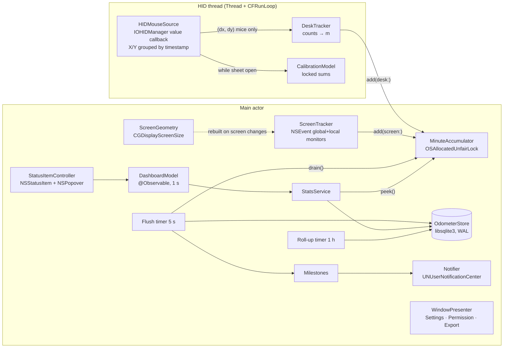

<!-- TINS Specification v1.0 -->
<!-- ZS:COMPLEXITY:MEDIUM -->
<!-- ZS:PRIORITY:HIGH -->
<!-- ZS:PLATFORM:MACOS-DESKTOP -->
<!-- ZS:LANGUAGE:SWIFT -->
<!-- ZS:FRAMEWORK:AppKit+SwiftUI / Swift 6 / macOS 14+ -->

# Mouse-Odometer for macOS

## Description

Mouse-Odometer is a small macOS menu bar app that works like a car odometer for your mouse. While it runs, it adds up how far the mouse physically travels across the desk and reports the total in meters and kilometres for four windows: **last hour**, **today**, **last 30 days** and **lifetime**. Clicking the gauge icon in the menu bar opens a compact dark dashboard, styled like a car instrument cluster. It shows the lifetime total on rolling digit wheels, three smaller counters and a 30-day bar sparkline.

The primary measurement is **desk distance**. It is read from the mouse sensor's raw relative counts through **IOHIDManager**, divided by the mouse's DPI. Like a car's wheel counter, it measures the device itself, so tracking speed, acceleration, a cursor pinned at a screen edge, or a game that captures the cursor do not affect it. As a secondary figure, the app also records **screen distance**: how far the cursor travelled across the displays, converted to meters using each display's physical size. Trackpads have no DPI and no desk travel, so they add to screen distance only.

This is a **separate, independently managed macOS product** with feature parity to Mouse-Odometer for Windows (.NET/WPF). It shares the behaviour, the window definitions, the database schema, the CSV format and the visual language, but none of the code. It lives in its own repository and is developed and built on a Mac. Data stays local in `~/Library/Application Support/Mouse-Odometer/`.

---

## Decisions Log (resolved before writing this spec)

| Topic | Decision |
|---|---|
| Language / UI | **Swift 6** (language mode 6, strict concurrency), **AppKit** `NSStatusItem` + `NSPopover` hosting **SwiftUI** views |
| Minimum OS | **macOS 14 Sonoma** (also Sequoia 15 and Tahoe 26); Apple Silicon and Intel |
| Desk distance | **IOHIDManager** raw relative X/Y counts from mice ÷ DPI (counterpart of Windows Raw Input). Needs the **Input Monitoring** permission |
| Trackpads | **Screen distance only** (built-in trackpad, Magic Trackpad). Classified per device; never counted as desk distance |
| Screen distance | Global + local `NSEvent` mouse monitors; cursor displacement in points × mm/point of the display (from `CGDisplayScreenSize` / EDID) |
| DPI | Entered by the user (default 800) **or** measured with the ruler calibration wizard (10 cm / 20 cm / 4 in / 8 in) |
| Storage | **System SQLite (`libsqlite3`), no third-party dependencies.** Same tables, upserts and roll-up as Windows |
| Project definition | **XcodeGen** `project.yml` generates the `.xcodeproj` (the `.xcodeproj` is not committed) |
| Signing / distribution | Hardened Runtime, **not sandboxed**, Developer ID signed. **Notarization and DMG packaging are done by the team's existing process** and are out of scope here |
| Menu bar | Template gauge icon + hover tooltip; **optional** "today" text next to the icon (Settings toggle, off by default) |
| Start at Login | `SMAppService.mainApp` (no helper app, no admin rights) |
| Extras in scope | Live tooltip, milestone notifications, CSV export, reset with confirmation, device list in Settings |
| Out of scope | Pause/resume, per-mouse DPI profiles, finger-travel on trackpads (needs private APIs), Mac App Store build |

### Parity map (Windows → macOS)

| Windows v1 | macOS v1 |
|---|---|
| Raw Input `WM_INPUT` + `RIDEV_INPUTSINK` on an input thread | `IOHIDManager` value callback on a dedicated thread with its own `CFRunLoop` |
| No permission needed | **Input Monitoring** permission, with an onboarding window and a relaunch button |
| `GetCursorPos` per raw report, physical pixels | `NSEvent` global/local monitors, `NSEvent.mouseLocation` in points |
| EDID through DisplayConfig + registry | `CGDisplayScreenSize` (EDID) with a synthetic-72-dpi check |
| Tray icon + `NotifyIcon` tooltip | `NSStatusItem` template icon + `toolTip` (+ optional text) |
| Flyout window, hides on focus loss, 📌 pin | `NSPopover` `.transient`, 📌 switches to `.applicationDefined` |
| Balloon tip / toast | `UNUserNotificationCenter` banners |
| `HKCU\…\Run` + `--minimized` | `SMAppService.mainApp`; the app always launches quietly except on first run |
| Task Manager "disabled" hint | `SMAppService.Status.requiresApproval` hint + "Open Login Items…" |
| Named mutex + event | LaunchServices single instance + bundle-ID check + distributed notification |
| `%LOCALAPPDATA%\Mouse-Odometer` | `~/Library/Application Support/Mouse-Odometer` |
| Single-file exe | Signed `.app` (DMG by your own pipeline) |

---

## Assessment of Affected Regions

This is a new repository with no existing code. The regions below are the macOS platform surfaces the app touches, with the risk each carries and how this spec handles it.

| Region | API / mechanism | Risk | Handling in this spec |
|---|---|---|---|
| Raw mouse input | `IOHIDManagerCreate`, device matching on GenericDesktop Mouse/Pointer, `IOHIDManagerRegisterInputValueCallback` | X and Y arrive as **separate values**; up to 8 kHz; C callbacks under Swift 6 concurrency | Dedicated `Thread` + `CFRunLoop`; values grouped per device by timestamp; pending reports emitted by a `beforeWaiting` run-loop observer; callbacks use `Unmanaged` context; class is `@unchecked Sendable` with locks around shared state |
| Privacy permission | TCC Input Monitoring: `IOHIDCheckAccess` / `IOHIDRequestAccess(kIOHIDRequestTypeListenEvent)` | `IOHIDManagerOpen` returns `kIOReturnNotPermitted`; a new grant often needs a relaunch; the permission is tied to the code signature | Onboarding window polls every 2 s, starts tracking when granted, offers **Relaunch**; screen distance works without it; sign debug builds with a stable identity |
| Trackpad / virtual devices | `kIOHIDProductKey`, `kIOHIDTransportKey`, `kIOHIDDeviceUsagePairsKey` | Trackpads have no DPI; remapper tools (Karabiner, Logi Options+) re-inject movement, which would double-count | `DeviceClassifier`: trackpad → screen only, virtual → ignored; Settings lists every device with its classification |
| Cursor position | `NSEvent.addGlobalMonitorForEvents` / `addLocalMonitorForEvents`, `NSEvent.mouseLocation` | Global monitors don't see your own app's events; secure input (lock screen) stops events | Global **and** local monitors; the chain resets on wake and unlock; teleport threshold of 1000 pt |
| Physical display size | `CGDisplayScreenSize`, `CGDisplayCopyDisplayMode`, `NSScreen` | Without EDID, macOS returns a synthetic 72-dpi size | Synthetic and implausible sizes rejected; fallback 0.25 mm/pt; per-display override |
| Display changes | `NSApplication.didChangeScreenParametersNotification` | Hot-plug, resolution change, arrangement change | Immutable `ScreenGeometry` snapshot rebuilt and swapped |
| Menu bar | `NSStatusItem`, `NSPopover`, `NSHostingController` | Transient popover + status button click reopens immediately; accessory apps must activate themselves | 400 ms click debounce; `NSApp.activate()` before showing any window |
| Notifications | `UNUserNotificationCenter` | Needs authorization; banners are hidden while the app is active unless the delegate allows them | Authorization requested on first run; delegate returns `[.banner, .list]` |
| Login item | `SMAppService.mainApp` | `.requiresApproval` (user switched it off), `.notFound` (translocated or temporary path) | Hints and an "Open Login Items…" button; "move to Applications" message |
| Storage | `import SQLite3` (system library) | Corruption; Swift wrapper safety | `PRAGMA quick_check`; corrupt file set aside; WAL; positional parameters; one owner (main actor) |
| Concurrency | Swift 6 strict checking | Data races between the HID thread and the UI | Only `DeskTracker` and `MinuteAccumulator` (both `Sendable`, `OSAllocatedUnfairLock`) cross threads; everything else is `@MainActor` or owned by it |
| Single instance | LaunchServices, `NSRunningApplication`, `DistributedNotificationCenter` | Copies in two folders would double-count | Bundle-ID check at launch; the second copy asks the first to open its dashboard, then quits |

---

## Functionality

### 1. Core Features

1. **Desk distance tracking.** Every complete relative HID report `(dx, dy)` from a device classified as a *mouse* adds `sqrt(dx² + dy²) × 0.0254 / DPI` meters. Absolute X/Y elements (pen tablets, remote desktops) are not desk distance and are ignored.
2. **Screen distance tracking** (on by default, can be switched off). On every mouse-moved or dragged event from **any** pointing device (mice and trackpads), the cursor position is sampled. The Euclidean distance in points since the previous sample is multiplied by the mm/point of the display under the cursor. Jumps larger than **1000 points** are teleports and are not counted.
3. **Four windows**, always live to the second (persisted data plus the unflushed buffer):
   - **Last hour**: the current minute plus the 59 minutes before it (rolling 60 minutes).
   - **Today**: since local midnight.
   - **Last 30 days**: today plus the 29 previous local calendar days. This matches the 30 sparkline bars exactly.
   - **Lifetime**: since first run, or since the last reset.
4. **Dashboard popover** opened from the menu bar icon (see layout).
5. **Menu bar item**: template gauge icon (SF Symbol `gauge.with.dots.needle.67percent`). Its tooltip is refreshed every 5 s:
   `Mouse-Odometer⏎Today: 312.4 m⏎Lifetime: 12.345 km`. Optional **today text** next to the icon (`312 m`, `7.9 km`, `1,234 km`), off by default.
6. **Mouse DPI**: entered manually or measured with the **calibration wizard**.
7. **Milestone notifications** (on by default): 100 m, 1 km, 5 km, 10 km, half marathon (21.0975 km), marathon (42.195 km), 100 km, 500 km, 1,000 km, then every further 1,000 km. If several are crossed at once, only the highest is announced.
8. **CSV export**: one row per local day, `date,desk_m,screen_m`, with `.` as the decimal separator whatever the locale.
9. **Reset all stats**, with a confirmation whose default is *Cancel*.
10. **Start at Login** (off by default), from the menu or Settings.
11. **Device list** in Settings: every matched pointing device with its classification (*Desk distance*, *Trackpad: screen distance only*, *Virtual device: ignored*).

### 2. User Interface

#### 2.1 Menu bar

```
 … 🔋 📶  [⏲ 312 m]  Thu 19 Nov 11:23
           ▲   ▲
           │   └─ optional "today" text (Settings › General), monospaced digits
           └──── template gauge icon (adapts to light/dark menu bar)
```
- **Left-click**: toggle the dashboard popover.
- **Right-click** or **Control-click**: the menu (2.3).
- **Hover**: the tooltip.

#### 2.2 Dashboard popover (328 pt wide, dark appearance, arrow pointing at the icon)

```
╭──────────────────────────────────────────╮
│ MOUSE-ODOMETER                 📌  ⚙  ✕ │   pin (toggle, amber when on), settings, close
│                                          │
│ LIFETIME                                 │
│ ┌──────────────────────────────┐         │
│ │[0][0][0][1][2].[3][4][5]     │ km      │   5 dark km wheels . 3 amber metre wheels
│ └──────────────────────────────┘         │
│ on screen 9.871 km                       │   hidden if screen distance is off
│                                          │
│ LAST HOUR     TODAY        30 DAYS       │
│ 42.1 m        312.4 m      7.912 km      │   17 pt semibold, monospaced digits
│ screen 30.2 m screen 250.0 m screen 6.1… │   11 pt muted (hidden if off)
│                                          │
│ ▂▃▅▂▇▆▃▁▂▅▆▇▃▂▅▆▄▃▂▅▇▆▃▂▄▅▆▇▅█         │   30 bars, today amber, hover tooltip
│ 30 days ago                       today  │
│                                          │
│ ⚠ Desk distance needs Input Monitoring.  │   only while desk tracking is not running
│   Grant access…                          │
│ Desk distance · 800 DPI (calibrated)     │   amber if DPI is the default
╰──────────────────────────────────────────╯
```

Behaviour:

- **Open**: left-click the icon, choose "Open Dashboard" in the menu, double-click the app in Finder while it runs, or launch a second copy.
- **Close**: ✕, Esc, clicking anywhere outside (transient), or clicking the icon again.
- **Pin** (📌): the popover stays open when you click elsewhere (`.applicationDefined` behaviour). Unpinning restores transient behaviour.
- **Click debounce**: a click on the status item within **400 ms** of the popover closing itself is ignored, so clicking the icon to close the popover doesn't reopen it.
- **Refresh**: the counters update every **1 s** and the sparkline every **30 s**, only while the popover is shown.
- **Odometer animation**: each wheel rolls with SwiftUI `.contentTransition(.numericText())` and a 0.26 s snappy animation. Animation is off when *Reduce motion* is on. A sixth km wheel appears past 99,999.999 km.
- **Sparkline tooltip**: `Tue 17 Nov: 312.4 m` (localised date).

#### 2.3 Status menu

```
┌──────────────────────────┐
│ **Open Dashboard**       │
│ Settings…            ⌘, │
├──────────────────────────┤
│ ✓ Start at Login         │   state read from SMAppService when the menu opens
│ Export CSV…              │
├──────────────────────────┤
│ Quit Mouse-Odometer  ⌘Q │
└──────────────────────────┘
```

#### 2.4 Settings window (560 pt wide, grouped Form, standard macOS look)

```
┌ Mouse-Odometer Settings ──────────────────────────────────┐
│ Mouse                                                     │
│   [ 800        ]  [Calibrate…]                            │
│   Calibrated on 19 Nov 2026.                              │
│   Use the DPI from your mouse's spec sheet …              │
│ Input Monitoring                                          │
│   ✅ Granted: desk distance is being recorded.   [Fix…]   │
│   MX Master 3S ............................ Desk distance │
│   Apple Internal Keyboard / Trackpad .. Trackpad: screen… │
│ Screen distance                                           │
│   [✓] Also record how far the cursor travels on screen    │
│   Built-in Retina Display                    [ auto ] mm  │
│   1512 × 982 pt · 3024 × 1964 px · EDID 302 × 196 mm ·    │
│   0.1997 mm/pt (EDID)                                     │
│ General                                                   │
│   [✓] Start at Login   (hint + Open Login Items… if off)  │
│   [ ] Show today's distance in the menu bar               │
│   [✓] Milestone notifications (1 km, marathon, …)         │
│ Data                                                      │
│   [Export CSV…] [Show in Finder]      [Reset All Stats…]  │
│   /Users/me/Library/Application Support/Mouse-Odometer    │
│ (red validation message)                                  │
│                                        [Cancel]  [Save]   │
└───────────────────────────────────────────────────────────┘
```

Validation (nothing is saved while an error is shown). Numbers are parsed in the current locale, with `.` also accepted:

| Field | Rule | Message |
|---|---|---|
| Mouse DPI | 50 ≤ DPI ≤ 64000 | `Enter a mouse DPI between 50 and 64000.` |
| Display override | empty **or** 50 ≤ mm ≤ 3000 | `Monitor width must be between 50 and 3000 mm, or empty.` |

The DPI source line reads `Calibrated on {date}.`, `Entered manually.` or `Default value, distances are only accurate once you enter or calibrate your mouse DPI.` Typing a different DPI after calibrating changes the source to *Entered*. Overrides for displays that are not currently connected are kept. *Calibrate…* is disabled while desk tracking is not running. The device list refreshes live when devices connect or disconnect.

#### 2.5 Calibration sheet (460 pt)

```
┌──────────────────────────────────────────────────┐
│ Calibrate mouse DPI                              │
│ 1. Lay a ruler on your desk, mouse at 0.         │
│ 2. Press Space to start.                         │
│ 3. Slide the mouse straight to the chosen mark.  │
│ 4. Press Return to finish (keyboard only).       │
│ Distance: [10 cm ▾]                              │
│ ┌──────────────────────────────────────────────┐ │
│ │ Measuring… slide the mouse to the mark …     │ │
│ │ 3,150 counts                                 │ │
│ │ 800 DPI                                      │ │
│ └──────────────────────────────────────────────┘ │
│            [Cancel] [Start] [Done] [Use Value]   │
└──────────────────────────────────────────────────┘
```

- Counts are summed only between Start and Done, from counted mice. The result uses the **net displacement** `sqrt(ΣdX² + ΣdY²)`; `DPI = netCounts ÷ (distanceMm ÷ 25.4)`, rounded.
- Shortcuts: **Space** = Start/Retry; **Return** = Done while measuring, then Use Value once a result exists; **Esc** = Cancel.
- Fewer than 100 counts gives `Not enough movement detected. Try again.` A result outside 50–64000 gives `Result is outside 50–64000 DPI. Try again.`
- A good result shows `Done. Repeat once or twice: results within ~3 % mean a good measurement.` *Use Value* fills the Settings DPI field with source *Calibrated*; it is stored when Settings is saved.

#### 2.6 Input Monitoring window (500 pt)

The window explains why the permission is needed. It points out that Apple's dialog says "receive keystrokes", which is just Apple's name for this permission, and that the app reads only pointing-device movement. It then lists three steps and shows the live status: *Waiting for permission…* or *Permission granted.* Buttons: **Later**, **Open System Settings** (`x-apple.systempreferences:com.apple.preference.security?Privacy_ListenEvent`), and **Relaunch** in place of Open System Settings when the grant needs a restart. It closes itself automatically as soon as desk tracking starts.

### 3. User Flows

**First run**
1. The user opens `Mouse-Odometer.app` from Applications. The single-instance check passes.
2. The data folder is created; settings default to 800 DPI (source *Default*) and the database is created. Screen tracking starts straight away.
3. `IOHIDRequestAccess` shows Apple's Input Monitoring prompt; the Mouse-Odometer Input Monitoring window opens as well.
4. Notification permission is requested. If granted, a notification reads *"Mouse-Odometer is running — It lives in the menu bar. Set your mouse DPI in Settings for accurate meters."*
5. The dashboard popover opens under the icon, with an amber footer about the default DPI.
6. The user enables Mouse-Odometer in System Settings › Privacy & Security › Input Monitoring. Within 2 s the window either starts desk tracking and closes, or shows **Relaunch**. After a relaunch, tracking starts silently.

**Later launches** (manual or at login): the app starts quietly in the menu bar. No window opens unless the permission is missing.

**Calibrate**: ⚙ → Settings → *Calibrate…* → Space → slide 10 cm → Return → `800 DPI` → *Use Value* → *Save*. The new DPI applies from the next report onwards; history (stored in meters) is not rewritten.

**Start at Login**: menu → *Start at Login* calls `SMAppService.mainApp.register()`. If the status is `.requiresApproval`, a notification asks the user to turn it on in System Settings › General › Login Items. If it is `.notFound`, an alert says to move the app to Applications.

**Second copy / double-click while running**: the running instance opens its dashboard. A second copy from another folder posts a distributed notification and quits.

**Export / Reset**: the same as Windows. Export flushes first and opens an `NSSavePanel` with default name `mouse-odometer-2026-11-19.csv`. Reset asks for confirmation, then clears the buffer and all tables, sets lifetime and milestone index to 0, vacuums, and posts *"All stats have been reset."*

**Quit**: menu → Quit. HID stops, screen monitors are removed, a final flush runs, the WAL is checkpointed and the database is closed.

### 4. Edge Cases & Error States

| Situation | Behaviour |
|---|---|
| Input Monitoring not granted | Desk distance is not recorded; screen distance still is; the dashboard shows the amber "Grant access…" row; Calibrate is disabled |
| Permission granted while running | Poll detects it; `startHID()` is retried; if `kIOReturnNotPermitted` persists, **Relaunch** is offered |
| Permission revoked while running | HID values simply stop arriving; on the next launch the onboarding window opens again |
| Debug build re-signed with a different identity | TCC sees a new app and the permission resets; sign with a stable team identity (see Step 0) |
| Built-in trackpad / Magic Trackpad | Classified *trackpad*: screen distance only |
| Magic Mouse | Classified *mouse*: desk distance (and screen distance) |
| Remapper / virtual HID devices | Classified *virtual*: ignored for desk distance (prevents double counting); their cursor movement still counts on screen |
| Several mice | Summed, using one DPI |
| Game captures the cursor / cursor pinned at an edge | Desk distance keeps counting; screen distance doesn't |
| Pen tablet / Sidecar / Universal Control / Screen Sharing | Absolute or remote input: not desk distance; cursor movement counts on screen |
| Lock screen, fast user switching, sleep | No events; the screen chain resets on wake and session activation, so there's no jump |
| Cursor warps > 1000 pt (e.g. moving between distant displays with a hot key) | Not counted |
| Display with no EDID size (some TVs/projectors) | `CGDisplayScreenSize` returns a synthetic 72-dpi size, which is detected and replaced by 0.25 mm/pt (*Fallback*); the user can override it |
| Two identical displays without serial numbers | Share one StableKey, so one override applies to both (documented limitation) |
| Display rotated | Diagonal ratio, so rotation doesn't change the result |
| Display hot-plug / arrangement change | Geometry rebuilt on `didChangeScreenParametersNotification` |
| System clock moves backwards | Minutes may repeat; the additive upsert merges them |
| DST transitions / midnight that doesn't exist | `Calendar.startOfDay` on a noon anchor gives the first valid minute of the day |
| Database write fails | Buckets restored to the buffer and retried on the next 5 s flush; logged |
| Database corrupt at launch | Renamed to `odometer.db.corrupt-yyyyMMdd-HHmmss` (+ `-wal`/`-shm`), fresh database, notification |
| `settings.json` unreadable | Renamed to `settings.json.bad`; defaults are used. Missing keys in an older file fall back to defaults |
| Login item `.requiresApproval` / `.notFound` | Hint with "Open Login Items…" / "move to Applications" message; never forced |
| Notifications denied | Milestones are still tracked (index advances); nothing is shown |
| App killed / crash / power loss | At most ~5 s of distance lost; `willSleep` and `willPowerOff` flush |
| HID thread fails to start within 5 s | `HIDError.threadDidNotStart`; onboarding window shown; logged |
| > 99,999.999 km lifetime | Odometer adds a wheel; formatting switches to `123,456.7 km` above 100,000 km |

---

## Technical Implementation

### 1. Architecture



Concurrency rules (Swift 6, `SWIFT_STRICT_CONCURRENCY = complete`):

- **Only two types cross threads:** `MinuteAccumulator` and `DeskTracker`, both `final class … : Sendable` with `OSAllocatedUnfairLock` state. `HIDMouseSource` is `@unchecked Sendable`: its handler list and device table are lock-protected, and its pending-report table is touched only on the HID thread.
- Everything else is `@MainActor` (`OdometerCore`, UI, `ScreenTracker`) or a plain non-Sendable class owned by `OdometerCore` (`OdometerStore`, `SQLiteDatabase`, `StatsService`).
- Timers and notification observers run on the main run loop and call into the main actor via `MainActor.assumeIsolated`.

### 2. Repository Layout

```
mouse-odometer-macos/
├─ project.yml                         XcodeGen definition (app + unit-test targets, one scheme)
├─ .gitignore                          ignores the generated .xcodeproj and Info.plist
├─ Tools/make-icon.swift               draws the AppIcon set (run once, output is committed)
├─ Sources/MouseOdometer/
│  ├─ App/
│  │  ├─ AppDelegate.swift             @main, launch sequence, timers, observers, single instance
│  │  └─ OdometerCore.swift            composition root; flush / roll-up / export / reset
│  ├─ Input/
│  │  ├─ HIDMouseSource.swift          IOHIDManager on its own thread
│  │  ├─ InputPermission.swift         TCC Input Monitoring check / request / relaunch
│  │  ├─ ScreenGeometry.swift          displays → mm/point
│  │  └─ ScreenTracker.swift           NSEvent monitors → screen meters
│  ├─ Logic/                           pure Foundation + SQLite3 (also compiled into the tests)
│  │  ├─ AppSettings.swift             settings model + JSON store
│  │  ├─ DeskTracker.swift             counts → meters (HID thread)
│  │  ├─ DeviceClassifier.swift        mouse / trackpad / virtual
│  │  ├─ DistanceMath.swift            conversions, calibration, plausibility
│  │  ├─ Formatting.swift              distance strings, menu bar text, tooltip
│  │  ├─ Log.swift                     error.log
│  │  ├─ Milestones.swift
│  │  ├─ MinuteAccumulator.swift
│  │  ├─ OdometerStore.swift           schema, upserts, roll-up, reset
│  │  ├─ SQLiteDatabase.swift          thin libsqlite3 wrapper
│  │  ├─ StatsService.swift            windows, daily series, CSV
│  │  └─ TimeWindows.swift             LocalDay + DST-safe window maths
│  ├─ Services/
│  │  ├─ LoginItemManager.swift        SMAppService.mainApp
│  │  └─ Notifier.swift                UNUserNotificationCenter
│  ├─ UI/
│  │  ├─ StatusItemController.swift    menu bar item, popover, menu
│  │  ├─ DashboardModel.swift / DashboardView.swift
│  │  ├─ OdometerView.swift / SparklineView.swift
│  │  ├─ SettingsModel.swift / SettingsView.swift
│  │  ├─ CalibrationView.swift         CalibrationModel + sheet
│  │  ├─ PermissionView.swift          PermissionModel + window
│  │  ├─ WindowPresenter.swift         window lifecycle + CSV export panel
│  │  └─ Theme.swift
│  └─ Assets.xcassets/                 generated by Tools/make-icon.swift
└─ Tests/MouseOdometerTests/LogicTests.swift   Swift Testing suite (20 tests)
```

### 3. Data Models

#### 3.1 SQLite (`~/Library/Application Support/Mouse-Odometer/odometer.db`, WAL, `synchronous=NORMAL`)

**Identical to the Windows schema**, so the two apps' data and CSV exports are directly comparable.

```sql
minute_bucket (minute_utc INTEGER PRIMARY KEY,   -- Unix seconds / 60 (UTC)
               desk_m REAL NOT NULL, screen_m REAL NOT NULL) WITHOUT ROWID;   -- last 35 days only
daily_bucket  (day_local TEXT PRIMARY KEY,       -- 'yyyy-MM-dd', local zone at roll-up time
               desk_m REAL NOT NULL, screen_m REAL NOT NULL) WITHOUT ROWID;   -- older than 35 days
meta          (key TEXT PRIMARY KEY, value NOT NULL) WITHOUT ROWID;           -- no affinity
-- keys: schema_version = 1 · lifetime_desk_m REAL · lifetime_screen_m REAL · milestone_index INTEGER
```

Invariants (same as Windows):
- `lifetime_*` is a running sum of every flushed bucket and is never recomputed.
- All writes are additive upserts, so retries and repeated minutes are safe.
- History is stored in meters; changing the DPI doesn't rewrite it.

#### 3.2 Settings (`settings.json`, `JSONEncoder` pretty + sorted keys, ISO-8601 dates)

```jsonc
{
  "dpiCalibratedAt" : "2026-11-19T10:23:00Z",   // only when dpiSource == "Calibrated"
  "dpiSource" : "Calibrated",                    // "Default" | "Entered" | "Calibrated"
  "firstRunCompleted" : true,
  "milestoneNotifications" : true,
  "monitorWidthOverridesMM" : { "1552-41136-0" : 597 },   // StableKey "vendor-model-serial" → mm (50…3000)
  "mouseDPI" : 800,                              // 50…64000, default 800
  "showTodayInMenuBar" : false,
  "trackScreenDistance" : true
}
```
Missing keys decode to their defaults. "Start at Login" is **not** stored here; `SMAppService` is the source of truth.

#### 3.3 In-memory types

```swift
struct MinuteAmount { var minuteUTC: Int64; var deskM: Double; var screenM: Double }
struct DistancePair { var deskM: Double; var screenM: Double }                  // supports +
struct StatsSnapshot { var lastHour, today, last30Days, lifetime: DistancePair }
struct DailyPoint: Identifiable { let day: LocalDay; let deskM, screenM: Double }
struct LocalDay: Hashable, Comparable { let year, month, day: Int }               // "yyyy-MM-dd"
enum   DeviceKind { case mouse, trackpad, virtual }
struct HIDDeviceInfo { id: UInt; product, manufacturer, transport: String; vendorID, productID: Int; kind: DeviceKind }
struct ScreenInfo { id: CGDirectDisplayID; name, stableKey: String; frame: CGRect; pixelWidth, pixelHeight: Int
                    physicalWidthMM, physicalHeightMM: Double?; mmPerPoint: Double; source: ScaleSource }
enum   ScaleSource { case edid, override, fallback }
struct Milestone { index: Int; meters: Double; title, body: String }
```

### 4. Key Algorithms

**4.1 HID report assembly (desk distance)**

```
on value (HID thread):
  element must be GenericDesktop X (0x30) or Y (0x31) and relative, else ignore
  device must be classified .mouse, else ignore
  p = pending[device]
  if p.timestamp != value.timestamp and p has movement: emit(p.dx, p.dy); p = empty
  p.timestamp = value.timestamp; add value to p.dx or p.dy
on run loop beforeWaiting: emit every pending report with movement
emit(dx, dy) → DeskTracker: deskM = sqrt(dx² + dy²) × 0.0254 / DPI
```
Example: 1,600 counts at 1,600 DPI = 0.0254 m. Back-and-forth movement adds up, as an odometer should.

**4.2 Device classification**

```
transport == "Virtual" or product contains "virtual"   → .virtual   (ignored)
product contains "trackpad" or "touchpad"              → .trackpad  (screen only)
usage pairs contain Digitizer (0x0D) / TouchPad (0x05) → .trackpad
otherwise                                              → .mouse     (desk distance)
```

**4.3 Screen distance**

```
on mouseMoved / *MouseDragged (global and local monitors, main thread):
  p = NSEvent.mouseLocation   (points, global)
  if last exists: d = |p − last|; if 0 < d ≤ 1000: screenM = d × mmPerPoint(display at p) / 1000
  last = p
reset last on wake, session activation, geometry change, enable/disable
```

**4.4 mm per point for a display**

1. `size = CGDisplayScreenSize(id)` gives millimetres from the EDID.
2. Reject the size if it is synthetic (within 1 % of `px / 2.835` for `CGDisplayPixelsWide`, the mode's pixel width, or the width in points) or implausible (long side 100–3000 mm, short side 50–2000 mm).
3. Choose in this order:
   - Override: `overrideMm / frame.width`.
   - EDID: `hypot(wMm, hMm) / hypot(wPt, hPt)`.
   - Fallback: `0.25 mm/pt`.

Example: MacBook Pro 14″ at 302 × 196 mm and 1512 × 982 pt gives **0.1997 mm/pt**. Points are what the cursor moves in, so the scaled resolution doesn't matter.

**4.5 Accumulation, flush, windows, roll-up, milestones, calibration**: identical to the Windows version.
- Per-minute buffer, flushed every 5 s with additive upserts in one transaction; restored on failure.
- Windows: `hourFrom = now − 59`, `todayFrom = localMidnight(today)`, `month30From = localMidnight(today − 29 d)`. Sums = minute rows ≥ from + unflushed buffer ≥ from.
- Roll-up of minutes older than 35 days into local-day rows, at launch and then hourly.
- Milestone index advances even when notifications are off; only the highest new milestone is announced.
- Calibration: `DPI = round(sqrt(ΣdX² + ΣdY²) / (mm / 25.4))`. Example: 3,150 counts over 100 mm gives **800 DPI**.

### 5. Style Guide

| Token | Value | Use |
|---|---|---|
| Panel | `#15171A` | popover background (popover forced to Dark Aqua) |
| Edge | `#2C3036` | odometer frame |
| Text | `#E8E6E3` | values |
| Muted | `#8B9099` | labels, secondary lines, idle icons |
| Accent (amber) | `#F2A33A` | metre wheels, today's bar, pin on, DPI / permission warnings |
| Hover | `#262A30` | icon-button hover |
| km wheel | gradient `#2A2D33 → #0E0F11`, digits `#F2F0EC` | |
| metre wheel | gradient `#F7B85A → #D88622`, digits `#1A140A` | |
| Bar / empty bar | `#4A5160` / `#2A2E35` | sparkline |

Typography: SF Pro (system) for text; SF Mono (`.monospaced` design) 21 pt semibold on 22 × 34 pt wheels; `.monospacedDigit()` on all counters. Icons are SF Symbols: `gauge.with.dots.needle.67percent` (fallback `speedometer`), `pin` / `pin.fill`, `gearshape`, `xmark`. The menu bar icon is a **template** image so it adapts to light and dark menu bars and tinted wallpapers.

App icon: generated by `Tools/make-icon.swift` (macOS rounded square on the 1024 grid, dark gradient, amber 270° arc, white needle and hub), 16–512 pt at @1x and @2x.

### 6. Accessibility

- Every icon button has an accessibility label and a `.help` tooltip. The odometer is a single element read as "Lifetime distance 12.345 km". The sparkline is labelled "Desk distance for the last 30 days".
- Everything works from the keyboard: Esc closes the popover; Settings uses Return = Save and Esc = Cancel; calibration uses Space, Return and Esc; ⌘, and ⌘Q are in the status menu.
- *Reduce motion* turns off the wheel animation.
- Contrast on the panel: Text 14.4:1, Muted 5.6:1, Amber 8.6:1 (WCAG AA).
- Settings and onboarding use standard controls, so Dynamic Type, VoiceOver and Increase Contrast behave natively.

### 7. Performance Goals

| Metric | Target |
|---|---|
| Work per HID value | < 2 µs (dictionary lookup, add; one lock per emitted report); no allocations in steady state |
| Supported polling rates | up to 8,000 Hz |
| Screen samples | AppKit-coalesced mouse events (≈ display refresh rate), O(1) each |
| Idle CPU (popover closed) | < 0.2 % |
| Memory | < 40 MB resident |
| Flush | ≤ 1 transaction / 5 s, < 5 ms |
| Popover refresh | 3 indexed range sums + 1 meta read per second, < 5 ms |
| Data loss on crash | ≤ 5 s |

---

## Implementation Steps

Follow the steps in order on a Mac. Each file is given **in full**: create it at the path shown (relative to the repository root), with nothing to fill in except your Team ID in `project.yml`.

### Step 0 — Prerequisites (on the Mac)

- macOS 14 or later, **Xcode 16 or later** (Swift 6 toolchain and Swift Testing). Check with `xcodebuild -version` and `swift --version`.
- XcodeGen: `brew install xcodegen` (check with `xcodegen --version`).
- An Apple Developer account. Use **Apple Development** signing for debug builds and **Developer ID Application** for release. TCC ties the Input Monitoring permission to the code signature: ad-hoc ("Sign to Run Locally") builds lose the permission on every rebuild.

### Step 1 — Create the repository

```bash
mkdir mouse-odometer-macos && cd mouse-odometer-macos
git init
mkdir -p Sources/MouseOdometer/{App,Input,Logic,Services,UI} Tests/MouseOdometerTests Tools
```

### Step 2 — XcodeGen project definition

Defines the app target, the logic unit-test target and one scheme. **Set `DEVELOPMENT_TEAM` to your Team ID in both targets.** The test target is deliberately not hosted in the app: it compiles `Logic/` directly, so running tests never starts a menu bar app or triggers permission prompts. Release builds are signed *Developer ID Application* with Hardened Runtime, ready for your notarization pipeline.

**`project.yml`**

```yaml
name: MouseOdometer
options:
  bundleIdPrefix: com.mushroomfleet
  deploymentTarget:
    macOS: "14.0"
  createIntermediateGroups: true
  developmentLanguage: en

settings:
  base:
    SWIFT_VERSION: "6.0"
    MACOSX_DEPLOYMENT_TARGET: "14.0"
    SWIFT_STRICT_CONCURRENCY: complete
    ENABLE_USER_SCRIPT_SANDBOXING: YES
    DEAD_CODE_STRIPPING: YES

targets:
  MouseOdometer:
    type: application
    platform: macOS
    sources:
      - path: Sources/MouseOdometer
    info:
      path: Sources/MouseOdometer/Info.plist
      properties:
        CFBundleName: Mouse-Odometer
        CFBundleDisplayName: Mouse-Odometer
        CFBundleShortVersionString: "1.0.0"
        CFBundleVersion: "1"
        LSMinimumSystemVersion: "14.0"
        LSUIElement: true
        LSApplicationCategoryType: public.app-category.utilities
        NSHumanReadableCopyright: "© 2026 Drift Johnson"
    settings:
      base:
        PRODUCT_NAME: Mouse-Odometer
        PRODUCT_MODULE_NAME: MouseOdometer
        PRODUCT_BUNDLE_IDENTIFIER: com.mushroomfleet.mouse-odometer
        ASSETCATALOG_COMPILER_APPICON_NAME: AppIcon
        ENABLE_HARDENED_RUNTIME: YES
        ENABLE_APP_SANDBOX: NO
        CODE_SIGN_STYLE: Automatic
        # Set your Apple Developer Team ID. Input Monitoring permission is tied to the code signature,
        # so sign even debug builds with "Apple Development" or the permission resets on every build.
        DEVELOPMENT_TEAM: ""
        CODE_SIGN_IDENTITY: "Apple Development"
      configs:
        Release:
          CODE_SIGN_IDENTITY: "Developer ID Application"
          CODE_SIGN_STYLE: Manual

  MouseOdometerTests:
    type: bundle.unit-test
    platform: macOS
    # Not hosted in the app: the pure logic is compiled straight into the test bundle,
    # so running tests never starts a menu bar app or asks for Input Monitoring.
    sources:
      - path: Tests/MouseOdometerTests
      - path: Sources/MouseOdometer/Logic
    settings:
      base:
        GENERATE_INFOPLIST_FILE: YES
        PRODUCT_BUNDLE_IDENTIFIER: com.mushroomfleet.mouse-odometer.tests
        CODE_SIGN_STYLE: Automatic
        DEVELOPMENT_TEAM: ""

schemes:
  MouseOdometer:
    build:
      targets:
        MouseOdometer: all
    run:
      config: Debug
    test:
      config: Debug
      targets:
        - MouseOdometerTests
    archive:
      config: Release
```

### Step 3 — Git ignore

The `.xcodeproj` and `Info.plist` are generated by XcodeGen and are never committed.

**`.gitignore`**

```gitignore
# XcodeGen output (regenerate with `xcodegen generate`)
MouseOdometer.xcodeproj/
Sources/MouseOdometer/Info.plist

# Xcode / build
DerivedData/
build/
*.xcuserstate
xcuserdata/
*.xcarchive
*.dmg
.DS_Store
```

### Step 4 — App icon generator

Run once with `swift Tools/make-icon.swift` from the repository root. It writes `Sources/MouseOdometer/Assets.xcassets` (commit the result). The project expects `AppIcon`, so run this **before** the first build.

**`Tools/make-icon.swift`**

```swift
#!/usr/bin/env swift
// Generates Sources/MouseOdometer/Assets.xcassets with the AppIcon set (no binary assets in the repo).
// Run once from the repository root, before `xcodegen generate`:   swift Tools/make-icon.swift
import AppKit

let root = URL(fileURLWithPath: FileManager.default.currentDirectoryPath)
let catalog = root.appendingPathComponent("Sources/MouseOdometer/Assets.xcassets")
let iconSet = catalog.appendingPathComponent("AppIcon.appiconset")
try FileManager.default.createDirectory(at: iconSet, withIntermediateDirectories: true)

func color(_ hex: UInt32) -> NSColor {
    NSColor(srgbRed: CGFloat((hex >> 16) & 0xFF) / 255, green: CGFloat((hex >> 8) & 0xFF) / 255,
            blue: CGFloat(hex & 0xFF) / 255, alpha: 1)
}

/// Gauge on a dark rounded square: amber 270° arc, white needle at −50°, white hub.
func render(_ px: Int) -> Data {
    let rep = NSBitmapImageRep(bitmapDataPlanes: nil, pixelsWide: px, pixelsHigh: px, bitsPerSample: 8,
                               samplesPerPixel: 4, hasAlpha: true, isPlanar: false,
                               colorSpaceName: .deviceRGB, bytesPerRow: 0, bitsPerPixel: 0)!
    NSGraphicsContext.saveGraphicsState()
    NSGraphicsContext.current = NSGraphicsContext(bitmapImageRep: rep)
    let s = CGFloat(px)
    // macOS icon grid: 824/1024 body with ~185/1024 corner radius.
    let inset = s * 100 / 1024
    let body = NSRect(x: inset, y: inset, width: s - 2 * inset, height: s - 2 * inset)
    let radius = s * 185 / 1024
    let bg = NSBezierPath(roundedRect: body, xRadius: radius, yRadius: radius)
    NSGradient(starting: color(0x2A2D33), ending: color(0x15171A))!.draw(in: bg, angle: -90)

    let c = NSPoint(x: s / 2, y: s / 2 - s * 0.02)
    let r = body.width * 0.33
    let arc = NSBezierPath()
    // AppKit angles are counter-clockwise from +x; the gap sits at the bottom (225°…315°).
    arc.appendArc(withCenter: c, radius: r, startAngle: 225, endAngle: -45, clockwise: true)
    arc.lineWidth = body.width * 0.075
    arc.lineCapStyle = .round
    color(0xF2A33A).setStroke()
    arc.stroke()

    let angle = 50.0 * Double.pi / 180   // needle up and to the right
    let tip = NSPoint(x: c.x + CGFloat(cos(angle)) * r * 0.9, y: c.y + CGFloat(sin(angle)) * r * 0.9)
    let needle = NSBezierPath()
    needle.move(to: c)
    needle.line(to: tip)
    needle.lineWidth = body.width * 0.06
    needle.lineCapStyle = .round
    NSColor.white.setStroke()
    needle.stroke()

    let hub = body.width * 0.11
    NSColor.white.setFill()
    NSBezierPath(ovalIn: NSRect(x: c.x - hub / 2, y: c.y - hub / 2, width: hub, height: hub)).fill()
    NSGraphicsContext.restoreGraphicsState()
    return rep.representation(using: .png, properties: [:])!
}

var images: [[String: String]] = []
for points in [16, 32, 128, 256, 512] {
    for scale in [1, 2] {
        let px = points * scale
        let name = "icon_\(points)x\(points)\(scale == 2 ? "@2x" : "").png"
        try render(px).write(to: iconSet.appendingPathComponent(name))
        images.append(["idiom": "mac", "size": "\(points)x\(points)", "scale": "\(scale)x", "filename": name])
    }
}

let info = ["author": "xcode", "version": 1] as [String: Any]
let iconJSON: [String: Any] = ["images": images, "info": info]
try JSONSerialization.data(withJSONObject: iconJSON, options: [.prettyPrinted, .sortedKeys])
    .write(to: iconSet.appendingPathComponent("Contents.json"))
try JSONSerialization.data(withJSONObject: ["info": info], options: [.prettyPrinted, .sortedKeys])
    .write(to: catalog.appendingPathComponent("Contents.json"))
print("Wrote \(images.count) icon images to \(iconSet.path)")
```

### Step 5 — Logic: Log

**`Sources/MouseOdometer/Logic/Log.swift`**

```swift
import Foundation
import os

/// Tiny append-only error log at ~/Library/Application Support/Mouse-Odometer/error.log, capped at 1 MB.
enum Log {
    private static let maxBytes = 1_000_000
    private static let target = OSAllocatedUnfairLock<URL?>(initialState: nil)

    static func configure(fileURL: URL) {
        target.withLock { $0 = fileURL }
    }

    static func write(_ message: String) {
        let stamp = ISO8601DateFormatter.string(from: Date(), timeZone: .current,
                                                formatOptions: [.withInternetDateTime, .withFractionalSeconds])
        let line = "\(stamp)  \(message)\n"
        target.withLock { url in
            guard let url else { return }
            let fm = FileManager.default
            if let size = (try? fm.attributesOfItem(atPath: url.path))?[.size] as? Int, size > maxBytes {
                let old = url.appendingPathExtension("old")
                try? fm.removeItem(at: old)
                try? fm.moveItem(at: url, to: old)
            }
            guard let data = line.data(using: .utf8) else { return }
            if let handle = try? FileHandle(forWritingTo: url) {
                defer { try? handle.close() }
                _ = try? handle.seekToEnd()
                try? handle.write(contentsOf: data)
            } else {
                try? data.write(to: url)
            }
        }
    }
}
```

### Step 6 — Logic: DistanceMath

**`Sources/MouseOdometer/Logic/DistanceMath.swift`**

```swift
import Foundation

/// Pure conversion maths shared by trackers, calibration and screen geometry.
enum DistanceMath {
    static let metersPerInch = 0.0254
    /// Cursor jumps larger than this between two samples are teleports (warping, display reconfiguration), not movement.
    static let teleportThresholdPoints: Double = 1000
    static let minimumCalibrationCounts = 100

    /// Desk distance of one relative HID report: Euclidean length in counts ÷ counts-per-meter.
    static func meters(dx: Int, dy: Int, dpi: Double) -> Double {
        let x = Double(dx), y = Double(dy)
        return (x * x + y * y).squareRoot() * metersPerInch / dpi
    }

    /// Net displacement used by calibration; sideways wobble cancels instead of adding up.
    static func netCounts(sumX: Int, sumY: Int) -> Int {
        let x = Double(sumX), y = Double(sumY)
        return Int((x * x + y * y).squareRoot().rounded())
    }

    /// DPI = counts / (distance mm / 25.4). Nil when there was too little movement or the result is out of range.
    static func calibratedDPI(netCounts: Int, distanceMM: Double) -> Double? {
        guard netCounts >= minimumCalibrationCounts, distanceMM > 0 else { return nil }
        let dpi = Double(netCounts) / (distanceMM / 25.4)
        return AppSettings.isValidDPI(dpi) ? dpi : nil
    }

    /// Diagonal ratio: independent of rotation, assumes square points.
    static func mmPerPoint(widthMM: Double, heightMM: Double, widthPt: Double, heightPt: Double) -> Double {
        let diagPt = (widthPt * widthPt + heightPt * heightPt).squareRoot()
        guard diagPt > 0 else { return 0 }
        return (widthMM * widthMM + heightMM * heightMM).squareRoot() / diagPt
    }

    /// Between a 4.5" panel and a ~140" wall. Rejects zero sizes and aspect-ratio-only EDIDs.
    static func isPlausibleSize(widthMM: Double, heightMM: Double) -> Bool {
        (100...3000).contains(widthMM) && (50...2000).contains(heightMM)
    }

    /// CGDisplayScreenSize returns `pixels / 2.835` (72 dpi) when the EDID has no size.
    /// Treat a width within 1 % of that value, for any of the candidate pixel widths, as "no EDID size".
    static func looksLikeSyntheticSize(widthMM: Double, candidatePixelWidths: [Int]) -> Bool {
        candidatePixelWidths.contains { px in
            guard px > 0 else { return false }
            let synthetic = Double(px) / 2.835
            return abs(widthMM - synthetic) <= synthetic * 0.01
        }
    }
}
```

### Step 7 — Logic: DeviceClassifier

**`Sources/MouseOdometer/Logic/DeviceClassifier.swift`**

```swift
import Foundation

/// How a matched HID pointing device contributes to the odometer.
enum DeviceKind: String, Sendable, Codable {
    /// Counted as desk distance.
    case mouse
    /// Trackpads have no DPI or desk travel: their cursor movement counts as screen distance only.
    case trackpad
    /// Software devices (remappers, remote-control tools) re-inject movement that a real mouse already produced.
    case virtual

    var countsDeskDistance: Bool { self == .mouse }

    var label: String {
        switch self {
        case .mouse: "Desk distance"
        case .trackpad: "Trackpad: screen distance only"
        case .virtual: "Virtual device: ignored"
        }
    }
}

/// Pure classification rules, unit-testable without IOKit.
enum DeviceClassifier {
    static let digitizerPage = 0x0D
    static let touchPadUsage = 0x05

    /// - Parameters:
    ///   - product: kIOHIDProductKey, e.g. "MX Master 3S", "Magic Trackpad", "Apple Internal Keyboard / Trackpad".
    ///   - transport: kIOHIDTransportKey, e.g. "USB", "Bluetooth", "Bluetooth Low Energy", "SPI", "Virtual".
    ///   - usagePairs: kIOHIDDeviceUsagePairsKey as (page, usage) tuples.
    static func classify(product: String, transport: String, usagePairs: [(page: Int, usage: Int)]) -> DeviceKind {
        let p = product.lowercased()
        let t = transport.lowercased()
        if t == "virtual" || p.contains("virtual") { return .virtual }
        if p.contains("trackpad") || p.contains("touchpad") { return .trackpad }
        if usagePairs.contains(where: { $0.page == digitizerPage && $0.usage == touchPadUsage }) { return .trackpad }
        return .mouse
    }
}
```

### Step 8 — Logic: MinuteAccumulator

`OSAllocatedUnfairLock` (macOS 13+) keeps the type `Sendable` and the hot path allocation-free.

**`Sources/MouseOdometer/Logic/MinuteAccumulator.swift`**

```swift
import Foundation
import os

/// Distance travelled during one UTC minute. `minuteUTC` = Unix seconds / 60.
struct MinuteAmount: Sendable, Equatable {
    var minuteUTC: Int64
    var deskM: Double
    var screenM: Double
}

/// Thread-safe buffer between the HID thread / main thread (`add`, up to thousands of calls per second)
/// and the 5-second flush (`drain`) and live stats (`peek`). Minute boundaries are cut inside `add`.
final class MinuteAccumulator: Sendable {
    private struct State {
        var closed: [MinuteAmount] = []
        var minute: Int64 = -1
        var desk: Double = 0
        var screen: Double = 0
    }

    private let state = OSAllocatedUnfairLock(initialState: State())
    private let clock: @Sendable () -> Int64

    init(clock: @escaping @Sendable () -> Int64 = MinuteAccumulator.currentMinuteUTC) {
        self.clock = clock
    }

    static func currentMinuteUTC() -> Int64 {
        Int64((Date().timeIntervalSince1970 / 60).rounded(.down))
    }

    func add(desk: Double, screen: Double) {
        let m = clock()
        state.withLock { s in
            if m != s.minute {
                if s.minute >= 0 && (s.desk > 0 || s.screen > 0) {
                    s.closed.append(MinuteAmount(minuteUTC: s.minute, deskM: s.desk, screenM: s.screen))
                }
                s.minute = m
                s.desk = 0
                s.screen = 0
            }
            s.desk += desk
            s.screen += screen
        }
    }

    /// Removes and returns everything not yet persisted: closed minutes plus the current partial minute.
    func drain() -> [MinuteAmount] {
        state.withLock { s in
            var result = s.closed
            s.closed.removeAll(keepingCapacity: true)
            if s.desk > 0 || s.screen > 0 {
                result.append(MinuteAmount(minuteUTC: s.minute, deskM: s.desk, screenM: s.screen))
            }
            s.desk = 0
            s.screen = 0
            return result
        }
    }

    /// Like `drain()` but leaves the buffer untouched. Used for live, sub-flush statistics.
    func peek() -> [MinuteAmount] {
        state.withLock { s in
            var result = s.closed
            if s.desk > 0 || s.screen > 0 {
                result.append(MinuteAmount(minuteUTC: s.minute, deskM: s.desk, screenM: s.screen))
            }
            return result
        }
    }

    /// Puts buckets back after a failed database write. Duplicate minutes are fine: the store adds.
    func restore(_ buckets: [MinuteAmount]) {
        state.withLock { s in s.closed.insert(contentsOf: buckets, at: 0) }
    }

    func discard() {
        state.withLock { s in
            s.closed.removeAll()
            s.desk = 0
            s.screen = 0
        }
    }
}
```

### Step 9 — Logic: DeskTracker

**`Sources/MouseOdometer/Logic/DeskTracker.swift`**

```swift
import Foundation
import os

/// Converts relative HID reports from counted mice into desk meters. Called on the HID thread.
final class DeskTracker: Sendable {
    private let metersPerCount: OSAllocatedUnfairLock<Double>
    private let accumulator: MinuteAccumulator

    init(accumulator: MinuteAccumulator, dpi: Double) {
        self.accumulator = accumulator
        self.metersPerCount = OSAllocatedUnfairLock(initialState: DistanceMath.metersPerInch / dpi)
    }

    func setDPI(_ dpi: Double) {
        let value = DistanceMath.metersPerInch / dpi
        metersPerCount.withLock { $0 = value }
    }

    func handle(dx: Int, dy: Int) {
        guard dx != 0 || dy != 0 else { return }
        let mpc = metersPerCount.withLock { $0 }
        let x = Double(dx), y = Double(dy)
        accumulator.add(desk: (x * x + y * y).squareRoot() * mpc, screen: 0)
    }
}
```

### Step 10 — Logic: TimeWindows

Day arithmetic anchors on **noon**, which exists on every day, and `Calendar.startOfDay` yields the first valid minute even where 00:00 is skipped by DST.

**`Sources/MouseOdometer/Logic/TimeWindows.swift`**

```swift
import Foundation

/// A calendar day in a given time zone, formatted as yyyy-MM-dd.
struct LocalDay: Hashable, Comparable, Sendable, CustomStringConvertible {
    let year: Int
    let month: Int
    let day: Int

    init(year: Int, month: Int, day: Int) {
        self.year = year
        self.month = month
        self.day = day
    }

    /// Parses "yyyy-MM-dd".
    init?(string: String) {
        let parts = string.split(separator: "-").compactMap { Int($0) }
        guard parts.count == 3 else { return nil }
        self.init(year: parts[0], month: parts[1], day: parts[2])
    }

    var description: String { String(format: "%04d-%02d-%02d", year, month, day) }

    static func < (a: LocalDay, b: LocalDay) -> Bool {
        (a.year, a.month, a.day) < (b.year, b.month, b.day)
    }
}

/// Window definitions (local time zone for calendar days):
///   Last hour    = the current minute + the 59 minutes before it (rolling 60 minutes)
///   Today        = since local midnight
///   Last 30 days = today + the 29 previous local calendar days (matches the 30 sparkline bars)
enum TimeWindows {
    struct Windows: Sendable, Equatable {
        let hourFrom: Int64
        let todayFrom: Int64
        let month30From: Int64
        let nowMinute: Int64
    }

    static func minute(of date: Date) -> Int64 {
        Int64((date.timeIntervalSince1970 / 60).rounded(.down))
    }

    static func date(ofMinute minute: Int64) -> Date {
        Date(timeIntervalSince1970: TimeInterval(minute) * 60)
    }

    static func calendar(_ timeZone: TimeZone) -> Calendar {
        var c = Calendar(identifier: .gregorian)
        c.timeZone = timeZone
        return c
    }

    static func localDay(of date: Date, timeZone: TimeZone = .current) -> LocalDay {
        let c = calendar(timeZone).dateComponents([.year, .month, .day], from: date)
        return LocalDay(year: c.year ?? 1970, month: c.month ?? 1, day: c.day ?? 1)
    }

    static func localDay(ofMinute minute: Int64, timeZone: TimeZone = .current) -> LocalDay {
        localDay(of: date(ofMinute: minute), timeZone: timeZone)
    }

    /// Noon always exists, even on DST-change days, so it is a safe anchor for day arithmetic.
    private static func noon(of day: LocalDay, _ cal: Calendar) -> Date {
        cal.date(from: DateComponents(year: day.year, month: day.month, day: day.day, hour: 12)) ?? Date(timeIntervalSince1970: 0)
    }

    /// First minute of the local day. `startOfDay` handles zones where 00:00 does not exist (DST at midnight).
    static func localMidnightMinute(of day: LocalDay, timeZone: TimeZone = .current) -> Int64 {
        let cal = calendar(timeZone)
        return minute(of: cal.startOfDay(for: noon(of: day, cal)))
    }

    static func adding(days: Int, to day: LocalDay, timeZone: TimeZone = .current) -> LocalDay {
        let cal = calendar(timeZone)
        let shifted = cal.date(byAdding: .day, value: days, to: noon(of: day, cal)) ?? noon(of: day, cal)
        return localDay(of: shifted, timeZone: timeZone)
    }

    static func windows(now: Date, timeZone: TimeZone = .current) -> Windows {
        let nowMinute = minute(of: now)
        let today = localDay(of: now, timeZone: timeZone)
        return Windows(
            hourFrom: nowMinute - 59,
            todayFrom: localMidnightMinute(of: today, timeZone: timeZone),
            month30From: localMidnightMinute(of: adding(days: -29, to: today, timeZone: timeZone), timeZone: timeZone),
            nowMinute: nowMinute)
    }
}
```

### Step 11 — Logic: Formatting

**`Sources/MouseOdometer/Logic/Formatting.swift`**

```swift
import Foundation

enum Formatting {
    /// 0–999.9 m → "312.4 m"; 1–99 999 km → "7.912 km"; ≥ 100 000 km → "123,456.7 km".
    /// Uses the given locale for separators (German: "312,4 m").
    static func distance(_ meters: Double, locale: Locale = .current) -> String {
        let m = (meters.isNaN || meters < 0) ? 0 : meters
        if m < 999.95 {
            return m.formatted(.number.precision(.fractionLength(1)).grouping(.never).locale(locale)) + " m"
        }
        let km = m / 1000
        if km < 100_000 {
            return km.formatted(.number.precision(.fractionLength(3)).grouping(.never).locale(locale)) + " km"
        }
        return km.formatted(.number.precision(.fractionLength(1)).grouping(.automatic).locale(locale)) + " km"
    }

    /// Compact menu bar text: "312 m", "7.9 km", "1,234 km".
    static func menuBarDistance(_ meters: Double, locale: Locale = .current) -> String {
        let m = (meters.isNaN || meters < 0) ? 0 : meters
        if m < 999.5 {
            return m.formatted(.number.precision(.fractionLength(0)).grouping(.never).locale(locale)) + " m"
        }
        let km = m / 1000
        if km < 99.95 {
            return km.formatted(.number.precision(.fractionLength(1)).grouping(.never).locale(locale)) + " km"
        }
        return km.formatted(.number.precision(.fractionLength(0)).grouping(.automatic).locale(locale)) + " km"
    }

    static func tooltip(todayDeskM: Double, lifetimeDeskM: Double, locale: Locale = .current) -> String {
        "Mouse-Odometer\nToday: \(distance(todayDeskM, locale: locale))\nLifetime: \(distance(lifetimeDeskM, locale: locale))"
    }
}
```

### Step 12 — Logic: Milestones

**`Sources/MouseOdometer/Logic/Milestones.swift`**

```swift
import Foundation

struct Milestone: Sendable, Equatable {
    let index: Int
    let meters: Double
    let title: String
    let body: String
}

/// Lifetime desk-distance milestones. Index n means "n milestones reached".
/// After the fixed list, every further 1 000 km is a milestone (2 000 km, 3 000 km, …).
enum Milestones {
    private static let fixed: [(meters: Double, title: String, body: String)] = [
        (100, "100 m", "Your mouse just crossed a football pitch."),
        (1_000, "1 km", "A full kilometre of desk travel."),
        (5_000, "5 km", "That's a whole parkrun, one flick at a time."),
        (10_000, "10 km", "Ten kilometres: a proper road race."),
        (21_097.5, "Half marathon", "21.0975 km. Hydrate your wrist."),
        (42_195, "Marathon", "42.195 km. Your mouse is officially a marathoner."),
        (100_000, "100 km", "Ultramarathon territory."),
        (500_000, "500 km", "Roughly Berlin to Munich, by mouse."),
        (1_000_000, "1,000 km", "A thousand kilometres on the odometer."),
    ]

    static func meters(for index: Int) -> Double {
        if index < 1 { return 0 }
        if index <= fixed.count { return fixed[index - 1].meters }
        return Double(index - fixed.count + 1) * 1_000_000
    }

    static func milestone(_ index: Int) -> Milestone {
        if index <= fixed.count {
            let f = fixed[index - 1]
            return Milestone(index: index, meters: f.meters, title: f.title, body: f.body)
        }
        let m = meters(for: index)
        let km = (m / 1000).formatted(.number.precision(.fractionLength(0)).grouping(.automatic).locale(Locale(identifier: "en_US")))
        return Milestone(index: index, meters: m, title: "\(km) km", body: "\(km) km of lifetime mouse travel. Legendary.")
    }

    /// Number of milestones whose distance is ≤ lifetime.
    static func reachedCount(_ lifetimeMeters: Double) -> Int {
        var n = 0
        for f in fixed {
            if lifetimeMeters >= f.meters { n += 1 } else { return n }
        }
        if lifetimeMeters >= 2_000_000 { n += Int((lifetimeMeters / 1_000_000).rounded(.down)) - 1 }
        return n
    }

    /// If new milestones were passed since `storedIndex`, returns the HIGHEST one only
    /// (crossing several at once must not spam notifications) and the new index to store.
    static func evaluate(lifetimeMeters: Double, storedIndex: Int) -> (reached: Milestone?, newIndex: Int) {
        let reached = reachedCount(lifetimeMeters)
        return reached > storedIndex ? (milestone(reached), reached) : (nil, storedIndex)
    }
}
```

### Step 13 — Logic: AppSettings

**`Sources/MouseOdometer/Logic/AppSettings.swift`**

```swift
import Foundation

enum DPISource: String, Codable, Sendable {
    case `default` = "Default"
    case entered = "Entered"
    case calibrated = "Calibrated"
}

/// User settings, stored as JSON next to the database. "Start at Login" lives in SMAppService, not here.
struct AppSettings: Codable, Sendable, Equatable {
    static let minDPI = 50.0
    static let maxDPI = 64_000.0
    static let defaultDPI = 800.0
    static let minOverrideMM = 50.0
    static let maxOverrideMM = 3000.0

    var mouseDPI = AppSettings.defaultDPI
    var dpiSource: DPISource = .default
    var dpiCalibratedAt: Date?
    var trackScreenDistance = true
    var showTodayInMenuBar = false
    var milestoneNotifications = true
    /// Display StableKey → visible image width in millimetres, as currently oriented.
    var monitorWidthOverridesMM: [String: Double] = [:]
    var firstRunCompleted = false

    init() {}

    static func isValidDPI(_ dpi: Double) -> Bool { dpi >= minDPI && dpi <= maxDPI }

    /// Repairs out-of-range values after loading a hand-edited file.
    mutating func normalize() {
        if !Self.isValidDPI(mouseDPI) {
            mouseDPI = Self.defaultDPI
            dpiSource = .default
            dpiCalibratedAt = nil
        }
        monitorWidthOverridesMM = monitorWidthOverridesMM.filter { (Self.minOverrideMM...Self.maxOverrideMM).contains($0.value) }
    }

    // Tolerant decoding: missing keys fall back to defaults so older files keep working.
    private enum CodingKeys: String, CodingKey {
        case mouseDPI, dpiSource, dpiCalibratedAt, trackScreenDistance, showTodayInMenuBar
        case milestoneNotifications, monitorWidthOverridesMM, firstRunCompleted
    }

    init(from decoder: Decoder) throws {
        let c = try decoder.container(keyedBy: CodingKeys.self)
        mouseDPI = try c.decodeIfPresent(Double.self, forKey: .mouseDPI) ?? Self.defaultDPI
        dpiSource = try c.decodeIfPresent(DPISource.self, forKey: .dpiSource) ?? .default
        dpiCalibratedAt = try c.decodeIfPresent(Date.self, forKey: .dpiCalibratedAt)
        trackScreenDistance = try c.decodeIfPresent(Bool.self, forKey: .trackScreenDistance) ?? true
        showTodayInMenuBar = try c.decodeIfPresent(Bool.self, forKey: .showTodayInMenuBar) ?? false
        milestoneNotifications = try c.decodeIfPresent(Bool.self, forKey: .milestoneNotifications) ?? true
        monitorWidthOverridesMM = try c.decodeIfPresent([String: Double].self, forKey: .monitorWidthOverridesMM) ?? [:]
        firstRunCompleted = try c.decodeIfPresent(Bool.self, forKey: .firstRunCompleted) ?? false
    }
}

struct SettingsStore: Sendable {
    let url: URL

    private static func encoder() -> JSONEncoder {
        let e = JSONEncoder()
        e.outputFormatting = [.prettyPrinted, .sortedKeys]
        e.dateEncodingStrategy = .iso8601
        return e
    }

    private static func decoder() -> JSONDecoder {
        let d = JSONDecoder()
        d.dateDecodingStrategy = .iso8601
        return d
    }

    /// Missing file → defaults. Unreadable file → renamed to settings.json.bad and defaults returned.
    func load() -> AppSettings {
        guard FileManager.default.fileExists(atPath: url.path) else { return AppSettings() }
        do {
            var s = try Self.decoder().decode(AppSettings.self, from: Data(contentsOf: url))
            s.normalize()
            return s
        } catch {
            Log.write("settings.json unreadable, using defaults: \(error)")
            let bad = url.appendingPathExtension("bad")
            try? FileManager.default.removeItem(at: bad)
            try? FileManager.default.moveItem(at: url, to: bad)
            return AppSettings()
        }
    }

    /// Atomic write.
    func save(_ settings: AppSettings) throws {
        try Self.encoder().encode(settings).write(to: url, options: .atomic)
    }
}
```

### Step 14 — Logic: SQLiteDatabase

Positional parameters (`?1`, `?2`, …), `SQLITE_TRANSIENT` for text, `BEGIN IMMEDIATE` transactions. No third-party package.

**`Sources/MouseOdometer/Logic/SQLiteDatabase.swift`**

```swift
import Foundation
import SQLite3

struct SQLiteError: Error, CustomStringConvertible {
    let code: Int32
    let message: String
    var description: String { "SQLite error \(code): \(message)" }
}

enum SQLiteValue {
    case int(Int64)
    case double(Double)
    case text(String)
}

/// Minimal wrapper over the system libsqlite3. Not thread-safe by design: the owner (OdometerCore,
/// main actor) is the only user. Positional parameters ?1, ?2, … are used throughout.
final class SQLiteDatabase {
    private var handle: OpaquePointer?

    init(path: String) throws {
        var h: OpaquePointer?
        let rc = sqlite3_open_v2(path, &h, SQLITE_OPEN_READWRITE | SQLITE_OPEN_CREATE, nil)
        guard rc == SQLITE_OK, let h else {
            let message = h.map { String(cString: sqlite3_errmsg($0)) } ?? "unable to open database"
            sqlite3_close(h)
            throw SQLiteError(code: rc, message: message)
        }
        handle = h
        sqlite3_busy_timeout(h, 2000)
    }

    deinit { close() }

    func close() {
        if let h = handle {
            sqlite3_close_v2(h)
            handle = nil
        }
    }

    var lastErrorMessage: String {
        handle.map { String(cString: sqlite3_errmsg($0)) } ?? "database closed"
    }

    /// Runs one or more statements without parameters.
    func exec(_ sql: String) throws {
        var err: UnsafeMutablePointer<CChar>?
        let rc = sqlite3_exec(handle, sql, nil, nil, &err)
        if rc != SQLITE_OK {
            let message = err.map { String(cString: $0) } ?? lastErrorMessage
            sqlite3_free(err)
            throw SQLiteError(code: rc, message: message)
        }
    }

    func prepare(_ sql: String) throws -> SQLiteStatement {
        var stmt: OpaquePointer?
        let rc = sqlite3_prepare_v2(handle, sql, -1, &stmt, nil)
        guard rc == SQLITE_OK, let stmt else { throw SQLiteError(code: rc, message: lastErrorMessage) }
        return SQLiteStatement(stmt: stmt, db: self)
    }

    /// First column of the first row as text (nil when there is no row).
    func scalarText(_ sql: String) throws -> String? {
        let s = try prepare(sql)
        return try s.step() ? s.text(0) : nil
    }

    func transaction(_ body: () throws -> Void) throws {
        try exec("BEGIN IMMEDIATE;")
        do {
            try body()
            try exec("COMMIT;")
        } catch {
            try? exec("ROLLBACK;")
            throw error
        }
    }
}

final class SQLiteStatement {
    private let stmt: OpaquePointer
    private let db: SQLiteDatabase

    /// SQLITE_TRANSIENT: SQLite copies bound text immediately.
    private static var transient: sqlite3_destructor_type { unsafeBitCast(-1, to: sqlite3_destructor_type.self) }

    fileprivate init(stmt: OpaquePointer, db: SQLiteDatabase) {
        self.stmt = stmt
        self.db = db
    }

    deinit { sqlite3_finalize(stmt) }

    func bind(_ values: [SQLiteValue]) throws {
        sqlite3_reset(stmt)
        sqlite3_clear_bindings(stmt)
        for (offset, value) in values.enumerated() {
            let index = Int32(offset + 1)
            let rc: Int32
            switch value {
            case .int(let v): rc = sqlite3_bind_int64(stmt, index, v)
            case .double(let v): rc = sqlite3_bind_double(stmt, index, v)
            case .text(let v): rc = sqlite3_bind_text(stmt, index, v, -1, Self.transient)
            }
            if rc != SQLITE_OK { throw SQLiteError(code: rc, message: db.lastErrorMessage) }
        }
    }

    /// Returns true when a row is available, false when done.
    func step() throws -> Bool {
        let rc = sqlite3_step(stmt)
        switch rc {
        case SQLITE_ROW: return true
        case SQLITE_DONE: return false
        default: throw SQLiteError(code: rc, message: db.lastErrorMessage)
        }
    }

    /// Bind, run to completion, reset.
    func run(_ values: [SQLiteValue] = []) throws {
        try bind(values)
        while try step() {}
        sqlite3_reset(stmt)
    }

    func int64(_ column: Int32) -> Int64 { sqlite3_column_int64(stmt, column) }
    func double(_ column: Int32) -> Double { sqlite3_column_double(stmt, column) }
    func text(_ column: Int32) -> String? {
        guard let p = sqlite3_column_text(stmt, column) else { return nil }
        return String(cString: p)
    }
}
```

### Step 15 — Logic: OdometerStore

SQL is byte-for-byte compatible with the Windows version's schema and upserts.

**`Sources/MouseOdometer/Logic/OdometerStore.swift`**

```swift
import Foundation
import SQLite3

/// SQLite persistence, schema-compatible with the Windows version.
///
/// minute_bucket : last 35 days at 1-minute resolution (keyed by UTC minute)
/// daily_bucket  : everything older, rolled up per LOCAL calendar day
/// meta          : lifetime totals (running sums, never recomputed) and milestone progress
final class OdometerStore {
    static let minuteRetentionDays: Int64 = 35

    private static let schema = """
        CREATE TABLE IF NOT EXISTS minute_bucket (
            minute_utc INTEGER PRIMARY KEY,
            desk_m     REAL NOT NULL DEFAULT 0,
            screen_m   REAL NOT NULL DEFAULT 0
        ) WITHOUT ROWID;
        CREATE TABLE IF NOT EXISTS daily_bucket (
            day_local TEXT PRIMARY KEY,
            desk_m    REAL NOT NULL DEFAULT 0,
            screen_m  REAL NOT NULL DEFAULT 0
        ) WITHOUT ROWID;
        CREATE TABLE IF NOT EXISTS meta (
            key   TEXT PRIMARY KEY,
            value NOT NULL
        ) WITHOUT ROWID;
        INSERT OR IGNORE INTO meta(key, value) VALUES
            ('schema_version', 1),
            ('lifetime_desk_m', 0.0),
            ('lifetime_screen_m', 0.0),
            ('milestone_index', 0);
        """

    private static let upsertMinute = """
        INSERT INTO minute_bucket(minute_utc, desk_m, screen_m) VALUES (?1, ?2, ?3)
        ON CONFLICT(minute_utc) DO UPDATE SET
            desk_m = desk_m + excluded.desk_m,
            screen_m = screen_m + excluded.screen_m;
        """

    private static let upsertDay = """
        INSERT INTO daily_bucket(day_local, desk_m, screen_m) VALUES (?1, ?2, ?3)
        ON CONFLICT(day_local) DO UPDATE SET
            desk_m = desk_m + excluded.desk_m,
            screen_m = screen_m + excluded.screen_m;
        """

    let fileURL: URL
    private let db: SQLiteDatabase

    init(fileURL: URL) throws {
        self.fileURL = fileURL
        db = try SQLiteDatabase(path: fileURL.path)
        try db.exec("PRAGMA journal_mode=WAL;")
        try db.exec("PRAGMA synchronous=NORMAL;")
        let check = try db.scalarText("PRAGMA quick_check;") ?? ""
        guard check.lowercased() == "ok" else {
            throw SQLiteError(code: SQLITE_CORRUPT, message: "Integrity check failed: \(check)")
        }
        try db.exec(Self.schema)
    }

    // MARK: writes

    /// Adds buckets (additive upsert) and bumps lifetime totals in one transaction.
    func addBuckets(_ buckets: [MinuteAmount]) throws {
        guard !buckets.isEmpty else { return }
        try db.transaction {
            let upsert = try db.prepare(Self.upsertMinute)
            for b in buckets {
                try upsert.run([.int(b.minuteUTC), .double(b.deskM), .double(b.screenM)])
            }
            let desk = buckets.reduce(0) { $0 + $1.deskM }
            let screen = buckets.reduce(0) { $0 + $1.screenM }
            try db.prepare("UPDATE meta SET value = value + ?1 WHERE key = 'lifetime_desk_m';").run([.double(desk)])
            try db.prepare("UPDATE meta SET value = value + ?1 WHERE key = 'lifetime_screen_m';").run([.double(screen)])
        }
    }

    /// Moves minute rows older than the cutoff into daily_bucket (local calendar days). Returns rows moved.
    @discardableResult
    func rollUp(cutoffMinuteUTC: Int64, timeZone: TimeZone = .current) throws -> Int {
        let old = try minutes(from: Int64.min, toExclusive: cutoffMinuteUTC)
        guard !old.isEmpty else { return 0 }
        var perDay: [LocalDay: (desk: Double, screen: Double)] = [:]
        for m in old {
            let day = TimeWindows.localDay(ofMinute: m.minuteUTC, timeZone: timeZone)
            let t = perDay[day] ?? (0, 0)
            perDay[day] = (t.desk + m.deskM, t.screen + m.screenM)
        }
        try db.transaction {
            let upsert = try db.prepare(Self.upsertDay)
            for (day, t) in perDay {
                try upsert.run([.text(day.description), .double(t.desk), .double(t.screen)])
            }
            try db.prepare("DELETE FROM minute_bucket WHERE minute_utc < ?1;").run([.int(cutoffMinuteUTC)])
        }
        return old.count
    }

    func resetAll() throws {
        try db.exec("""
            DELETE FROM minute_bucket;
            DELETE FROM daily_bucket;
            UPDATE meta SET value = 0.0 WHERE key IN ('lifetime_desk_m', 'lifetime_screen_m');
            UPDATE meta SET value = 0 WHERE key = 'milestone_index';
            """)
        try db.exec("PRAGMA wal_checkpoint(TRUNCATE);")
        try db.exec("VACUUM;")
    }

    // MARK: reads

    func sumMinutes(since fromMinuteUTC: Int64) throws -> (desk: Double, screen: Double) {
        let s = try db.prepare("SELECT COALESCE(SUM(desk_m),0), COALESCE(SUM(screen_m),0) FROM minute_bucket WHERE minute_utc >= ?1;")
        try s.bind([.int(fromMinuteUTC)])
        guard try s.step() else { return (0, 0) }
        return (s.double(0), s.double(1))
    }

    /// Minute rows with from ≤ minute < toExclusive, oldest first.
    func minutes(from fromMinuteUTC: Int64, toExclusive: Int64) throws -> [MinuteAmount] {
        let s = try db.prepare("SELECT minute_utc, desk_m, screen_m FROM minute_bucket WHERE minute_utc >= ?1 AND minute_utc < ?2 ORDER BY minute_utc;")
        try s.bind([.int(fromMinuteUTC), .int(toExclusive)])
        var result: [MinuteAmount] = []
        while try s.step() {
            result.append(MinuteAmount(minuteUTC: s.int64(0), deskM: s.double(1), screenM: s.double(2)))
        }
        return result
    }

    func dailyRows() throws -> [(day: LocalDay, desk: Double, screen: Double)] {
        let s = try db.prepare("SELECT day_local, desk_m, screen_m FROM daily_bucket ORDER BY day_local;")
        var result: [(day: LocalDay, desk: Double, screen: Double)] = []
        while try s.step() {
            if let text = s.text(0), let day = LocalDay(string: text) {
                result.append((day, s.double(1), s.double(2)))
            }
        }
        return result
    }

    func lifetime() throws -> (desk: Double, screen: Double) {
        (try metaDouble("lifetime_desk_m"), try metaDouble("lifetime_screen_m"))
    }

    func milestoneIndex() throws -> Int { Int(try metaDouble("milestone_index")) }

    func setMilestoneIndex(_ index: Int) throws {
        try db.prepare("UPDATE meta SET value = ?1 WHERE key = 'milestone_index';").run([.int(Int64(index))])
    }

    func close() {
        try? db.exec("PRAGMA wal_checkpoint(TRUNCATE);")
        db.close()
    }

    // MARK: helpers

    private func metaDouble(_ key: String) throws -> Double {
        let s = try db.prepare("SELECT value FROM meta WHERE key = ?1;")
        try s.bind([.text(key)])
        return try s.step() ? s.double(0) : 0
    }
}
```

### Step 16 — Logic: StatsService

**`Sources/MouseOdometer/Logic/StatsService.swift`**

```swift
import Foundation

struct DistancePair: Sendable, Equatable {
    var deskM: Double
    var screenM: Double

    static let zero = DistancePair(deskM: 0, screenM: 0)
    static func + (a: DistancePair, b: DistancePair) -> DistancePair {
        DistancePair(deskM: a.deskM + b.deskM, screenM: a.screenM + b.screenM)
    }
}

struct StatsSnapshot: Sendable, Equatable {
    var lastHour: DistancePair
    var today: DistancePair
    var last30Days: DistancePair
    var lifetime: DistancePair

    static let zero = StatsSnapshot(lastHour: .zero, today: .zero, last30Days: .zero, lifetime: .zero)
}

struct DailyPoint: Sendable, Equatable, Identifiable {
    let day: LocalDay
    let deskM: Double
    let screenM: Double
    var id: LocalDay { day }
}

/// Combines persisted data with the not-yet-flushed buffer so the dashboard is live to the second.
final class StatsService {
    private let store: OdometerStore
    private let accumulator: MinuteAccumulator
    private let timeZone: () -> TimeZone

    init(store: OdometerStore, accumulator: MinuteAccumulator, timeZone: @escaping () -> TimeZone = { .current }) {
        self.store = store
        self.accumulator = accumulator
        self.timeZone = timeZone
    }

    func snapshot(now: Date = Date()) throws -> StatsSnapshot {
        let w = TimeWindows.windows(now: now, timeZone: timeZone())
        let pending = accumulator.peek()

        func window(_ from: Int64) throws -> DistancePair {
            let (d, s) = try store.sumMinutes(since: from)
            return pending.filter { $0.minuteUTC >= from }
                .reduce(DistancePair(deskM: d, screenM: s)) { $0 + DistancePair(deskM: $1.deskM, screenM: $1.screenM) }
        }

        let (ld, ls) = try store.lifetime()
        let lifetime = pending.reduce(DistancePair(deskM: ld, screenM: ls)) { $0 + DistancePair(deskM: $1.deskM, screenM: $1.screenM) }
        return StatsSnapshot(lastHour: try window(w.hourFrom), today: try window(w.todayFrom),
                             last30Days: try window(w.month30From), lifetime: lifetime)
    }

    /// Exactly `days` points, oldest first; the last one is today. Missing days are zero.
    func dailySeries(days: Int = 30, now: Date = Date()) throws -> [DailyPoint] {
        let tz = timeZone()
        let today = TimeWindows.localDay(of: now, timeZone: tz)
        let first = TimeWindows.adding(days: -(days - 1), to: today, timeZone: tz)
        let from = TimeWindows.localMidnightMinute(of: first, timeZone: tz)

        var totals: [LocalDay: DistancePair] = [:]
        func add(_ minute: Int64, _ d: Double, _ s: Double) {
            let day = TimeWindows.localDay(ofMinute: minute, timeZone: tz)
            totals[day] = (totals[day] ?? .zero) + DistancePair(deskM: d, screenM: s)
        }
        for m in try store.minutes(from: from, toExclusive: Int64.max) { add(m.minuteUTC, m.deskM, m.screenM) }
        for p in accumulator.peek() where p.minuteUTC >= from { add(p.minuteUTC, p.deskM, p.screenM) }

        return (0..<days).map { i in
            let day = TimeWindows.adding(days: i, to: first, timeZone: tz)
            let t = totals[day] ?? .zero
            return DailyPoint(day: day, deskM: t.deskM, screenM: t.screenM)
        }
    }

    /// Every recorded day (daily roll-ups + minute rows + unflushed), oldest first. For CSV export.
    func allDays() throws -> [DailyPoint] {
        let tz = timeZone()
        var totals: [LocalDay: DistancePair] = [:]
        func add(_ day: LocalDay, _ d: Double, _ s: Double) {
            totals[day] = (totals[day] ?? .zero) + DistancePair(deskM: d, screenM: s)
        }
        for row in try store.dailyRows() { add(row.day, row.desk, row.screen) }
        for m in try store.minutes(from: Int64.min, toExclusive: Int64.max) {
            add(TimeWindows.localDay(ofMinute: m.minuteUTC, timeZone: tz), m.deskM, m.screenM)
        }
        for p in accumulator.peek() { add(TimeWindows.localDay(ofMinute: p.minuteUTC, timeZone: tz), p.deskM, p.screenM) }
        return totals.keys.sorted().map { DailyPoint(day: $0, deskM: totals[$0]!.deskM, screenM: totals[$0]!.screenM) }
    }

    /// CSV text: header + one row per local day. '.' decimal separator regardless of locale.
    func csv() throws -> String {
        var out = "date,desk_m,screen_m\n"
        let posix = Locale(identifier: "en_US_POSIX")
        func n(_ v: Double) -> String { v.formatted(.number.precision(.fractionLength(0...3)).grouping(.never).locale(posix)) }
        for d in try allDays() {
            out += "\(d.day),\(n(d.deskM)),\(n(d.screenM))\n"
        }
        return out
    }
}
```

### Step 17 — HID mouse source

The macOS counterpart of Windows Raw Input. C callbacks receive `self` through an `Unmanaged` context pointer. A `beforeWaiting` run-loop observer emits the last pending report after every burst, so neither calibration nor the odometer loses the final report.

**`Sources/MouseOdometer/Input/HIDMouseSource.swift`**

```swift
import Foundation
import IOKit.hid
import os

/// A matched HID pointing device, as shown in Settings.
struct HIDDeviceInfo: Sendable, Identifiable, Equatable {
    let id: UInt          // IOHIDDevice pointer bits (stable while connected)
    let product: String
    let manufacturer: String
    let transport: String
    let vendorID: Int
    let productID: Int
    let kind: DeviceKind
}

enum HIDError: Error, CustomStringConvertible {
    case openFailed(IOReturn)
    case threadDidNotStart

    var description: String {
        switch self {
        case .openFailed(let r) where r == kIOReturnNotPermitted:
            "Input Monitoring permission has not been granted (kIOReturnNotPermitted)."
        case .openFailed(let r): "IOHIDManagerOpen failed (0x\(String(UInt32(bitPattern: r), radix: 16)))."
        case .threadDidNotStart: "The HID input thread did not start within 5 seconds."
        }
    }
}

/// Reads raw relative X/Y counts from every connected mouse via IOHIDManager on a dedicated thread with
/// its own CFRunLoop, so a busy UI never delays input. This is the macOS counterpart of Windows Raw Input.
///
/// A HID report delivers X and Y as separate values with the same timestamp. Values are grouped per
/// device by timestamp; complete reports are emitted as (dx, dy) when the next report starts, and all
/// pending reports are emitted when the run loop is about to sleep (i.e. after each burst of input).
final class HIDMouseSource: @unchecked Sendable {
    typealias MoveHandler = @Sendable (_ dx: Int, _ dy: Int) -> Void

    private struct Pending {
        var timestamp: UInt64 = 0
        var dx = 0
        var dy = 0
    }

    private let handlers = OSAllocatedUnfairLock<[(id: UUID, handler: MoveHandler)]>(initialState: [])
    private let deviceTable = OSAllocatedUnfairLock<[UInt: HIDDeviceInfo]>(initialState: [:])
    private let devicesChanged = OSAllocatedUnfairLock<(@Sendable ([HIDDeviceInfo]) -> Void)?>(initialState: nil)

    // HID-thread-only state
    private var pending: [UInt: Pending] = [:]
    private var manager: IOHIDManager?
    private var runLoop: CFRunLoop?
    private var thread: Thread?
    private var openResult: IOReturn = kIOReturnSuccess

    var isRunning: Bool { runLoop != nil }

    var devices: [HIDDeviceInfo] {
        deviceTable.withLock { Array($0.values) }.sorted { $0.product.localizedCaseInsensitiveCompare($1.product) == .orderedAscending }
    }

    func setDevicesChangedHandler(_ handler: (@Sendable ([HIDDeviceInfo]) -> Void)?) {
        devicesChanged.withLock { $0 = handler }
    }

    @discardableResult
    func addMoveHandler(_ handler: @escaping MoveHandler) -> UUID {
        let id = UUID()
        handlers.withLock { $0.append((id, handler)) }
        return id
    }

    func removeMoveHandler(_ id: UUID) {
        handlers.withLock { $0.removeAll { $0.id == id } }
    }

    // MARK: lifecycle

    func start() throws {
        guard thread == nil else { return }
        let started = DispatchSemaphore(value: 0)
        let t = Thread { [unowned self] in self.threadMain(started) }
        t.name = "Mouse-Odometer HID input"
        t.qualityOfService = .userInteractive
        thread = t
        t.start()
        guard started.wait(timeout: .now() + 5) == .success else { throw HIDError.threadDidNotStart }
        if openResult != kIOReturnSuccess {
            thread = nil
            throw HIDError.openFailed(openResult)
        }
    }

    func stop() {
        guard let rl = runLoop else { return }
        CFRunLoopPerformBlock(rl, CFRunLoopMode.defaultMode.rawValue) { [self] in
            if let m = manager {
                IOHIDManagerUnscheduleFromRunLoop(m, CFRunLoopGetCurrent(), CFRunLoopMode.defaultMode.rawValue)
                IOHIDManagerClose(m, IOOptionBits(kIOHIDOptionsTypeNone))
            }
            manager = nil
            CFRunLoopStop(CFRunLoopGetCurrent())
        }
        CFRunLoopWakeUp(rl)
        runLoop = nil
        thread = nil
    }

    private func threadMain(_ started: DispatchSemaphore) {
        let m = IOHIDManagerCreate(kCFAllocatorDefault, IOOptionBits(kIOHIDOptionsTypeNone))
        let matching: [[String: Int]] = [
            [kIOHIDDeviceUsagePageKey: kHIDPage_GenericDesktop, kIOHIDDeviceUsageKey: kHIDUsage_GD_Mouse],
            [kIOHIDDeviceUsagePageKey: kHIDPage_GenericDesktop, kIOHIDDeviceUsageKey: kHIDUsage_GD_Pointer],
        ]
        IOHIDManagerSetDeviceMatchingMultiple(m, matching as CFArray)

        let context = Unmanaged.passUnretained(self).toOpaque()
        IOHIDManagerRegisterDeviceMatchingCallback(m, { ctx, _, _, device in
            guard let ctx else { return }
            Unmanaged<HIDMouseSource>.fromOpaque(ctx).takeUnretainedValue().deviceAdded(device)
        }, context)
        IOHIDManagerRegisterDeviceRemovalCallback(m, { ctx, _, _, device in
            guard let ctx else { return }
            Unmanaged<HIDMouseSource>.fromOpaque(ctx).takeUnretainedValue().deviceRemoved(device)
        }, context)
        IOHIDManagerRegisterInputValueCallback(m, { ctx, _, _, value in
            guard let ctx else { return }
            Unmanaged<HIDMouseSource>.fromOpaque(ctx).takeUnretainedValue().handle(value)
        }, context)

        let rl = CFRunLoopGetCurrent()!
        IOHIDManagerScheduleWithRunLoop(m, rl, CFRunLoopMode.defaultMode.rawValue)

        // Emit whatever is pending whenever the run loop is about to sleep (end of an input burst).
        let observer = CFRunLoopObserverCreateWithHandler(kCFAllocatorDefault, CFRunLoopActivity.beforeWaiting.rawValue, true, 0) { [unowned self] _, _ in
            self.flushPending()
        }
        CFRunLoopAddObserver(rl, observer, .defaultMode)

        openResult = IOHIDManagerOpen(m, IOOptionBits(kIOHIDOptionsTypeNone))
        if openResult == kIOReturnSuccess {
            manager = m
            runLoop = rl
            started.signal()
            CFRunLoopRun()
        } else {
            IOHIDManagerUnscheduleFromRunLoop(m, rl, CFRunLoopMode.defaultMode.rawValue)
            CFRunLoopRemoveObserver(rl, observer, .defaultMode)
            started.signal()
        }
    }

    // MARK: callbacks (HID thread)

    private static func key(_ device: IOHIDDevice) -> UInt {
        UInt(bitPattern: Unmanaged.passUnretained(device).toOpaque())
    }

    private func deviceAdded(_ device: IOHIDDevice) {
        let info = Self.describe(device)
        deviceTable.withLock { $0[info.id] = info }
        notifyDevicesChanged()
    }

    private func deviceRemoved(_ device: IOHIDDevice) {
        let k = Self.key(device)
        deviceTable.withLock { _ = $0.removeValue(forKey: k) }
        pending.removeValue(forKey: k)
        notifyDevicesChanged()
    }

    private func notifyDevicesChanged() {
        let list = devices
        devicesChanged.withLock { $0 }?(list)
    }

    private static func describe(_ device: IOHIDDevice) -> HIDDeviceInfo {
        func string(_ key: String) -> String { IOHIDDeviceGetProperty(device, key as CFString) as? String ?? "" }
        func int(_ key: String) -> Int { IOHIDDeviceGetProperty(device, key as CFString) as? Int ?? 0 }
        let pairs = (IOHIDDeviceGetProperty(device, kIOHIDDeviceUsagePairsKey as CFString) as? [[String: Int]] ?? [])
            .map { (page: $0[kIOHIDDeviceUsagePageKey] ?? 0, usage: $0[kIOHIDDeviceUsageKey] ?? 0) }
        let product = string(kIOHIDProductKey)
        let transport = string(kIOHIDTransportKey)
        return HIDDeviceInfo(
            id: key(device),
            product: product.isEmpty ? "Unnamed pointing device" : product,
            manufacturer: string(kIOHIDManufacturerKey),
            transport: transport,
            vendorID: int(kIOHIDVendorIDKey),
            productID: int(kIOHIDProductIDKey),
            kind: DeviceClassifier.classify(product: product, transport: transport, usagePairs: pairs))
    }

    private func handle(_ value: IOHIDValue) {
        let element = IOHIDValueGetElement(value)
        guard IOHIDElementGetUsagePage(element) == UInt32(kHIDPage_GenericDesktop) else { return }
        let usage = IOHIDElementGetUsage(element)
        let isX = usage == UInt32(kHIDUsage_GD_X)
        guard isX || usage == UInt32(kHIDUsage_GD_Y) else { return }
        // Absolute X/Y (pen tablets, remote desktops) are positions, not sensor counts.
        guard IOHIDElementIsRelative(element) else { return }

        let device = IOHIDElementGetDevice(element)
        let k = Self.key(device)
        var info = deviceTable.withLock { $0[k] }
        if info == nil {
            let described = Self.describe(device)
            deviceTable.withLock { $0[k] = described }
            info = described
        }
        guard info?.kind.countsDeskDistance == true else { return }

        let v = IOHIDValueGetIntegerValue(value)
        let ts = IOHIDValueGetTimeStamp(value)
        var p = pending[k] ?? Pending()
        if p.timestamp != ts && (p.dx != 0 || p.dy != 0) {
            emit(p.dx, p.dy)
            p = Pending()
        }
        p.timestamp = ts
        if isX { p.dx += v } else { p.dy += v }
        pending[k] = p
    }

    private func flushPending() {
        guard !pending.isEmpty else { return }
        for (k, p) in pending where p.dx != 0 || p.dy != 0 {
            emit(p.dx, p.dy)
            pending[k] = Pending()
        }
    }

    private func emit(_ dx: Int, _ dy: Int) {
        let current = handlers.withLock { $0 }
        for entry in current { entry.handler(dx, dy) }
    }
}
```

### Step 18 — Input Monitoring permission

**`Sources/MouseOdometer/Input/InputPermission.swift`**

```swift
import AppKit
import IOKit.hid

/// Input Monitoring (TCC "ListenEvent") is required for IOHIDManager to deliver mouse values.
/// macOS words the system prompt as "receive keystrokes from any application"; Mouse-Odometer
/// matches only pointing devices and only reads X/Y movement.
enum InputPermission {
    enum Status: Equatable { case granted, denied, unknown }

    static var status: Status {
        let access = IOHIDCheckAccess(kIOHIDRequestTypeListenEvent)
        if access == kIOHIDAccessTypeGranted { return .granted }
        if access == kIOHIDAccessTypeDenied { return .denied }
        return .unknown
    }

    /// Shows the system prompt the first time; afterwards it only returns the current state.
    @discardableResult
    static func request() -> Bool {
        IOHIDRequestAccess(kIOHIDRequestTypeListenEvent)
    }

    @MainActor
    static func openSystemSettings() {
        if let url = URL(string: "x-apple.systempreferences:com.apple.preference.security?Privacy_ListenEvent") {
            NSWorkspace.shared.open(url)
        }
    }

    /// macOS usually requires a relaunch before a newly granted Input Monitoring permission takes effect.
    @MainActor
    static func relaunch() {
        let path = Bundle.main.bundlePath
        let task = Process()
        task.executableURL = URL(fileURLWithPath: "/bin/sh")
        task.arguments = ["-c", "sleep 1; /usr/bin/open \"$0\"", path]
        try? task.run()
        NSApp.terminate(nil)
    }
}
```

### Step 19 — Screen geometry

**`Sources/MouseOdometer/Input/ScreenGeometry.swift`**

```swift
import AppKit
import CoreGraphics

enum ScaleSource: String, Sendable {
    case edid = "EDID"
    case override = "Override"
    case fallback = "Fallback"
}

/// One display. `frame` is in global AppKit points (origin bottom-left of the main screen),
/// the same space as `NSEvent.mouseLocation`.
struct ScreenInfo: Sendable, Identifiable {
    let id: CGDirectDisplayID
    let name: String
    let stableKey: String        // vendor-model-serial; key for width overrides
    let frame: CGRect
    let pixelWidth: Int
    let pixelHeight: Int
    let physicalWidthMM: Double?
    let physicalHeightMM: Double?
    let mmPerPoint: Double
    let source: ScaleSource
}

/// Immutable snapshot of all displays; rebuilt on screen-parameter changes and settings changes.
struct ScreenGeometry: Sendable {
    static let defaultMMPerPoint = 0.25
    static let empty = ScreenGeometry(screens: [])

    let screens: [ScreenInfo]

    func screen(containing p: CGPoint) -> ScreenInfo? {
        // Inclusive edges: mouseLocation can equal maxX / maxY at the far edges.
        screens.first { p.x >= $0.frame.minX && p.x <= $0.frame.maxX && p.y >= $0.frame.minY && p.y <= $0.frame.maxY }
    }

    @MainActor
    static func build(widthOverridesMM: [String: Double]) -> ScreenGeometry {
        var result: [ScreenInfo] = []
        for screen in NSScreen.screens {
            guard let number = screen.deviceDescription[NSDeviceDescriptionKey("NSScreenNumber")] as? NSNumber else { continue }
            let id = CGDirectDisplayID(number.uint32Value)
            let frame = screen.frame
            let mode = CGDisplayCopyDisplayMode(id)
            let pixelWidth = mode?.pixelWidth ?? Int(frame.width * screen.backingScaleFactor)
            let pixelHeight = mode?.pixelHeight ?? Int(frame.height * screen.backingScaleFactor)
            let key = "\(CGDisplayVendorNumber(id))-\(CGDisplayModelNumber(id))-\(CGDisplaySerialNumber(id))"

            // Physical size from EDID (millimetres). Synthetic 72-dpi values mean "unknown".
            let size = CGDisplayScreenSize(id)
            var wMM: Double? = Double(size.width)
            var hMM: Double? = Double(size.height)
            if let w = wMM, let h = hMM {
                let synthetic = DistanceMath.looksLikeSyntheticSize(
                    widthMM: w, candidatePixelWidths: [CGDisplayPixelsWide(id), pixelWidth, Int(frame.width)])
                let plausible = DistanceMath.isPlausibleSize(widthMM: max(w, h), heightMM: min(w, h))
                if synthetic || !plausible { wMM = nil; hMM = nil }
            }

            let mmPerPoint: Double
            let source: ScaleSource
            if let override = widthOverridesMM[key], override > 0, frame.width > 0 {
                mmPerPoint = override / frame.width
                source = .override
            } else if let w = wMM, let h = hMM {
                mmPerPoint = DistanceMath.mmPerPoint(widthMM: w, heightMM: h, widthPt: frame.width, heightPt: frame.height)
                source = .edid
            } else {
                mmPerPoint = defaultMMPerPoint
                source = .fallback
            }

            result.append(ScreenInfo(id: id, name: screen.localizedName, stableKey: key, frame: frame,
                                     pixelWidth: pixelWidth, pixelHeight: pixelHeight,
                                     physicalWidthMM: wMM, physicalHeightMM: hMM,
                                     mmPerPoint: mmPerPoint, source: source))
        }
        return ScreenGeometry(screens: result)
    }
}
```

### Step 20 — Screen tracker

Global monitors don't see events aimed at your own app, so a local monitor is added as well. Both run on the main thread.

**`Sources/MouseOdometer/Input/ScreenTracker.swift`**

```swift
import AppKit

/// Screen distance: how far the cursor moves across the displays, from any pointing device
/// (mice AND trackpads). Driven by global + local NSEvent monitors on the main thread; the cursor
/// position (`NSEvent.mouseLocation`, points) is sampled on each event and the displacement is
/// converted with the mm-per-point of the display under the cursor.
@MainActor
final class ScreenTracker {
    private let accumulator: MinuteAccumulator
    private var geometry: ScreenGeometry = .empty
    private var enabled: Bool
    private var last: CGPoint?
    private var cached: ScreenInfo?
    private var monitors: [Any] = []

    init(accumulator: MinuteAccumulator, enabled: Bool) {
        self.accumulator = accumulator
        self.enabled = enabled
    }

    func start() {
        guard monitors.isEmpty else { return }
        let mask: NSEvent.EventTypeMask = [.mouseMoved, .leftMouseDragged, .rightMouseDragged, .otherMouseDragged]
        // Monitors are called on the main thread; assumeIsolated states that to the compiler.
        if let global = NSEvent.addGlobalMonitorForEvents(matching: mask, handler: { [weak self] _ in
            MainActor.assumeIsolated { self?.sample() }
        }) {
            monitors.append(global)
        }
        if let local = NSEvent.addLocalMonitorForEvents(matching: mask, handler: { [weak self] event in
            MainActor.assumeIsolated { self?.sample() }
            return event
        }) {
            monitors.append(local)
        }
    }

    func stop() {
        for monitor in monitors { NSEvent.removeMonitor(monitor) }
        monitors.removeAll()
    }

    func setEnabled(_ value: Bool) {
        enabled = value
        last = nil
    }

    func setGeometry(_ value: ScreenGeometry) {
        geometry = value
        cached = nil
        last = nil
    }

    /// Call after sleep, unlock or a display change so the next sample is not counted as a jump.
    func resetChain() {
        last = nil
    }

    private func sample() {
        let p = NSEvent.mouseLocation
        defer { last = p }
        guard enabled, let l = last else { return }
        let dx = p.x - l.x, dy = p.y - l.y
        let points = (dx * dx + dy * dy).squareRoot()
        guard points > 0, points <= DistanceMath.teleportThresholdPoints else { return }
        accumulator.add(desk: 0, screen: points * mmPerPoint(at: p) / 1000)
    }

    private func mmPerPoint(at p: CGPoint) -> Double {
        if let c = cached, p.x >= c.frame.minX, p.x <= c.frame.maxX, p.y >= c.frame.minY, p.y <= c.frame.maxY {
            return c.mmPerPoint
        }
        cached = geometry.screen(containing: p)
        return cached?.mmPerPoint ?? ScreenGeometry.defaultMMPerPoint
    }
}
```

### Step 21 — Login item

**`Sources/MouseOdometer/Services/LoginItemManager.swift`**

```swift
import Foundation
import ServiceManagement

/// "Start at Login" via SMAppService (macOS 13+). The app bundle itself is the login item, so moving
/// the app does not break it, and no helper app or admin rights are needed.
enum LoginItemManager {
    enum State: Equatable {
        case enabled
        case disabled
        /// Registered, but the user switched it off in System Settings › General › Login Items.
        case requiresApproval
        /// The system cannot find the app (e.g. running from a translocated or temporary location).
        case unavailable
    }

    static var state: State {
        switch SMAppService.mainApp.status {
        case .enabled: .enabled
        case .requiresApproval: .requiresApproval
        case .notFound: .unavailable
        case .notRegistered: .disabled
        @unknown default: .disabled
        }
    }

    static var isEnabled: Bool { state == .enabled || state == .requiresApproval }

    static func setEnabled(_ enabled: Bool) throws {
        if enabled {
            if SMAppService.mainApp.status != .enabled { try SMAppService.mainApp.register() }
        } else {
            if SMAppService.mainApp.status != .notRegistered { try SMAppService.mainApp.unregister() }
        }
    }

    static func openSystemSettings() {
        SMAppService.openSystemSettingsLoginItems()
    }
}
```

### Step 22 — Notifications

**`Sources/MouseOdometer/Services/Notifier.swift`**

```swift
import Foundation
import UserNotifications

/// Milestone and status notifications via UNUserNotificationCenter.
/// Banners are shown even while Mouse-Odometer is the active app (e.g. with the popover open).
final class Notifier: NSObject, UNUserNotificationCenterDelegate, Sendable {
    func configure() {
        UNUserNotificationCenter.current().delegate = self
    }

    /// Asks once (the system remembers the answer). `completion` runs with the result on an arbitrary queue.
    func requestAuthorization(completion: (@Sendable (Bool) -> Void)? = nil) {
        UNUserNotificationCenter.current().requestAuthorization(options: [.alert, .sound]) { granted, error in
            if let error { Log.write("Notification authorization: \(error.localizedDescription)") }
            completion?(granted)
        }
    }

    func post(title: String, body: String) {
        let content = UNMutableNotificationContent()
        content.title = title
        content.body = body
        let request = UNNotificationRequest(identifier: UUID().uuidString, content: content, trigger: nil)
        UNUserNotificationCenter.current().add(request) { error in
            if let error { Log.write("Notification failed: \(error.localizedDescription)") }
        }
    }

    func userNotificationCenter(_ center: UNUserNotificationCenter,
                                willPresent notification: UNNotification) async -> UNNotificationPresentationOptions {
        [.banner, .list]
    }
}
```

### Step 23 — Core composition root

**`Sources/MouseOdometer/App/OdometerCore.swift`**

```swift
import AppKit

/// Owns every non-UI component and their wiring. Created once at launch; lives on the main actor.
/// The HID thread only touches `DeskTracker` and `MinuteAccumulator`, both of which are Sendable.
@MainActor
final class OdometerCore {
    let dataFolder: URL
    let settingsStore: SettingsStore
    private(set) var settings: AppSettings
    let store: OdometerStore
    let accumulator: MinuteAccumulator
    let desk: DeskTracker
    let hid = HIDMouseSource()
    let screen: ScreenTracker
    let stats: StatsService
    let notifier = Notifier()
    private(set) var geometry: ScreenGeometry = .empty
    private(set) var hidRunning = false
    /// Non-nil when a damaged database was set aside at launch.
    let recoveredDatabaseURL: URL?

    private var deskHandlerID: UUID?

    private init(dataFolder: URL, settingsStore: SettingsStore, settings: AppSettings, store: OdometerStore, recovered: URL?) {
        self.dataFolder = dataFolder
        self.settingsStore = settingsStore
        self.settings = settings
        self.store = store
        self.recoveredDatabaseURL = recovered
        let accumulator = MinuteAccumulator()
        self.accumulator = accumulator
        self.desk = DeskTracker(accumulator: accumulator, dpi: settings.mouseDPI)
        self.screen = ScreenTracker(accumulator: accumulator, enabled: settings.trackScreenDistance)
        self.stats = StatsService(store: store, accumulator: accumulator)
    }

    static func create() throws -> OdometerCore {
        let fm = FileManager.default
        let support = try fm.url(for: .applicationSupportDirectory, in: .userDomainMask, appropriateFor: nil, create: true)
        let folder = support.appendingPathComponent("Mouse-Odometer", isDirectory: true)
        try fm.createDirectory(at: folder, withIntermediateDirectories: true)
        Log.configure(fileURL: folder.appendingPathComponent("error.log"))

        let settingsStore = SettingsStore(url: folder.appendingPathComponent("settings.json"))
        let settings = settingsStore.load()

        let dbURL = folder.appendingPathComponent("odometer.db")
        var recovered: URL?
        let store: OdometerStore
        do {
            store = try OdometerStore(fileURL: dbURL)
        } catch {
            // Keep the damaged file for the user; start a fresh database.
            Log.write("Database unusable, setting aside: \(error)")
            let formatter = DateFormatter()
            formatter.locale = Locale(identifier: "en_US_POSIX")
            formatter.dateFormat = "yyyyMMdd-HHmmss"
            let stamp = formatter.string(from: Date())
            let aside = folder.appendingPathComponent("odometer.db.corrupt-\(stamp)")
            try fm.moveItem(at: dbURL, to: aside)
            for suffix in ["-wal", "-shm"] {
                let side = URL(fileURLWithPath: dbURL.path + suffix)
                if fm.fileExists(atPath: side.path) {
                    try? fm.moveItem(at: side, to: URL(fileURLWithPath: aside.path + suffix))
                }
            }
            recovered = aside
            store = try OdometerStore(fileURL: dbURL)
        }
        return OdometerCore(dataFolder: folder, settingsStore: settingsStore, settings: settings, store: store, recovered: recovered)
    }

    /// Everything that needs no permission: geometry, screen tracking, roll-up, notifications delegate.
    func start() {
        notifier.configure()
        rebuildGeometry()
        screen.start()
        rollUp()
    }

    /// Starts desk tracking. Throws `HIDError.openFailed(kIOReturnNotPermitted)` without Input Monitoring.
    func startHID() throws {
        guard !hidRunning else { return }
        if deskHandlerID == nil {
            let desk = self.desk
            deskHandlerID = hid.addMoveHandler { dx, dy in desk.handle(dx: dx, dy: dy) }
        }
        try hid.start()
        hidRunning = true
    }

    func rebuildGeometry() {
        geometry = ScreenGeometry.build(widthOverridesMM: settings.monitorWidthOverridesMM)
        screen.setGeometry(geometry)
    }

    func saveAndApply(_ updated: AppSettings) throws {
        var s = updated
        s.normalize()
        try settingsStore.save(s)
        settings = s
        desk.setDPI(s.mouseDPI)
        screen.setEnabled(s.trackScreenDistance)
        rebuildGeometry()
    }

    /// Persists buffered minutes. Returns a milestone to announce, or nil.
    func flush() -> Milestone? {
        let buckets = accumulator.drain()
        guard !buckets.isEmpty else { return nil }
        do {
            try store.addBuckets(buckets)
            let lifetime = try store.lifetime().desk
            let stored = try store.milestoneIndex()
            let (reached, newIndex) = Milestones.evaluate(lifetimeMeters: lifetime, storedIndex: stored)
            if newIndex != stored { try store.setMilestoneIndex(newIndex) }
            // The index always advances; notifications only when enabled (so enabling later doesn't replay old ones).
            return settings.milestoneNotifications ? reached : nil
        } catch {
            Log.write("Flush failed, will retry: \(error)")
            accumulator.restore(buckets)
            return nil
        }
    }

    func rollUp() {
        do {
            try store.rollUp(cutoffMinuteUTC: MinuteAccumulator.currentMinuteUTC() - OdometerStore.minuteRetentionDays * 1440)
        } catch {
            Log.write("Roll-up failed: \(error)")
        }
    }

    func resetAll() throws {
        accumulator.discard()
        try store.resetAll()
    }

    func exportCSV(to url: URL) throws {
        _ = flush()
        try stats.csv().write(to: url, atomically: true, encoding: .utf8)
    }

    func shutdown() {
        hid.stop()
        screen.stop()
        _ = flush()
        store.close()
    }
}
```

### Step 24 — Theme

**`Sources/MouseOdometer/UI/Theme.swift`**

```swift
import SwiftUI

/// Palette shared with the Windows version (see Style Guide).
enum Theme {
    static let panel = Color(hex: 0x15171A)
    static let edge = Color(hex: 0x2C3036)
    static let text = Color(hex: 0xE8E6E3)
    static let muted = Color(hex: 0x8B9099)
    static let accent = Color(hex: 0xF2A33A)
    static let hover = Color(hex: 0x262A30)
    static let wheelTop = Color(hex: 0x2A2D33)
    static let wheelBottom = Color(hex: 0x0E0F11)
    static let wheelDigit = Color(hex: 0xF2F0EC)
    static let meterTop = Color(hex: 0xF7B85A)
    static let meterBottom = Color(hex: 0xD88622)
    static let meterDigit = Color(hex: 0x1A140A)
    static let bar = Color(hex: 0x4A5160)
    static let emptyBar = Color(hex: 0x2A2E35)
    static let odometerBackground = Color(hex: 0x0B0C0E)
}

extension Color {
    init(hex: UInt32) {
        self.init(.sRGB,
                  red: Double((hex >> 16) & 0xFF) / 255,
                  green: Double((hex >> 8) & 0xFF) / 255,
                  blue: Double(hex & 0xFF) / 255,
                  opacity: 1)
    }
}
```

### Step 25 — Dashboard model

**`Sources/MouseOdometer/UI/DashboardModel.swift`**

```swift
import Foundation
import Observation

/// State behind the dashboard popover. Refreshed every second while the popover is visible,
/// the sparkline every 30 seconds.
@MainActor
@Observable
final class DashboardModel {
    var snapshot: StatsSnapshot = .zero
    var series: [DailyPoint] = []
    var trackScreen = true
    var dpi = AppSettings.defaultDPI
    var dpiSource: DPISource = .default
    var permissionMissing = false
    var pinned = false {
        didSet { onPinChanged?(pinned) }
    }

    @ObservationIgnored var onPinChanged: ((Bool) -> Void)?
    @ObservationIgnored var onSettings: (() -> Void)?
    @ObservationIgnored var onClose: (() -> Void)?
    @ObservationIgnored var onGrantPermission: (() -> Void)?
    @ObservationIgnored private let core: OdometerCore

    init(core: OdometerCore) {
        self.core = core
    }

    func refresh(full: Bool) {
        do {
            snapshot = try core.stats.snapshot()
            if full || series.isEmpty { series = try core.stats.dailySeries(days: 30) }
        } catch {
            Log.write("Dashboard refresh: \(error)")
        }
        trackScreen = core.settings.trackScreenDistance
        dpi = core.settings.mouseDPI
        dpiSource = core.settings.dpiSource
        permissionMissing = !core.hidRunning
    }

    var footer: String {
        let value = dpi.formatted(.number.precision(.fractionLength(0...1)).grouping(.never)) + " DPI"
        switch dpiSource {
        case .calibrated: return "Desk distance · \(value) (calibrated)"
        case .entered: return "Desk distance · \(value)"
        case .default: return "Desk distance · \(value) (default, set your mouse DPI in Settings)"
        }
    }
}
```

### Step 26 — Odometer wheels

**`Sources/MouseOdometer/UI/OdometerView.swift`**

```swift
import SwiftUI

/// Car-style rolling odometer: integer kilometres on dark wheels, a dot, three metre digits on amber wheels.
/// 12.345 km → [0][0][0][1][2].[3][4][5]. A sixth km wheel appears past 99 999.999 km.
struct OdometerView: View {
    let meters: Double

    @Environment(\.accessibilityReduceMotion) private var reduceMotion

    private static let fractionDigits = 3
    private static let minIntegerDigits = 5

    private var digits: [Int] {
        let m = Int64(max(0, meters).rounded(.down))
        var text = String(m)
        let minLength = Self.minIntegerDigits + Self.fractionDigits
        if text.count < minLength { text = String(repeating: "0", count: minLength - text.count) + text }
        return text.compactMap { $0.wholeNumberValue }
    }

    var body: some View {
        let all = digits
        let integerCount = all.count - Self.fractionDigits
        HStack(spacing: 2) {
            ForEach(0..<integerCount, id: \.self) { i in
                DigitWheel(digit: all[i], fractional: false, animate: !reduceMotion)
            }
            Text(".")
                .font(.system(size: 22, weight: .bold))
                .foregroundStyle(Theme.text)
                .padding(.horizontal, 1)
                .offset(y: 6)
            ForEach(integerCount..<all.count, id: \.self) { i in
                DigitWheel(digit: all[i], fractional: true, animate: !reduceMotion)
            }
        }
        .padding(3)
        .background(Theme.odometerBackground, in: RoundedRectangle(cornerRadius: 5))
        .overlay(RoundedRectangle(cornerRadius: 5).stroke(Theme.edge, lineWidth: 1))
        .accessibilityElement(children: .ignore)
        .accessibilityLabel("Lifetime distance \(Formatting.distance(meters))")
    }
}

private struct DigitWheel: View {
    let digit: Int
    let fractional: Bool
    let animate: Bool

    var body: some View {
        Text(String(digit))
            .font(.system(size: 21, weight: .semibold, design: .monospaced))
            .foregroundStyle(fractional ? Theme.meterDigit : Theme.wheelDigit)
            .contentTransition(.numericText(countsDown: false))
            .animation(animate ? .snappy(duration: 0.26) : nil, value: digit)
            .frame(width: 22, height: 34)
            .background(
                LinearGradient(colors: fractional ? [Theme.meterTop, Theme.meterBottom] : [Theme.wheelTop, Theme.wheelBottom],
                               startPoint: .top, endPoint: .bottom),
                in: RoundedRectangle(cornerRadius: 2))
            .clipped()
    }
}
```

### Step 27 — Sparkline

**`Sources/MouseOdometer/UI/SparklineView.swift`**

```swift
import SwiftUI

/// 30 daily bars of desk distance; today's bar is amber. Hovering a bar shows "Tue 17 Nov: 312.4 m".
struct SparklineView: View {
    let points: [DailyPoint]

    var body: some View {
        GeometryReader { geo in
            let maxValue = max(1.0, points.map(\.deskM).max() ?? 1)
            let count = max(points.count, 1)
            let slot = geo.size.width / CGFloat(count)
            let gap = min(2, slot * 0.25)
            HStack(alignment: .bottom, spacing: gap) {
                ForEach(Array(points.enumerated()), id: \.element.id) { index, point in
                    let isToday = index == points.count - 1
                    let height = point.deskM <= 0 ? 1 : max(2, CGFloat(point.deskM / maxValue) * geo.size.height)
                    Rectangle()
                        .fill(point.deskM <= 0 ? Theme.emptyBar : (isToday ? Theme.accent : Theme.bar))
                        .frame(maxWidth: .infinity)
                        .frame(height: height)
                        .help("\(Self.dayLabel(point.day)): \(Formatting.distance(point.deskM))")
                }
            }
            .frame(width: geo.size.width, height: geo.size.height, alignment: .bottom)
        }
        .accessibilityElement(children: .ignore)
        .accessibilityLabel("Desk distance for the last 30 days")
    }

    private static func dayLabel(_ day: LocalDay) -> String {
        var components = DateComponents()
        components.year = day.year
        components.month = day.month
        components.day = day.day
        components.hour = 12
        guard let date = Calendar.current.date(from: components) else { return day.description }
        return date.formatted(.dateTime.weekday(.abbreviated).day().month(.abbreviated))
    }
}
```

### Step 28 — Dashboard view

**`Sources/MouseOdometer/UI/DashboardView.swift`**

```swift
import SwiftUI

/// Compact dashboard shown in the menu bar popover.
struct DashboardView: View {
    @Bindable var model: DashboardModel

    var body: some View {
        VStack(alignment: .leading, spacing: 0) {
            titleRow
                .padding(.bottom, 10)

            label("LIFETIME")
            HStack(alignment: .bottom, spacing: 8) {
                OdometerView(meters: model.snapshot.lifetime.deskM)
                Text("km")
                    .font(.system(size: 13))
                    .foregroundStyle(Theme.muted)
                    .padding(.bottom, 4)
            }
            .padding(.top, 5)
            if model.trackScreen {
                secondary("on screen " + Formatting.distance(model.snapshot.lifetime.screenM))
                    .padding(.top, 4)
            }

            HStack(alignment: .top, spacing: 0) {
                counter("LAST HOUR", model.snapshot.lastHour)
                counter("TODAY", model.snapshot.today)
                counter("30 DAYS", model.snapshot.last30Days)
            }
            .padding(.top, 14)

            SparklineView(points: model.series)
                .frame(height: 44)
                .padding(.top, 14)
                .padding(.bottom, 3)
            HStack {
                secondary("30 days ago")
                Spacer()
                secondary("today")
            }

            if model.permissionMissing {
                Button {
                    model.onGrantPermission?()
                } label: {
                    Label("Desk distance needs Input Monitoring. Grant access…", systemImage: "exclamationmark.triangle.fill")
                        .font(.system(size: 11, weight: .semibold))
                        .foregroundStyle(Theme.accent)
                        .frame(maxWidth: .infinity, alignment: .leading)
                }
                .buttonStyle(.plain)
                .padding(.top, 10)
            }

            Text(model.footer)
                .font(.system(size: 11))
                .foregroundStyle(model.dpiSource == .default ? Theme.accent : Theme.muted)
                .fixedSize(horizontal: false, vertical: true)
                .padding(.top, 10)
        }
        .padding(EdgeInsets(top: 12, leading: 16, bottom: 14, trailing: 16))
        .frame(width: 328)
        .background(Theme.panel)
        .environment(\.colorScheme, .dark)
        .onExitCommand { model.onClose?() }
    }

    private var titleRow: some View {
        HStack(spacing: 2) {
            Text("MOUSE-ODOMETER")
                .font(.system(size: 11, weight: .semibold))
                .foregroundStyle(Theme.muted)
            Spacer()
            IconButton(systemImage: model.pinned ? "pin.fill" : "pin", help: "Keep the dashboard open",
                       tint: model.pinned ? Theme.accent : Theme.muted) {
                model.pinned.toggle()
            }
            IconButton(systemImage: "gearshape", help: "Settings", tint: Theme.muted) { model.onSettings?() }
            IconButton(systemImage: "xmark", help: "Close (Esc)", tint: Theme.muted) { model.onClose?() }
        }
    }

    private func counter(_ title: String, _ value: DistancePair) -> some View {
        VStack(alignment: .leading, spacing: 0) {
            label(title)
            Text(Formatting.distance(value.deskM))
                .font(.system(size: 17, weight: .semibold))
                .foregroundStyle(Theme.text)
                .monospacedDigit()
                .padding(.top, 2)
            if model.trackScreen {
                secondary("screen " + Formatting.distance(value.screenM))
                    .padding(.top, 1)
            }
        }
        .frame(maxWidth: .infinity, alignment: .leading)
    }

    private func label(_ text: String) -> some View {
        Text(text)
            .font(.system(size: 10.5, weight: .semibold))
            .foregroundStyle(Theme.muted)
    }

    private func secondary(_ text: String) -> some View {
        Text(text)
            .font(.system(size: 11))
            .foregroundStyle(Theme.muted)
            .monospacedDigit()
    }
}

private struct IconButton: View {
    let systemImage: String
    let help: String
    let tint: Color
    let action: () -> Void
    @State private var hovering = false

    var body: some View {
        Button(action: action) {
            Image(systemName: systemImage)
                .font(.system(size: 11, weight: .medium))
                .foregroundStyle(hovering ? Theme.text : tint)
                .frame(width: 26, height: 22)
                .background(hovering ? Theme.hover : .clear, in: RoundedRectangle(cornerRadius: 4))
        }
        .buttonStyle(.plain)
        .onHover { hovering = $0 }
        .help(help)
        .accessibilityLabel(help)
    }
}
```

### Step 29 — Status item and popover

Right-click shows the menu by assigning it temporarily and calling `performClick`, then removing it so left-click keeps opening the popover.

**`Sources/MouseOdometer/UI/StatusItemController.swift`**

```swift
import AppKit
import SwiftUI

/// Menu bar item: gauge icon (+ optional "today" text), hover tooltip, left-click popover, right-click menu.
@MainActor
final class StatusItemController: NSObject, NSPopoverDelegate, NSMenuDelegate {
    var onSettings: (() -> Void)?
    var onExport: (() -> Void)?
    var onGrantPermission: (() -> Void)?

    private let core: OdometerCore
    private let statusItem = NSStatusBar.system.statusItem(withLength: NSStatusItem.variableLength)
    private let popover = NSPopover()
    private let model: DashboardModel
    private let menu = NSMenu()
    private let loginItem = NSMenuItem(title: "Start at Login", action: nil, keyEquivalent: "")
    private var refreshTimer: Timer?
    private var ticks = 0
    /// When the popover last closed itself (transient click-outside). Used to debounce status-item clicks.
    private var lastAutoClose = Date.distantPast
    private static let clickDebounce: TimeInterval = 0.4

    init(core: OdometerCore) {
        self.core = core
        self.model = DashboardModel(core: core)
        super.init()

        if let button = statusItem.button {
            let image = NSImage(systemSymbolName: "gauge.with.dots.needle.67percent", accessibilityDescription: "Mouse-Odometer")
                ?? NSImage(systemSymbolName: "speedometer", accessibilityDescription: "Mouse-Odometer")
            image?.isTemplate = true
            button.image = image
            button.imagePosition = .imageLeading
            button.font = NSFont.monospacedDigitSystemFont(ofSize: NSFont.systemFontSize, weight: .regular)
            button.target = self
            button.action = #selector(statusItemClicked(_:))
            button.sendAction(on: [.leftMouseUp, .rightMouseUp])
            button.toolTip = "Mouse-Odometer"
        }

        popover.behavior = .transient
        popover.animates = true
        popover.appearance = NSAppearance(named: .darkAqua)
        popover.delegate = self
        let hosting = NSHostingController(rootView: DashboardView(model: model))
        hosting.sizingOptions = [.preferredContentSize]
        popover.contentViewController = hosting

        model.onPinChanged = { [weak self] pinned in
            self?.popover.behavior = pinned ? .applicationDefined : .transient
        }
        model.onSettings = { [weak self] in
            self?.closeDashboard()
            self?.onSettings?()
        }
        model.onClose = { [weak self] in self?.closeDashboard() }
        model.onGrantPermission = { [weak self] in
            self?.closeDashboard()
            self?.onGrantPermission?()
        }

        buildMenu()
        refreshStatus()
    }

    // MARK: menu

    private func buildMenu() {
        menu.delegate = self
        let open = NSMenuItem(title: "Open Dashboard", action: #selector(openDashboardFromMenu), keyEquivalent: "")
        let settings = NSMenuItem(title: "Settings…", action: #selector(openSettings), keyEquivalent: ",")
        loginItem.action = #selector(toggleLoginItem)
        let export = NSMenuItem(title: "Export CSV…", action: #selector(exportCSV), keyEquivalent: "")
        let quit = NSMenuItem(title: "Quit Mouse-Odometer", action: #selector(quit), keyEquivalent: "q")
        for item in [open, settings, loginItem, export, quit] { item.target = self }
        open.attributedTitle = NSAttributedString(string: "Open Dashboard",
                                                  attributes: [.font: NSFont.boldSystemFont(ofSize: NSFont.systemFontSize)])
        menu.items = [open, settings, .separator(), loginItem, export, .separator(), quit]
    }

    func menuWillOpen(_ menu: NSMenu) {
        loginItem.state = LoginItemManager.isEnabled ? .on : .off
    }

    @objc private func statusItemClicked(_ sender: NSStatusBarButton) {
        guard let event = NSApp.currentEvent else { return }
        if event.type == .rightMouseUp || event.modifierFlags.contains(.control) {
            closeDashboard()
            statusItem.menu = menu
            statusItem.button?.performClick(nil)
            statusItem.menu = nil   // keep left-click free for the popover
        } else {
            toggleDashboard()
        }
    }

    @objc private func openDashboardFromMenu() { showDashboard() }
    @objc private func openSettings() { onSettings?() }
    @objc private func exportCSV() { onExport?() }
    @objc private func quit() { NSApp.terminate(nil) }

    @objc private func toggleLoginItem() {
        let enable = !LoginItemManager.isEnabled
        do {
            try LoginItemManager.setEnabled(enable)
            if enable && LoginItemManager.state == .requiresApproval {
                core.notifier.post(title: "Start at Login",
                                   body: "Mouse-Odometer is switched off in System Settings › General › Login Items. Turn it on there too.")
            }
        } catch {
            let alert = NSAlert()
            alert.messageText = "Could not change the login item."
            alert.informativeText = LoginItemManager.state == .unavailable
                ? "Move Mouse-Odometer to your Applications folder and try again."
                : error.localizedDescription
            NSApp.activate()
            alert.runModal()
        }
    }

    // MARK: popover

    func toggleDashboard() {
        if popover.isShown {
            closeDashboard()
            return
        }
        // Clicking the status item while the popover is open first closes it (transient); don't reopen at once.
        if Date().timeIntervalSince(lastAutoClose) < Self.clickDebounce { return }
        showDashboard()
    }

    func showDashboard() {
        guard let button = statusItem.button, !popover.isShown else { return }
        model.refresh(full: true)
        NSApp.activate()
        popover.show(relativeTo: button.bounds, of: button, preferredEdge: .minY)
        popover.contentViewController?.view.window?.makeKey()
        startRefreshing()
    }

    func closeDashboard() {
        if popover.isShown { popover.performClose(nil) }
    }

    func popoverDidClose(_ notification: Notification) {
        lastAutoClose = Date()
        refreshTimer?.invalidate()
        refreshTimer = nil
    }

    private func startRefreshing() {
        refreshTimer?.invalidate()
        ticks = 0
        let timer = Timer(timeInterval: 1, repeats: true) { [weak self] _ in
            MainActor.assumeIsolated {
                guard let self else { return }
                self.ticks += 1
                self.model.refresh(full: self.ticks % 30 == 0)
            }
        }
        RunLoop.main.add(timer, forMode: .common)
        refreshTimer = timer
    }

    // MARK: status text

    /// Tooltip + optional menu bar text. Called every 5 s and after settings changes.
    func refreshStatus() {
        guard let button = statusItem.button else { return }
        do {
            let s = try core.stats.snapshot()
            button.toolTip = Formatting.tooltip(todayDeskM: s.today.deskM, lifetimeDeskM: s.lifetime.deskM)
            button.title = core.settings.showTodayInMenuBar ? " " + Formatting.menuBarDistance(s.today.deskM) : ""
        } catch {
            Log.write("Status refresh: \(error)")
        }
        if popover.isShown { model.refresh(full: false) }
    }

    func refreshDashboardNow() {
        model.refresh(full: true)
        refreshStatus()
    }

    func remove() {
        refreshTimer?.invalidate()
        NSStatusBar.system.removeStatusItem(statusItem)
    }
}
```

### Step 30 — Settings model

**`Sources/MouseOdometer/UI/SettingsModel.swift`**

```swift
import AppKit
import Observation

/// Editable draft of the settings. Nothing is applied until `save()` succeeds.
@MainActor
@Observable
final class SettingsModel {
    struct MonitorRow: Identifiable {
        let id: String            // display ID (unique while connected)
        let stableKey: String     // vendor-model-serial; key for overrides
        let title: String
        let detail: String
        var overrideText: String
    }

    var dpiText: String
    var dpiSource: DPISource
    var dpiCalibratedAt: Date?
    var trackScreen: Bool
    var showTodayInMenuBar: Bool
    var milestones: Bool
    var startAtLogin: Bool
    var monitors: [MonitorRow] = []
    var devices: [HIDDeviceInfo] = []
    var errorMessage: String?
    var showingCalibration = false
    var confirmingReset = false
    var permission: InputPermission.Status = InputPermission.status
    var loginState: LoginItemManager.State = LoginItemManager.state

    @ObservationIgnored let core: OdometerCore
    @ObservationIgnored var onSaved: (() -> Void)?
    @ObservationIgnored var onClose: (() -> Void)?
    @ObservationIgnored var onExport: (() -> Void)?
    @ObservationIgnored var onGrantPermission: (() -> Void)?
    @ObservationIgnored private var loadedDPI: Double

    init(core: OdometerCore) {
        self.core = core
        let s = core.settings
        dpiText = s.mouseDPI.formatted(.number.precision(.fractionLength(0...1)).grouping(.never))
        loadedDPI = s.mouseDPI
        dpiSource = s.dpiSource
        dpiCalibratedAt = s.dpiCalibratedAt
        trackScreen = s.trackScreenDistance
        showTodayInMenuBar = s.showTodayInMenuBar
        milestones = s.milestoneNotifications
        startAtLogin = LoginItemManager.isEnabled
        reloadEnvironment()
    }

    /// Re-reads monitors, HID devices, permission and login-item state.
    func reloadEnvironment() {
        core.rebuildGeometry()
        let overrides = core.settings.monitorWidthOverridesMM
        let previous = Dictionary(monitors.map { ($0.stableKey, $0.overrideText) }, uniquingKeysWith: { first, _ in first })
        monitors = core.geometry.screens.map { screen in
            let detected: String
            if let w = screen.physicalWidthMM, let h = screen.physicalHeightMM {
                detected = "EDID \(Int(w.rounded())) × \(Int(h.rounded())) mm"
            } else {
                detected = "no EDID size, estimated"
            }
            let mmpp = screen.mmPerPoint.formatted(.number.precision(.fractionLength(4)))
            let detail = "\(Int(screen.frame.width)) × \(Int(screen.frame.height)) pt · \(screen.pixelWidth) × \(screen.pixelHeight) px · \(detected) · \(mmpp) mm/pt (\(screen.source.rawValue))"
            let text = previous[screen.stableKey]
                ?? overrides[screen.stableKey].map { $0.formatted(.number.precision(.fractionLength(0...1)).grouping(.never)) }
                ?? ""
            return MonitorRow(id: String(screen.id), stableKey: screen.stableKey, title: screen.name, detail: detail, overrideText: text)
        }
        devices = core.hid.devices
        permission = InputPermission.status
        loginState = LoginItemManager.state
    }

    var dpiSourceText: String {
        switch dpiSource {
        case .calibrated:
            if let d = dpiCalibratedAt { return "Calibrated on \(d.formatted(date: .abbreviated, time: .omitted))." }
            return "Calibrated."
        case .entered: return "Entered manually."
        case .default: return "Default value, distances are only accurate once you enter or calibrate your mouse DPI."
        }
    }

    func applyCalibration(_ dpi: Double) {
        let rounded = dpi.rounded()
        dpiText = rounded.formatted(.number.precision(.fractionLength(0)).grouping(.never))
        loadedDPI = rounded
        dpiSource = .calibrated
        dpiCalibratedAt = Date()
    }

    static func parseNumber(_ text: String) -> Double? {
        let trimmed = text.trimmingCharacters(in: .whitespaces)
        if let v = try? Double(trimmed, format: .number) { return v }
        return Double(trimmed.replacingOccurrences(of: ",", with: "."))
    }

    func save() {
        errorMessage = nil
        guard let dpi = Self.parseNumber(dpiText), AppSettings.isValidDPI(dpi) else {
            errorMessage = "Enter a mouse DPI between 50 and 64000."
            return
        }

        var overrides: [String: Double] = [:]
        for row in monitors where !row.overrideText.trimmingCharacters(in: .whitespaces).isEmpty {
            guard let mm = Self.parseNumber(row.overrideText),
                  (AppSettings.minOverrideMM...AppSettings.maxOverrideMM).contains(mm) else {
                errorMessage = "Monitor width must be between 50 and 3000 mm, or empty."
                return
            }
            overrides[row.stableKey] = mm
        }
        // Keep overrides for displays that are not connected right now.
        let connected = Set(monitors.map(\.stableKey))
        for (key, mm) in core.settings.monitorWidthOverridesMM where !connected.contains(key) { overrides[key] = mm }

        var source = dpiSource
        if abs(dpi - loadedDPI) > 0.01 { source = .entered }   // typed a new value after loading/calibrating

        var updated = core.settings
        updated.mouseDPI = dpi
        updated.dpiSource = source
        updated.dpiCalibratedAt = source == .calibrated ? dpiCalibratedAt : nil
        updated.trackScreenDistance = trackScreen
        updated.showTodayInMenuBar = showTodayInMenuBar
        updated.milestoneNotifications = milestones
        updated.monitorWidthOverridesMM = overrides
        updated.firstRunCompleted = true

        do {
            try core.saveAndApply(updated)
            if startAtLogin != LoginItemManager.isEnabled { try LoginItemManager.setEnabled(startAtLogin) }
        } catch {
            errorMessage = LoginItemManager.state == .unavailable
                ? "Could not change Start at Login. Move Mouse-Odometer to your Applications folder and try again."
                : "Could not save settings: \(error.localizedDescription)"
            loginState = LoginItemManager.state
            return
        }
        onSaved?()
        onClose?()
    }

    func revealDataFolder() {
        NSWorkspace.shared.activateFileViewerSelecting([core.dataFolder])
    }

    func resetAll() {
        do {
            try core.resetAll()
            core.notifier.post(title: "Mouse-Odometer", body: "All stats have been reset.")
            onSaved?()
        } catch {
            errorMessage = "Reset failed: \(error.localizedDescription)"
        }
    }
}
```

### Step 31 — Settings view

**`Sources/MouseOdometer/UI/SettingsView.swift`**

```swift
import SwiftUI

struct SettingsView: View {
    @Bindable var model: SettingsModel

    var body: some View {
        VStack(spacing: 0) {
            Form {
                Section("Mouse") {
                    HStack {
                        TextField("Mouse DPI", text: $model.dpiText)
                            .frame(width: 200)
                            .accessibilityLabel("Mouse DPI")
                        Button("Calibrate…") { model.showingCalibration = true }
                            .disabled(!model.core.hidRunning)
                    }
                    hint(model.dpiSourceText)
                    hint("Use the DPI from your mouse's spec sheet or software (often 400, 800, 1600 or 3200). If your mouse has DPI buttons, calibrate on the stage you use most.")
                }

                Section("Input Monitoring") {
                    HStack {
                        Image(systemName: model.permission == .granted ? "checkmark.circle.fill" : "exclamationmark.triangle.fill")
                            .foregroundStyle(model.permission == .granted ? .green : .orange)
                        Text(model.permission == .granted && model.core.hidRunning
                             ? "Granted: desk distance is being recorded."
                             : "Not active: desk distance needs Input Monitoring.")
                        Spacer()
                        if !(model.permission == .granted && model.core.hidRunning) {
                            Button("Fix…") { model.onGrantPermission?() }
                        }
                    }
                    if model.devices.isEmpty {
                        hint("No pointing devices detected.")
                    } else {
                        ForEach(model.devices) { device in
                            HStack {
                                Text(device.product)
                                Spacer()
                                Text(device.kind.label).foregroundStyle(.secondary)
                            }
                            .font(.callout)
                        }
                    }
                }

                Section("Screen distance") {
                    Toggle("Also record how far the cursor travels on screen", isOn: $model.trackScreen)
                    hint("Includes trackpads. Physical size is read from each display's EDID. Enter the visible image width in mm to override a wrong or missing value; leave it empty to use the detected value.")
                    ForEach($model.monitors) { $row in
                        HStack(alignment: .firstTextBaseline) {
                            VStack(alignment: .leading, spacing: 2) {
                                Text(row.title)
                                Text(row.detail).font(.caption).foregroundStyle(.secondary)
                            }
                            Spacer()
                            TextField("", text: $row.overrideText, prompt: Text("auto"))
                                .frame(width: 64)
                                .multilineTextAlignment(.trailing)
                                .accessibilityLabel("Width override in millimetres for \(row.title)")
                            Text("mm")
                        }
                    }
                }

                Section("General") {
                    Toggle("Start at Login", isOn: $model.startAtLogin)
                    if model.loginState == .requiresApproval {
                        HStack {
                            hint("Mouse-Odometer is switched off in System Settings › General › Login Items.")
                            Button("Open Login Items…") { LoginItemManager.openSystemSettings() }
                        }
                    }
                    Toggle("Show today's distance in the menu bar", isOn: $model.showTodayInMenuBar)
                    Toggle("Milestone notifications (1 km, marathon, …)", isOn: $model.milestones)
                }

                Section("Data") {
                    HStack {
                        Button("Export CSV…") { model.onExport?() }
                        Button("Show in Finder") { model.revealDataFolder() }
                        Spacer()
                        Button("Reset All Stats…", role: .destructive) { model.confirmingReset = true }
                    }
                    hint(model.core.dataFolder.path)
                }
            }
            .formStyle(.grouped)

            if let error = model.errorMessage {
                Text(error)
                    .foregroundStyle(.red)
                    .frame(maxWidth: .infinity, alignment: .leading)
                    .padding(.horizontal, 20)
                    .padding(.top, 4)
            }

            HStack {
                Spacer()
                Button("Cancel", role: .cancel) { model.onClose?() }
                    .keyboardShortcut(.cancelAction)
                Button("Save") { model.save() }
                    .keyboardShortcut(.defaultAction)
            }
            .padding(EdgeInsets(top: 10, leading: 20, bottom: 16, trailing: 20))
        }
        .frame(width: 560)
        .frame(minHeight: 560, maxHeight: 820)
        .sheet(isPresented: $model.showingCalibration) {
            CalibrationView(model: CalibrationModel(hid: model.core.hid)) { dpi in
                model.applyCalibration(dpi)
            }
        }
        .alert("Reset all Mouse-Odometer stats?", isPresented: $model.confirmingReset) {
            Button("Cancel", role: .cancel) {}
            Button("Reset", role: .destructive) { model.resetAll() }
        } message: {
            Text("This deletes your entire history, including lifetime distance, and cannot be undone. Export a CSV first if you want to keep it.")
        }
    }

    private func hint(_ text: String) -> some View {
        Text(text)
            .font(.caption)
            .foregroundStyle(.secondary)
            .fixedSize(horizontal: false, vertical: true)
    }
}
```

### Step 32 — Calibration

**`Sources/MouseOdometer/UI/CalibrationView.swift`**

```swift
import SwiftUI
import os

/// Ruler calibration. Sums raw relative counts from counted mice between Start and Done and uses the
/// NET displacement sqrt(ΣdX² + ΣdY²), so wobble perpendicular to the ruler cancels out.
@MainActor
@Observable
final class CalibrationModel {
    enum Phase: Equatable { case ready, measuring, result(Double), failed(String) }

    struct Distance: Identifiable, Hashable {
        let id: String
        let millimetres: Double
    }

    static let distances = [
        Distance(id: "10 cm", millimetres: 100),
        Distance(id: "20 cm", millimetres: 200),
        Distance(id: "4 inches", millimetres: 101.6),
        Distance(id: "8 inches", millimetres: 203.2),
    ]

    var phase: Phase = .ready
    var distance = CalibrationModel.distances[0]
    var counts = 0

    @ObservationIgnored private let hid: HIDMouseSource
    @ObservationIgnored private let sums = OSAllocatedUnfairLock(initialState: (x: 0, y: 0, active: false))
    @ObservationIgnored private var handlerID: UUID?
    @ObservationIgnored private var timer: Timer?

    init(hid: HIDMouseSource) {
        self.hid = hid
    }

    func attach() {
        guard handlerID == nil else { return }
        let sums = self.sums
        handlerID = hid.addMoveHandler { dx, dy in
            sums.withLock { s in
                guard s.active else { return }
                s.x += dx
                s.y += dy
            }
        }
    }

    func detach() {
        if let id = handlerID { hid.removeMoveHandler(id) }
        handlerID = nil
        timer?.invalidate()
        timer = nil
    }

    private func currentCounts() -> Int {
        let s = sums.withLock { $0 }
        return DistanceMath.netCounts(sumX: s.x, sumY: s.y)
    }

    func start() {
        sums.withLock { $0 = (0, 0, true) }
        counts = 0
        phase = .measuring
        timer?.invalidate()
        let t = Timer(timeInterval: 0.05, repeats: true) { [weak self] _ in
            MainActor.assumeIsolated {
                guard let self else { return }
                self.counts = self.currentCounts()
            }
        }
        RunLoop.main.add(t, forMode: .common)
        timer = t
    }

    func finish() {
        sums.withLock { $0.active = false }
        timer?.invalidate()
        timer = nil
        counts = currentCounts()
        if let dpi = DistanceMath.calibratedDPI(netCounts: counts, distanceMM: distance.millimetres) {
            phase = .result(dpi.rounded())
        } else if counts < DistanceMath.minimumCalibrationCounts {
            phase = .failed("Not enough movement detected. Try again.")
        } else {
            phase = .failed("Result is outside 50–64000 DPI. Try again.")
        }
    }
}

struct CalibrationView: View {
    @State var model: CalibrationModel
    let onUse: (Double) -> Void
    @Environment(\.dismiss) private var dismiss

    var body: some View {
        VStack(alignment: .leading, spacing: 14) {
            Text("Calibrate mouse DPI").font(.headline)
            VStack(alignment: .leading, spacing: 4) {
                Text("1. Lay a ruler on your desk and put the mouse at its 0 mark.")
                Text("2. Press **Space** to start.")
                Text("3. Slide the mouse in a straight line to the chosen mark. Keep it on the desk.")
                Text("4. Press **Return** to finish. Use the keyboard so the mouse stays put.")
            }
            Picker("Distance:", selection: $model.distance) {
                ForEach(CalibrationModel.distances) { Text($0.id).tag($0) }
            }
            .frame(width: 220)
            .disabled(model.phase == .measuring)

            VStack(alignment: .leading, spacing: 4) {
                Text(statusText).fontWeight(.semibold)
                Text("\(model.counts.formatted()) counts").font(.system(.body, design: .monospaced))
                if case .result(let dpi) = model.phase {
                    Text("\(Int(dpi)) DPI").font(.title3.weight(.semibold))
                }
            }
            .frame(maxWidth: .infinity, alignment: .leading)
            .padding(12)
            .background(.quaternary, in: RoundedRectangle(cornerRadius: 6))

            HStack {
                Spacer()
                Button("Cancel", role: .cancel) { dismiss() }
                    .keyboardShortcut(.cancelAction)
                Button(model.phase == .ready ? "Start" : "Retry") { model.start() }
                    .keyboardShortcut(model.phase == .measuring ? nil : KeyboardShortcut(.space, modifiers: []))
                    .disabled(model.phase == .measuring)
                Button("Done") { model.finish() }
                    .keyboardShortcut(model.phase == .measuring ? KeyboardShortcut.defaultAction : nil)
                    .disabled(model.phase != .measuring)
                Button("Use Value") {
                    if case .result(let dpi) = model.phase { onUse(dpi) }
                    dismiss()
                }
                .keyboardShortcut(isResult ? KeyboardShortcut.defaultAction : nil)
                .disabled(!isResult)
            }
        }
        .padding(20)
        .frame(width: 460)
        .onAppear { model.attach() }
        .onDisappear { model.detach() }
    }

    private var isResult: Bool {
        if case .result = model.phase { return true }
        return false
    }

    private var statusText: String {
        switch model.phase {
        case .ready: "Ready."
        case .measuring: "Measuring… slide the mouse to the mark, then press Return."
        case .result: "Done. Repeat once or twice: results within ~3 % mean a good measurement."
        case .failed(let message): message
        }
    }
}
```

### Step 33 — Input Monitoring onboarding

**`Sources/MouseOdometer/UI/PermissionView.swift`**

```swift
import SwiftUI

/// Onboarding for the Input Monitoring permission. Polls every 2 s while open; once granted it tries to
/// start desk tracking, and offers a relaunch when macOS needs one for the new permission to apply.
@MainActor
@Observable
final class PermissionModel {
    var status: InputPermission.Status = InputPermission.status
    var needsRelaunch = false

    @ObservationIgnored private let core: OdometerCore
    @ObservationIgnored var onStarted: (() -> Void)?
    @ObservationIgnored var onClose: (() -> Void)?
    @ObservationIgnored private var timer: Timer?

    init(core: OdometerCore) {
        self.core = core
    }

    func startPolling() {
        timer?.invalidate()
        let t = Timer(timeInterval: 2, repeats: true) { [weak self] _ in
            MainActor.assumeIsolated { self?.poll() }
        }
        RunLoop.main.add(t, forMode: .common)
        timer = t
        poll()
    }

    func stopPolling() {
        timer?.invalidate()
        timer = nil
    }

    func poll() {
        status = InputPermission.status
        guard status == .granted, !core.hidRunning else { return }
        do {
            try core.startHID()
            stopPolling()
            onStarted?()
        } catch {
            Log.write("HID start after grant: \(error)")
            needsRelaunch = true
        }
    }

    func requestOrOpenSettings() {
        if status == .unknown {
            InputPermission.request()
            poll()
        }
        if status != .granted { InputPermission.openSystemSettings() }
    }
}

struct PermissionView: View {
    @Bindable var model: PermissionModel

    var body: some View {
        VStack(alignment: .leading, spacing: 14) {
            HStack(spacing: 12) {
                Image(systemName: "gauge.with.dots.needle.67percent")
                    .font(.system(size: 34))
                    .foregroundStyle(Theme.accent)
                Text("Allow Input Monitoring").font(.title2.weight(.semibold))
            }
            Text("Mouse-Odometer measures desk distance from your mouse's raw sensor counts. macOS only allows that with the **Input Monitoring** permission.")
            Text("The system dialog says the app wants to \"receive keystrokes\"; that is simply what Apple calls this permission. Mouse-Odometer only listens to pointing devices and only reads movement totals. It never records keys, clicks, positions or what you are doing, and it makes no network connections.")
                .font(.callout)
                .foregroundStyle(.secondary)
            VStack(alignment: .leading, spacing: 4) {
                Text("1. Click **Open System Settings**.")
                Text("2. Turn on **Mouse-Odometer** under Privacy & Security › Input Monitoring.")
                Text("3. If macOS asks, choose **Quit & Reopen**, or click **Relaunch** here.")
            }
            HStack {
                Image(systemName: model.status == .granted ? "checkmark.circle.fill" : "circle.dashed")
                    .foregroundStyle(model.status == .granted ? .green : .secondary)
                Text(model.status == .granted ? "Permission granted." : "Waiting for permission…")
            }
            .font(.callout)

            HStack {
                Text("Screen distance keeps working without this permission.")
                    .font(.caption)
                    .foregroundStyle(.secondary)
                Spacer()
                Button("Later") { model.onClose?() }
                    .keyboardShortcut(.cancelAction)
                if model.needsRelaunch {
                    Button("Relaunch") { InputPermission.relaunch() }
                        .keyboardShortcut(.defaultAction)
                } else {
                    Button("Open System Settings") { model.requestOrOpenSettings() }
                        .keyboardShortcut(.defaultAction)
                }
            }
        }
        .padding(24)
        .frame(width: 500)
        .onAppear { model.startPolling() }
        .onDisappear { model.stopPolling() }
    }
}
```

### Step 34 — Window presenter

**`Sources/MouseOdometer/UI/WindowPresenter.swift`**

```swift
import AppKit
import SwiftUI
import UniformTypeIdentifiers

/// Creates and reuses the Settings and Input Monitoring windows, and runs the CSV export panel.
/// Mouse-Odometer is an accessory app (LSUIElement), so it activates itself before showing any window.
@MainActor
final class WindowPresenter: NSObject, NSWindowDelegate {
    var onSettingsChanged: (() -> Void)?
    var onTrackingStarted: (() -> Void)?

    private let core: OdometerCore
    private var settingsWindow: NSWindow?
    private var permissionWindow: NSWindow?

    init(core: OdometerCore) {
        self.core = core
    }

    func showSettings() {
        if let w = settingsWindow {
            activate(w)
            return
        }
        let model = SettingsModel(core: core)
        model.onSaved = { [weak self] in self?.onSettingsChanged?() }
        model.onClose = { [weak self] in self?.settingsWindow?.close() }
        model.onExport = { [weak self] in self?.exportCSV() }
        model.onGrantPermission = { [weak self] in self?.showPermission() }
        core.hid.setDevicesChangedHandler { _ in
            Task { @MainActor in model.reloadEnvironment() }
        }
        let window = makeWindow(title: "Mouse-Odometer Settings", content: SettingsView(model: model))
        settingsWindow = window
        activate(window)
    }

    func showPermission() {
        if let w = permissionWindow {
            activate(w)
            return
        }
        let model = PermissionModel(core: core)
        model.onStarted = { [weak self] in
            self?.permissionWindow?.close()
            self?.onTrackingStarted?()
        }
        model.onClose = { [weak self] in self?.permissionWindow?.close() }
        let window = makeWindow(title: "Mouse-Odometer", content: PermissionView(model: model))
        permissionWindow = window
        activate(window)
    }

    func exportCSV() {
        let panel = NSSavePanel()
        panel.title = "Export Mouse-Odometer history"
        panel.nameFieldStringValue = "mouse-odometer-\(TimeWindows.localDay(of: Date())).csv"
        panel.allowedContentTypes = [.commaSeparatedText]
        panel.canCreateDirectories = true
        NSApp.activate()
        guard panel.runModal() == .OK, let url = panel.url else { return }
        do {
            try core.exportCSV(to: url)
            core.notifier.post(title: "Export complete", body: url.path)
        } catch {
            let alert = NSAlert()
            alert.messageText = "Export failed"
            alert.informativeText = error.localizedDescription
            alert.runModal()
        }
    }

    private func makeWindow<Content: View>(title: String, content: Content) -> NSWindow {
        let hosting = NSHostingController(rootView: content)
        hosting.sizingOptions = [.preferredContentSize]
        let window = NSWindow(contentViewController: hosting)
        window.title = title
        window.styleMask = [.titled, .closable]
        window.isReleasedWhenClosed = false
        window.delegate = self
        window.center()
        return window
    }

    private func activate(_ window: NSWindow) {
        NSApp.activate()
        window.makeKeyAndOrderFront(nil)
    }

    func windowWillClose(_ notification: Notification) {
        guard let window = notification.object as? NSWindow else { return }
        if window === settingsWindow {
            settingsWindow = nil
            core.hid.setDevicesChangedHandler(nil)
        }
        if window === permissionWindow { permissionWindow = nil }
    }
}
```

### Step 35 — App delegate and entry point

`@main` with a custom `static func main()` sets the activation policy to `.accessory` before the run loop starts. There is no storyboard and no SwiftUI `App` scene.

**`Sources/MouseOdometer/App/AppDelegate.swift`**

```swift
import AppKit

extension Notification.Name {
    /// Posted (distributed) by a second launch so the running instance opens its dashboard.
    static let mouseOdometerShowDashboard = Notification.Name("com.mushroomfleet.mouse-odometer.show-dashboard")
}

@main
@MainActor
final class AppDelegate: NSObject, NSApplicationDelegate {
    private var core: OdometerCore?
    private var statusItem: StatusItemController?
    private var windows: WindowPresenter?
    private var timers: [Timer] = []
    private var observers: [(center: NotificationCenter, token: NSObjectProtocol)] = []

    static func main() {
        let app = NSApplication.shared
        let delegate = AppDelegate()
        app.delegate = delegate
        app.setActivationPolicy(.accessory)   // menu bar only (LSUIElement is also set in Info.plist)
        withExtendedLifetime(delegate) { app.run() }
    }

    // MARK: launch

    func applicationDidFinishLaunching(_ notification: Notification) {
        // 1. Single instance: another copy (e.g. from a different folder) is already tracking.
        if isAnotherInstanceRunning() {
            DistributedNotificationCenter.default().postNotificationName(
                .mouseOdometerShowDashboard, object: nil, userInfo: nil, deliverImmediately: true)
            NSApp.terminate(nil)
            return
        }
        DistributedNotificationCenter.default().addObserver(
            self, selector: #selector(showDashboardRequested(_:)), name: .mouseOdometerShowDashboard, object: nil)

        // 2. Core: data folder, settings, database, screen tracking.
        let core: OdometerCore
        do {
            core = try OdometerCore.create()
        } catch {
            let alert = NSAlert()
            alert.alertStyle = .critical
            alert.messageText = "Mouse-Odometer could not start."
            alert.informativeText = String(describing: error)
            NSApp.activate()
            alert.runModal()
            NSApp.terminate(nil)
            return
        }
        self.core = core
        core.start()

        // 3. UI.
        let windows = WindowPresenter(core: core)
        let status = StatusItemController(core: core)
        self.windows = windows
        self.statusItem = status
        status.onSettings = { [weak windows] in windows?.showSettings() }
        status.onExport = { [weak windows] in windows?.exportCSV() }
        status.onGrantPermission = { [weak windows] in windows?.showPermission() }
        windows.onSettingsChanged = { [weak status] in status?.refreshDashboardNow() }
        windows.onTrackingStarted = { [weak status] in status?.refreshDashboardNow() }

        // 4. Desk tracking (needs Input Monitoring).
        startDeskTracking()

        // 5. Timers and system notifications.
        schedule(every: 5) { [weak self] in self?.flushAndAnnounce() }
        schedule(every: 5) { [weak self] in self?.statusItem?.refreshStatus() }
        schedule(every: 3600) { [weak self] in self?.core?.rollUp() }
        observe(NotificationCenter.default, NSApplication.didChangeScreenParametersNotification) { [weak self] in
            self?.core?.rebuildGeometry()
        }
        let workspace = NSWorkspace.shared.notificationCenter
        observe(workspace, NSWorkspace.willSleepNotification) { [weak self] in _ = self?.core?.flush() }
        observe(workspace, NSWorkspace.willPowerOffNotification) { [weak self] in _ = self?.core?.flush() }
        observe(workspace, NSWorkspace.didWakeNotification) { [weak self] in self?.core?.screen.resetChain() }
        observe(workspace, NSWorkspace.sessionDidBecomeActiveNotification) { [weak self] in self?.core?.screen.resetChain() }

        // 6. First run / recovery notices.
        if core.recoveredDatabaseURL != nil {
            core.notifier.post(title: "Mouse-Odometer",
                               body: "The stats database was damaged and has been set aside. Tracking continues with a fresh history.")
        }
        if !core.settings.firstRunCompleted {
            var s = core.settings
            s.firstRunCompleted = true
            try? core.saveAndApply(s)
            let notifier = core.notifier
            notifier.requestAuthorization { granted in
                guard granted else { return }
                notifier.post(title: "Mouse-Odometer is running",
                              body: "It lives in the menu bar. Set your mouse DPI in Settings for accurate meters.")
            }
            // Let the status item finish layout before anchoring the popover to it.
            DispatchQueue.main.asyncAfter(deadline: .now() + 0.4) { [weak self] in
                MainActor.assumeIsolated { self?.statusItem?.showDashboard() }
            }
        }
    }

    private func startDeskTracking() {
        guard let windows else { return }
        switch InputPermission.status {
        case .granted:
            tryStartHID()
        case .unknown:
            InputPermission.request()   // shows the system prompt once
            if InputPermission.status == .granted { tryStartHID() } else { windows.showPermission() }
        case .denied:
            windows.showPermission()
        }
    }

    private func tryStartHID() {
        guard let core else { return }
        do {
            try core.startHID()
        } catch {
            Log.write("HID start: \(error)")
            windows?.showPermission()
        }
        statusItem?.refreshDashboardNow()
    }

    private func isAnotherInstanceRunning() -> Bool {
        guard let id = Bundle.main.bundleIdentifier else { return false }
        let me = ProcessInfo.processInfo.processIdentifier
        return NSRunningApplication.runningApplications(withBundleIdentifier: id).contains { $0.processIdentifier != me }
    }

    @objc private func showDashboardRequested(_ notification: Notification) {
        statusItem?.showDashboard()
    }

    private func flushAndAnnounce() {
        guard let core, let milestone = core.flush() else { return }
        core.notifier.post(title: "Milestone: \(milestone.title)", body: milestone.body)
    }

    // MARK: helpers

    private func schedule(every seconds: TimeInterval, _ action: @escaping @MainActor @Sendable () -> Void) {
        let timer = Timer(timeInterval: seconds, repeats: true) { _ in
            MainActor.assumeIsolated { action() }
        }
        timer.tolerance = seconds * 0.1
        RunLoop.main.add(timer, forMode: .common)
        timers.append(timer)
    }

    private func observe(_ center: NotificationCenter, _ name: Notification.Name, _ action: @escaping @MainActor @Sendable () -> Void) {
        let token = center.addObserver(forName: name, object: nil, queue: .main) { _ in
            MainActor.assumeIsolated { action() }
        }
        observers.append((center, token))
    }

    // MARK: lifecycle

    /// Double-clicking the app while it runs opens the dashboard.
    func applicationShouldHandleReopen(_ sender: NSApplication, hasVisibleWindows flag: Bool) -> Bool {
        statusItem?.showDashboard()
        return false
    }

    func applicationSupportsSecureRestorableState(_ app: NSApplication) -> Bool { true }

    func applicationWillTerminate(_ notification: Notification) {
        timers.forEach { $0.invalidate() }
        for o in observers { o.center.removeObserver(o.token) }
        DistributedNotificationCenter.default().removeObserver(self)
        core?.shutdown()       // stops input, final flush, closes the database
        statusItem?.remove()
    }
}
```

### Step 36 — Unit tests (Swift Testing)

20 tests across 8 suites: conversions, calibration, device rules, accumulator concurrency, Berlin/Santiago time windows, formatting, milestones, settings and the SQLite store (temporary databases), including a check that the 30-day sparkline sums to the 30-day window.

**`Tests/MouseOdometerTests/LogicTests.swift`**

```swift
import Foundation
import Testing

// The Logic folder is compiled directly into this test bundle (see project.yml), so no @testable import.

private func near(_ a: Double, _ b: Double, _ eps: Double = 1e-6) -> Bool { abs(a - b) <= eps }
private let berlin = TimeZone(identifier: "Europe/Berlin")!
private let posix = Locale(identifier: "en_US_POSIX")
private let us = Locale(identifier: "en_US")
private let german = Locale(identifier: "de_DE")

private func date(_ y: Int, _ mo: Int, _ d: Int, _ h: Int, _ mi: Int, _ tz: TimeZone) -> Date {
    TimeWindows.calendar(tz).date(from: DateComponents(year: y, month: mo, day: d, hour: h, minute: mi))!
}

@Suite struct DistanceMathTests {
    @Test func countsToMeters() {
        #expect(near(DistanceMath.meters(dx: 800, dy: 0, dpi: 800), 0.0254))
        #expect(near(DistanceMath.meters(dx: 300, dy: 400, dpi: 500), 0.0254))   // 3-4-5
        #expect(near(DistanceMath.meters(dx: -1600, dy: 0, dpi: 1600), 0.0254))
    }

    @Test func calibration() {
        #expect(near(DistanceMath.calibratedDPI(netCounts: 3150, distanceMM: 100)!, 800.1, 0.05))
        #expect(DistanceMath.netCounts(sumX: 3000, sumY: 4000) == 5000)
        #expect(DistanceMath.netCounts(sumX: 3150, sumY: 0) == 3150)
        #expect(DistanceMath.calibratedDPI(netCounts: 50, distanceMM: 100) == nil)          // too little movement
        #expect(DistanceMath.calibratedDPI(netCounts: 10_000_000, distanceMM: 100) == nil)  // absurd
    }

    @Test func screenScale() {
        // MacBook Pro 14": 302 × 196 mm panel shown as 1512 × 982 points.
        let mmpp = DistanceMath.mmPerPoint(widthMM: 302, heightMM: 196, widthPt: 1512, heightPt: 982)
        #expect(near(mmpp, 0.1997, 0.0005))
        // Rotation-independent.
        #expect(near(mmpp, DistanceMath.mmPerPoint(widthMM: 196, heightMM: 302, widthPt: 982, heightPt: 1512)))
        #expect(DistanceMath.isPlausibleSize(widthMM: 597, heightMM: 336))
        #expect(!DistanceMath.isPlausibleSize(widthMM: 60, heightMM: 34))
        #expect(!DistanceMath.isPlausibleSize(widthMM: 0, heightMM: 0))
        // CGDisplayScreenSize's 72-dpi fallback for a 1920-px display = 677.2 mm.
        #expect(DistanceMath.looksLikeSyntheticSize(widthMM: 677.2, candidatePixelWidths: [1920]))
        #expect(!DistanceMath.looksLikeSyntheticSize(widthMM: 531, candidatePixelWidths: [1920, 3840]))
    }
}

@Suite struct DeviceClassifierTests {
    @Test func rules() {
        #expect(DeviceClassifier.classify(product: "MX Master 3S", transport: "Bluetooth Low Energy", usagePairs: [(1, 2)]) == .mouse)
        #expect(DeviceClassifier.classify(product: "Magic Mouse", transport: "Bluetooth", usagePairs: [(1, 2)]) == .mouse)
        #expect(DeviceClassifier.classify(product: "Magic Trackpad", transport: "Bluetooth", usagePairs: [(1, 2)]) == .trackpad)
        #expect(DeviceClassifier.classify(product: "Apple Internal Keyboard / Trackpad", transport: "SPI", usagePairs: [(1, 2)]) == .trackpad)
        #expect(DeviceClassifier.classify(product: "Some Pad", transport: "USB", usagePairs: [(1, 2), (0x0D, 0x05)]) == .trackpad)
        #expect(DeviceClassifier.classify(product: "Karabiner VirtualHIDPointing", transport: "USB", usagePairs: [(1, 2)]) == .virtual)
        #expect(DeviceClassifier.classify(product: "Remote Pointer", transport: "Virtual", usagePairs: [(1, 2)]) == .virtual)
        #expect(DeviceKind.mouse.countsDeskDistance && !DeviceKind.trackpad.countsDeskDistance && !DeviceKind.virtual.countsDeskDistance)
    }
}

/// Mutable fake clock shared with the accumulator's @Sendable closure.
private final class FakeClock: @unchecked Sendable {
    private let lock = NSLock()
    private var value: Int64
    init(_ v: Int64) { value = v }
    func set(_ v: Int64) { lock.lock(); value = v; lock.unlock() }
    func get() -> Int64 { lock.lock(); defer { lock.unlock() }; return value }
}

@Suite struct AccumulatorTests {
    @Test func minuteBoundariesDrainPeekRestore() {
        let clock = FakeClock(1000)
        let acc = MinuteAccumulator(clock: { clock.get() })
        acc.add(desk: 1, screen: 0.5)
        acc.add(desk: 2, screen: 0.5)
        clock.set(1001)
        acc.add(desk: 4, screen: 1)
        let peek = acc.peek()
        #expect(peek.count == 2)
        #expect(peek[0] == MinuteAmount(minuteUTC: 1000, deskM: 3, screenM: 1))
        #expect(peek[1].minuteUTC == 1001)
        let drained = acc.drain()
        #expect(drained.count == 2)
        #expect(acc.peek().isEmpty)
        acc.add(desk: 1, screen: 0)
        #expect(acc.peek() == [MinuteAmount(minuteUTC: 1001, deskM: 1, screenM: 0)])
        acc.restore(drained)
        #expect(acc.peek().count == 3)
        acc.discard()
        #expect(acc.peek().isEmpty)
    }

    @Test func concurrentAdds() async {
        let acc = MinuteAccumulator(clock: { 5 })
        await withTaskGroup(of: Void.self) { group in
            for _ in 0..<4 {
                group.addTask { for _ in 0..<250_000 { acc.add(desk: 0.001, screen: 0) } }
            }
        }
        #expect(near(acc.drain()[0].deskM, 1000, 1e-6))
    }

    @Test func deskTracker() {
        let acc = MinuteAccumulator(clock: { 7 })
        let desk = DeskTracker(accumulator: acc, dpi: 800)
        desk.handle(dx: 800, dy: 0)
        desk.handle(dx: 0, dy: 0)            // ignored
        desk.setDPI(1600)
        desk.handle(dx: 0, dy: -1600)
        #expect(near(acc.drain()[0].deskM, 0.0508))
    }
}

@Suite struct TimeWindowTests {
    @Test func berlinWindows() {
        let now = date(2026, 11, 18, 11, 46, berlin)
        let w = TimeWindows.windows(now: now, timeZone: berlin)
        let midnightUTC = Int64(Date(timeIntervalSince1970: 1_794_956_400).timeIntervalSince1970 / 60) // 2026-11-17T23:00:00Z
        #expect(w.todayFrom == midnightUTC)
        #expect(w.nowMinute - w.hourFrom == 59)
        // 30 days back crosses the DST change on 25 Oct: Oct 20 00:00 CEST = Oct 19 22:00Z.
        let oct20 = Int64(Date(timeIntervalSince1970: 1_792_447_200).timeIntervalSince1970 / 60)
        #expect(w.month30From == oct20)
        #expect(TimeWindows.localDay(ofMinute: midnightUTC + 30, timeZone: berlin) == LocalDay(year: 2026, month: 11, day: 18))
        #expect(TimeWindows.localDay(ofMinute: midnightUTC - 1, timeZone: berlin) == LocalDay(year: 2026, month: 11, day: 17))
    }

    @Test func midnightThatDoesNotExist() {
        // America/Santiago switches to DST at 00:00 on 2026-09-06: local midnight is skipped.
        let santiago = TimeZone(identifier: "America/Santiago")!
        let day = LocalDay(year: 2026, month: 9, day: 6)
        let m = TimeWindows.localMidnightMinute(of: day, timeZone: santiago)
        #expect(TimeWindows.localDay(ofMinute: m, timeZone: santiago) == day)
        #expect(TimeWindows.localDay(ofMinute: m - 1, timeZone: santiago) == LocalDay(year: 2026, month: 9, day: 5))
    }

    @Test func localDayParsingAndOrdering() {
        #expect(LocalDay(string: "2026-11-18") == LocalDay(year: 2026, month: 11, day: 18))
        #expect(LocalDay(year: 2026, month: 1, day: 5).description == "2026-01-05")
        #expect(LocalDay(year: 2026, month: 9, day: 30) < LocalDay(year: 2026, month: 10, day: 1))
        #expect(TimeWindows.adding(days: -29, to: LocalDay(year: 2026, month: 11, day: 18), timeZone: berlin)
                == LocalDay(year: 2026, month: 10, day: 20))
    }
}

@Suite struct FormattingTests {
    @Test func distances() {
        #expect(Formatting.distance(0, locale: posix) == "0.0 m")
        #expect(Formatting.distance(312.44, locale: posix) == "312.4 m")
        #expect(Formatting.distance(999.96, locale: posix) == "1.000 km")
        #expect(Formatting.distance(7912, locale: posix) == "7.912 km")
        #expect(Formatting.distance(123_456_700, locale: us) == "123,456.7 km")
        #expect(Formatting.distance(312.44, locale: german) == "312,4 m")
        #expect(Formatting.distance(-5, locale: posix) == "0.0 m")
    }

    @Test func menuBar() {
        #expect(Formatting.menuBarDistance(312.4, locale: posix) == "312 m")
        #expect(Formatting.menuBarDistance(7912, locale: posix) == "7.9 km")
        #expect(Formatting.menuBarDistance(1_234_000, locale: us) == "1,234 km")
    }
}

@Suite struct MilestoneTests {
    @Test func thresholds() {
        #expect(Milestones.reachedCount(99.9) == 0)
        #expect(Milestones.reachedCount(100) == 1)
        #expect(Milestones.reachedCount(42_195) == 6)
        #expect(Milestones.reachedCount(1_000_000) == 9)
        #expect(Milestones.reachedCount(1_999_999) == 9)
        #expect(Milestones.reachedCount(2_000_000) == 10)
        #expect(Milestones.milestone(11).title == "3,000 km")
        for i in 1...30 { #expect(Milestones.reachedCount(Milestones.meters(for: i)) == i) }
    }

    @Test func evaluateReportsHighestOnlyOnce() {
        let first = Milestones.evaluate(lifetimeMeters: 50_000, storedIndex: 2)
        #expect(first.reached?.title == "Marathon" && first.newIndex == 6)
        let again = Milestones.evaluate(lifetimeMeters: 50_000, storedIndex: 6)
        #expect(again.reached == nil && again.newIndex == 6)
    }
}

@Suite struct SettingsTests {
    @Test func normalize() {
        var s = AppSettings()
        s.mouseDPI = 10
        s.dpiSource = .entered
        s.monitorWidthOverridesMM = ["a": 5, "b": 600]
        s.normalize()
        #expect(s.mouseDPI == 800 && s.dpiSource == .default)
        #expect(s.monitorWidthOverridesMM == ["b": 600])
    }

    @Test func roundTripTolerantAndCorrupt() throws {
        let dir = FileManager.default.temporaryDirectory.appendingPathComponent("mo-\(UUID().uuidString)")
        try FileManager.default.createDirectory(at: dir, withIntermediateDirectories: true)
        let store = SettingsStore(url: dir.appendingPathComponent("settings.json"))
        var s = AppSettings()
        s.mouseDPI = 1600
        s.dpiSource = .calibrated
        try store.save(s)
        #expect(store.load().mouseDPI == 1600)
        #expect(try String(contentsOf: store.url, encoding: .utf8).contains("\"Calibrated\""))
        try #"{"mouseDPI": 1200}"#.write(to: store.url, atomically: true, encoding: .utf8)   // older file, missing keys
        let partial = store.load()
        #expect(partial.mouseDPI == 1200 && partial.trackScreenDistance && partial.milestoneNotifications)
        try "{ not json".write(to: store.url, atomically: true, encoding: .utf8)
        #expect(store.load().mouseDPI == 800)
        #expect(FileManager.default.fileExists(atPath: store.url.appendingPathExtension("bad").path))
    }
}

@Suite struct StoreTests {
    private func makeStore() throws -> OdometerStore {
        let url = FileManager.default.temporaryDirectory.appendingPathComponent("mo-\(UUID().uuidString).db")
        return try OdometerStore(fileURL: url)
    }

    @Test func additiveUpsertAndLifetime() throws {
        let store = try makeStore()
        try store.addBuckets([MinuteAmount(minuteUTC: 10, deskM: 1.5, screenM: 1)])
        try store.addBuckets([MinuteAmount(minuteUTC: 10, deskM: 2, screenM: 0.5),
                              MinuteAmount(minuteUTC: 11, deskM: 1, screenM: 0)])
        let rows = try store.minutes(from: 0, toExclusive: 100)
        #expect(rows == [MinuteAmount(minuteUTC: 10, deskM: 3.5, screenM: 1.5), MinuteAmount(minuteUTC: 11, deskM: 1, screenM: 0)])
        let life = try store.lifetime()
        #expect(near(life.desk, 4.5) && near(life.screen, 1.5))
        #expect(near(try store.sumMinutes(since: 11).desk, 1))
    }

    @Test func rollUpKeepsLifetimeAndGroupsByLocalDay() throws {
        let store = try makeStore()
        let base = TimeWindows.localMidnightMinute(of: LocalDay(year: 2026, month: 1, day: 10), timeZone: berlin)
        try store.addBuckets([MinuteAmount(minuteUTC: base + 10, deskM: 1, screenM: 2),
                              MinuteAmount(minuteUTC: base + 20, deskM: 3, screenM: 0),
                              MinuteAmount(minuteUTC: base + 1440 + 5, deskM: 7, screenM: 0)])
        let moved = try store.rollUp(cutoffMinuteUTC: base + 1440, timeZone: berlin)
        #expect(moved == 2)
        let days = try store.dailyRows()
        #expect(days.count == 1 && days[0].day == LocalDay(year: 2026, month: 1, day: 10) && near(days[0].desk, 4))
        #expect(try store.minutes(from: Int64.min, toExclusive: Int64.max).count == 1)
        #expect(near(try store.lifetime().desk, 11))
    }

    @Test func milestoneIndexAndReset() throws {
        let store = try makeStore()
        try store.addBuckets([MinuteAmount(minuteUTC: 1, deskM: 5, screenM: 5)])
        try store.setMilestoneIndex(3)
        #expect(try store.milestoneIndex() == 3)
        try store.resetAll()
        #expect(try store.milestoneIndex() == 0)
        #expect(near(try store.lifetime().desk, 0))
        #expect(try store.minutes(from: Int64.min, toExclusive: Int64.max).isEmpty)
    }

    @Test func statsWindowsIncludeUnflushedAndSeriesMatchesMonth() throws {
        let store = try makeStore()
        let now = date(2026, 11, 18, 11, 46, berlin)
        let nowMinute = TimeWindows.minute(of: now)
        let acc = MinuteAccumulator(clock: { nowMinute })
        let stats = StatsService(store: store, accumulator: acc, timeZone: { berlin })
        try store.addBuckets([MinuteAmount(minuteUTC: nowMinute - 30, deskM: 10, screenM: 0),        // last hour
                              MinuteAmount(minuteUTC: nowMinute - 300, deskM: 20, screenM: 0),       // today
                              MinuteAmount(minuteUTC: nowMinute - 1440 * 10, deskM: 40, screenM: 0), // 30 days
                              MinuteAmount(minuteUTC: nowMinute - 1440 * 31, deskM: 80, screenM: 0)])// lifetime only
        acc.add(desk: 1, screen: 0)                                                                  // unflushed
        let s = try stats.snapshot(now: now)
        #expect(near(s.lastHour.deskM, 11))
        #expect(near(s.today.deskM, 31))
        #expect(near(s.last30Days.deskM, 71))
        #expect(near(s.lifetime.deskM, 151))
        let series = try stats.dailySeries(days: 30, now: now)
        #expect(series.count == 30 && series.last?.day == LocalDay(year: 2026, month: 11, day: 18))
        #expect(near(series.reduce(0) { $0 + $1.deskM }, s.last30Days.deskM))
        #expect(try stats.csv().hasPrefix("date,desk_m,screen_m\n"))
    }
}
```

### Step 37 — Generate, build, test

```bash
swift Tools/make-icon.swift                 # once; commit Sources/MouseOdometer/Assets.xcassets
xcodegen generate                            # creates MouseOdometer.xcodeproj + Info.plist
xcodebuild -project MouseOdometer.xcodeproj -scheme MouseOdometer -configuration Debug build
xcodebuild -project MouseOdometer.xcodeproj -scheme MouseOdometer test    # 20 tests must pass
open MouseOdometer.xcodeproj                 # or run from Xcode with ⌘R
```

Fix any compiler diagnostics before moving on. Rerun `xcodegen generate` whenever files are added or removed.

### Step 38 — First run and permission

1. Run the app from Xcode (⌘R) or copy `Mouse-Odometer.app` to `/Applications` and open it.
2. Approve Apple's Input Monitoring prompt, or click **Open System Settings** in the Mouse-Odometer window and turn on **Mouse-Odometer**.
3. If shown, choose **Quit & Reopen** (macOS) or **Relaunch** (app).
4. Check that Settings › Input Monitoring shows *Granted* and lists your mouse as *Desk distance* and your trackpad as *Trackpad: screen distance only*.

### Step 39 — Release archive (hand-off to your notarization pipeline)

```bash
xcodebuild -project MouseOdometer.xcodeproj -scheme MouseOdometer -configuration Release \
           -archivePath build/MouseOdometer.xcarchive archive
```

The archive contains a Hardened-Runtime, Developer-ID-signed `Mouse-Odometer.app` with no extra entitlements and no sandbox. Notarization, stapling and DMG creation follow your existing process. For **Start at Login**, users should run the app from `/Applications`.

---

## Testing Scenarios

### Automated (Swift Testing, Step 36)

| Suite | Checks |
|---|---|
| DistanceMath | 800 counts @ 800 DPI = 0.0254 m; 3-4-5; negative counts; calibration 3150 / 100 mm ≈ 800 DPI; net counts; too little / absurd → nil; MBP 14″ = 0.1997 mm/pt; rotation-independent; plausibility; synthetic 72-dpi detection |
| DeviceClassifier | MX Master → mouse; Magic Mouse → mouse; Magic Trackpad / internal trackpad / digitizer-touchpad pair → trackpad; Karabiner / transport "Virtual" → virtual |
| Accumulator | minute boundaries, drain/peek/restore/discard; 4 tasks × 250k adds sum exactly; DeskTracker DPI change |
| TimeWindows | Berlin midnight = 23:00Z; last hour = 60 min; 30 days across the 25 Oct DST change; Santiago skipped midnight; LocalDay parsing, ordering and arithmetic |
| Formatting | m/km thresholds, German separators, grouping above 100,000 km, clamping, compact menu bar text |
| Milestones | thresholds, 1,000 km steps, round-trip 1…30, highest-only, no repeat |
| Settings | normalisation, round-trip, enum as string, tolerant decoding of older files, corrupt file → defaults + `.bad` |
| Store / Stats | additive upsert + lifetime; roll-up keeps lifetime and groups by local day; milestone index + reset; windows include unflushed data; 30 bars sum to the 30-day value; CSV header |

### Manual (on the Mac)

| # | Scenario | Expected |
|---|---|---|
| M1 | First launch | Input Monitoring prompt + onboarding window; notification; popover under the icon; amber DPI footer |
| M2 | Grant permission | Within 2 s tracking starts and the window closes, or Relaunch appears and works |
| M3 | Move the mouse 10 cm along a ruler (correct DPI) | Lifetime and all windows rise by ~0.100 m (±3 %) |
| M4 | System Settings › Mouse › Tracking speed to max, repeat M3 | Desk distance unchanged; screen distance larger |
| M5 | Use the trackpad only | Desk distance unchanged; screen distance rises |
| M6 | Push the cursor into a screen corner and keep moving the mouse | Desk distance rises; screen distance doesn't |
| M7 | Calibrate three times (10 cm) | Results within ±3 %; Use Value → Save → footer shows "(calibrated)" |
| M8 | External display + built-in display | Settings lists both with EDID sizes and mm/pt; dragging across each gives plausible screen distance |
| M9 | Enter an override for a TV without EDID | Source shows *Override*; mm/pt = override / width in points |
| M10 | Menu → Start at Login, log out and in | App in the menu bar, no window; `SMAppService` status enabled |
| M11 | Turn it off in System Settings › Login Items, open Settings | `.requiresApproval` hint + Open Login Items… button |
| M12 | Double-click the app while it runs | Popover opens; no second icon |
| M13 | Click the icon while the popover is open | Popover closes and does **not** reopen |
| M14 | Pin, click elsewhere | Popover stays open; ✕ or Esc closes it |
| M15 | Toggle "Show today's distance in the menu bar" | `312 m` appears and disappears next to the icon |
| M16 | Export CSV | One row per day; `.` decimals in every locale; today matches the dashboard |
| M17 | Reset → Cancel / Reset | Cancel: nothing changes. Reset: all zero; notification |
| M18 | Force-quit in Activity Monitor, relaunch | ≤ ~5 s of movement lost; totals otherwise intact |
| M19 | Replace odometer.db with garbage, launch | DB set aside as `.corrupt-…`; notification; tracking continues |
| M20 | Leave it running across midnight | Today resets at local midnight; bars shift |
| M21 | 8 kHz gaming mouse, circles for 60 s | No UI lag; CPU < 2 %; plausible distance |
| M22 | Lock (⌃⌘Q), unlock, move | No jump in screen distance |
| M23 | Install Karabiner-Elements (virtual pointing device) | Listed as *Virtual device: ignored*; desk distance not doubled |
| M24 | Reach 100 m | "Milestone: 100 m" notification; not repeated after relaunch |
| M25 | Reduce motion on | Digits change without rolling |

---

## Acceptance Checklist

- [ ] `xcodegen generate` + `xcodebuild … build` succeed with no errors under Swift 6 strict concurrency.
- [ ] `xcodebuild … test`: all 20 tests pass.
- [ ] The Release archive is Developer-ID signed with Hardened Runtime and passes your notarization.
- [ ] Desk distance matches a ruler within ±3 % after calibration and ignores tracking speed; trackpads add screen distance only.
- [ ] All four windows update live and agree (30 days = sum of the sparkline bars).
- [ ] Input Monitoring onboarding, Start at Login, tooltip, optional menu bar text, milestones, CSV export and reset behave as specified.
- [ ] A CSV exported on macOS has the same columns and format as the Windows export.
- [ ] Manual scenarios M1–M25 pass.

---

## Extended Features (not part of v1 — do not implement unless asked)

- Pause/resume from the status menu.
- Per-device DPI profiles (keyed by vendor/product ID from `HIDDeviceInfo`).
- Click and scroll-wheel counters.
- Importing a Windows `odometer.db` (the schemas already match).
- A widget (WidgetKit) showing today and lifetime.

---

## Authoring Verification Notes

This plan was written on a machine without a Swift toolchain, so **none of the Swift sources have been compiled yet**. Expect the first `xcodebuild` (Step 37) to surface a few small diagnostics, most likely around Swift 6 strict-concurrency annotations or SDK signature details, and fix them there.

What was checked while authoring:
- The SQLite schema and every upsert, meta update and reset statement in `OdometerStore.swift` were executed against SQLite: merging is additive, `meta` values stay REAL/INTEGER, and reset zeroes everything.
- Every algorithm in `Logic/` ports the Windows implementation, whose logic suite (59 checks) passes, and keeps the same constants and window definitions.
- The epoch constants and worked examples in the tests (Berlin midnight 1794956400, Oct 20 CEST 1792447200, 0.1997 mm/pt, 677.2 mm synthetic width) were recomputed independently.
- `Logic/` imports only Foundation, `os` and SQLite3, so it can be compiled into the test bundle without AppKit.
